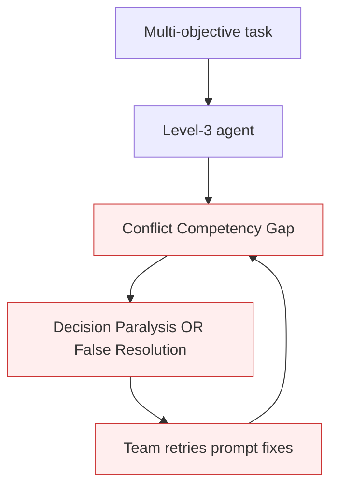

# Conflict Competency Gap

**Also known as:** Goal-Conflict Architectural Limit, Level-3 Conflict-Resolution Gap

**Category:** Anti-Patterns  
**Status in practice:** deprecated

## Intent

Architectural gap: current agents cannot resolve complex goal conflicts the way humans do through experience and contextual judgment, even at Progression-Framework Level 3.

## Context

The team observes decision-paralysis or false-resolution on multi-objective tasks. The question is whether this is a prompt issue, a model-tier issue, or something more fundamental. Bornet's empirical answer: it's architectural — Level-3 agents (the 'conditional autonomy' tier of Bornet's five-level Agentic Artificial Intelligence progression framework — autonomous only within a bounded domain) fundamentally lack human-style conflict-resolution competency.

## Problem

Treating decision-paralysis / false-resolution as fixable by 'better prompt' or 'better model tier' leads to repeated investment in fixes that don't address the structural cause. Teams iterate on prompts indefinitely; the failure mode keeps recurring.

## Forces

- The architectural limitation is invisible behind individual failures (each looks fixable).
- Vendor marketing positions higher-tier models as 'fixing' such gaps.
- Naming a gap as architectural commits the team to a design change, not a prompt tweak.

## Therefore

Therefore: name the gap as architectural; do not invest in incremental fixes; design around it via Priority Matrix and clear human-decision-point governance.

## Solution

Acknowledge the gap. Pair with: priority-matrix-conflict-resolution (resolution pattern), decision-paralysis (one failure mode), false-resolution (other failure mode), three-tier-autonomy-portfolio (governance: put conflict-prone tasks in higher-touchpoint tiers).

## Structure

```
Anti-pattern: Goal conflict -> treated as prompt or model problem -> repeated fixes -> same failures recur. Corrected: Acknowledge gap -> priority matrix for resolution + conflict-prone tasks placed in higher human-touchpoint tier.
```

## Diagram



## Example scenario

A team's regulatory document-processing agent fails on equally-weighted speed-vs-security-vs-completeness inputs. First fix: 'better prompt' (works for one week, fails again on novel inputs). Second fix: 'upgrade to GPT-5' (same failure pattern). Third fix: acknowledge the Conflict Competency Gap — redesign the workflow with a Priority Matrix and an explicit human-decision-point for cases outside the matrix. Failures stop.

## Consequences

**Benefits**

- Short-term: a better prompt or a stronger model looks like a cheap and quick fix.
- Naming it lets a team stop iterating on prompts and design around the limit instead.

**Liabilities**

- Teams burn iteration cycles on prompt fixes that won't solve an architectural problem.
- Production deployments accumulate the two failure modes.
- Stakeholder confidence damaged when 'the new model still fails the same way'.

## Failure modes

- Endless prompt tuning — the team keeps rewriting prompts for a conflict the agent structurally cannot resolve.
- Model-upgrade letdown — a new model tier is adopted and still fails the same way.
- Accumulating failures — decision paralysis and false resolution keep appearing in production.
- Wrong tier placement — conflict-prone tasks run with low human oversight.

## What this pattern constrains

No useful constraint; the missing constraint is acknowledging the architectural gap and designing around it rather than within it.

## Applicability

**Use when**

- Never as an unaddressed state. Cite when reviewing repeated multi-objective failures.
- Use as the architectural label that justifies redesign over prompt iteration.
- Surface in any agent-design document touching multi-objective workloads.

**Do not use when**

- Single-objective workloads where the gap doesn't manifest.
- Pure-research contexts exploring future Level-4/5 systems.
- Any production design that assumes the gap will be fixed by 'the next model'.

## Components

- Multi-objective task — input
- Level-3 agent — architectural limit
- Conflict Competency Gap — named architectural failure
- Manifestations — decision-paralysis OR false-resolution

## Tools

- Failure-mode label in design documents
- Mitigation: Priority Matrix + three-tier autonomy
- Stakeholder communication template

## Evaluation metrics

- Multi-objective task failure rate by manifestation (paralysis / false-resolution)
- Prompt-iteration cycles wasted before redesign
- Stakeholder trust delta after redesign

## Known uses

- **[Bornet et al. — Agentic Artificial Intelligence, Chapter 5 'Lessons for Organizations'](https://www.worldscientific.com/worldscibooks/10.1142/14380)** _available_

## Related patterns

- _alternative-to_ **Priority Matrix (Conflict Resolution)**
- _complements_ **Decision Paralysis**
- _complements_ **False Resolution**

## References

- [Agentic Artificial Intelligence — Chapter 5](https://www.worldscientific.com/worldscibooks/10.1142/14380) — 2025
