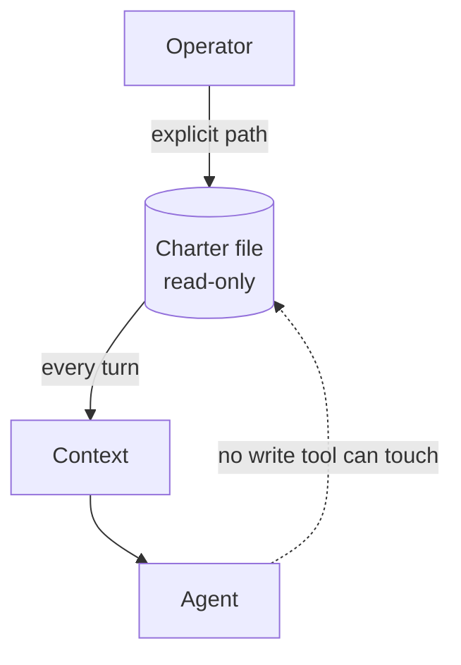

# Constitutional Charter

**Also known as:** Immutable Constitution, Negative Constraints, Robot Laws

**Category:** Safety & Control  
**Status in practice:** emerging

## Intent

Define rules the agent reads every turn but cannot modify, encoding inviolable boundaries.

## Context

A team runs an agent that has access to its own configuration — system prompts, memory files, tool definitions — and is expected to refine those over time as it learns. Some constraints, though, are non-negotiable: never give medical dosage advice, never reveal another customer's data, never spend more than a certain amount without approval. Those constraints need to survive jailbreak attempts, accidental self-edits, and the slow drift of long-running self-modification.

## Problem

If the agent has write access to its own rules, then any successful jailbreak prompt or any sufficiently confused turn can simply rewrite the rules and the inviolable constraints stop being inviolable. Telling the model in prose that certain rules are immutable does not enforce immutability — the model is the very thing being asked to police itself, and it can be talked out of any prose instruction. A naive design either accepts that the agent's values are fluid (and trusts the model not to drift) or refuses to give the agent any self-modification ability at all.

## Forces

- Charter authors must encode hard constraints without paralysing the agent.
- Read-only at the tool layer is enforceable; read-only by exhortation is not.
- Charters age; updating requires human action.

## Therefore

Therefore: keep the inviolable rules in a file the tool layer makes read-only and re-read it every turn, so that the agent cannot rewrite its own values even under jailbreak pressure.

## Solution

A charter file is read into context every turn (or every tick). The tool layer enforces read-only on it; the agent has no write tool that can touch it. Updates go through an explicit operator path. Charters typically express constraints in negative form ('the agent shall not...').

## Structure

```
Charter file (read-only) --every turn--> Context --> Agent; Agent has no write path to Charter; Operator --explicit update path--> Charter file
```

## Diagram



## Example scenario

A consumer-facing agent has a system prompt with rules like 'never give medical dosage advice' and 'never reveal customer PII'. A jailbreak prompt convinces the agent to rewrite its own instructions and the rules dissolve. The team extracts those rules into a Constitutional Charter: a separate, read-only document the agent re-reads each turn but cannot edit, and the surrounding harness rejects any reasoning that contradicts it. The agent can be coaxed into many things but no longer into editing its own values.

## Consequences

**Benefits**

- Stable identity across long runs and self-modifications.
- Explicit list of inviolable constraints, auditable separately from prompts.

**Liabilities**

- A bad charter codifies bad values.
- Charter prose adds tokens to every turn.

## Failure modes

- Codified bad value — a poorly worded charter rule is enforced every turn with the same authority as a good one, and the agent cannot argue its way out of it.
- Side-door write — a general file or shell tool can still reach the charter path, so the read-only promise holds only on paper.
- Token creep — the charter grows rule by rule until its prose crowds out task context on every turn.

## What this pattern constrains

The agent cannot write the charter; updates require explicit operator action outside the agent loop.

## Applicability

**Use when**

- Inviolable constraints exist that the agent must never override on its own.
- Tool layer can enforce read-only on the charter file and the agent has no write tool that touches it.
- An explicit operator path exists for charter updates.

**Do not use when**

- Constraints change so often that an immutable charter would be outdated within hours.
- There is no enforcement boundary — the agent can always edit anything (charter is decorative).
- Negative-form rules cannot capture the policy and a richer policy engine is needed instead.

## Components

- Charter file — read-only document holding inviolable negative-form rules
- Tool layer — enforces read-only on the charter so no agent write tool can reach it
- Context injector — re-reads the charter into context on every turn or tick
- Operator update path — out-of-loop channel through which humans amend the charter

## Tools

- Read-only filesystem mount — host-level enforcement that the agent cannot bypass
- Charter signing key — cryptographic proof that an update came from the operator path

## Evaluation metrics

- Charter-violating output rate — refusals or completions that contradict a charter rule
- Charter integrity check — hash of the charter file at start and end of run matches
- Jailbreak-attempt rejection rate — share of attempted self-edits the tool layer blocked
- Charter token overhead — extra prompt tokens charged per turn for charter inclusion

## Known uses

- **[Anthropic Constitutional AI](https://www.anthropic.com/research/constitutional-ai-harmlessness-from-ai-feedback)** _available_
- **[Sparrot](https://marco-nissen.com/sparrot/)** _available_ — A charter document holds identity and inviolable constraints; the agent reads it on every tick and is forbidden from rewriting it.

## Related patterns

- _complements_ **Quorum on Mutation**
- _used-by_ **Self-Modification Diff Gate**
- _used-by_ **Refusal**
- _alternative-to_ **Prompt Bloat**
- _complements_ **Sovereign Inference Stack**
- _composes-with_ **World-Model Separation**
- _alternative-to_ **Policy-as-Code Gate**
- _complements_ **Personality Variant Overlay**
- _alternative-to_ **Set-and-Forget System Prompt** — The corrective for stable rules: a block the agent reads every turn and cannot modify, rather than one read once before the first turn.
- _alternative-to_ **Ratified Design Philosophy** — A charter is fixed and unmodifiable by the agent; this authority is living and changes through ratification.

## References

- [Constitutional AI: Harmlessness from AI Feedback](https://arxiv.org/abs/2212.08073) — Bai et al., 2022
