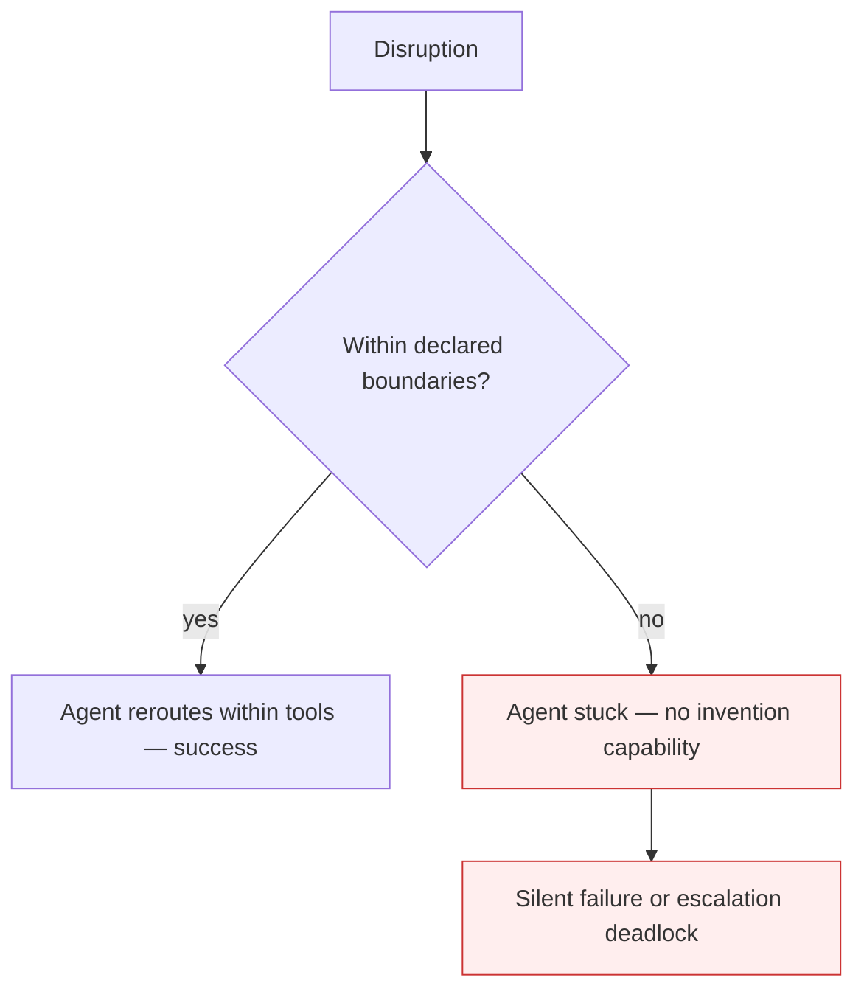

# Constrained Adaptability

**Also known as:** Recalculate-Within-Boundaries Limit, GPS-Reroute Limitation

**Category:** Anti-Patterns  
**Status in practice:** deprecated

## Intent

Agents recalculate within declared tools and rules like a GPS rerouting, but cannot creatively transcend those boundaries to invent new approaches the way humans do.

## Context

The team observes the agent successfully adapting to disruptions — switching to backup tools, rerouting around outages, retrying with alternative parameters. They mistake this for genuine adaptability. When a disruption demands a creative workaround not pre-programmed (manual fallback, novel tool combination, challenging the original constraints), the agent fails.

## Problem

Conflating Constrained Adaptability with genuine adaptability leads to over-trusting agents in novel situations. The team assumes 'the agent handled the API outage, so it'll handle the system migration too'. It won't — the API outage was within boundaries; the system migration requires inventing.

## Forces

- Constrained adaptability looks genuinely adaptive on demo-day.
- Novel situations only surface in production at scale.
- Distinguishing 'within-boundary' from 'beyond-boundary' adaptability requires the team to articulate the boundaries.

## Therefore

Therefore: name the limit; design human-escalation paths for beyond-boundary situations; don't expect Level-3 agents (Bornet's 'conditional autonomy' tier — autonomous within a bounded domain, not beyond it) to invent.

## Solution

Acknowledge Constrained Adaptability as the operational character of current agents. Pair with: tool-resilience-framework (within-boundary fallback design), human-in-the-loop (beyond-boundary escalation), agentic-ai-progression-framework (level-rating sets expectations), capability-mapping (documents what the agent can/can't do).

## Structure

```
Anti-pattern: Agent succeeds within boundaries -> team assumes general adaptability -> novel situation -> silent failure or deadlock. Corrected: Documented boundaries (capability map) -> within-boundary fallback -> beyond-boundary escalation to human.
```

## Diagram



## Example scenario

A healthcare document-processing agent handles a cloud storage outage by switching to local backup — within-boundary adaptation, ships as a success story. Two months later a vendor system migration requires a temporary manual workflow the agent has not seen. The agent fails silently — keeps trying its programmed alternatives, none of which apply. A human team would have invented a phone-and-spreadsheet workaround. The agent could not.

## Consequences

**Benefits**

- Short-term: rerouting within known tools looks like real adaptability, so extra escalation design seems unneeded.
- Naming it lets a team map the agent's boundaries and design escalation paths for what lies beyond them.

**Liabilities**

- Over-trust in novel situations leads to silent failures or escalation deadlocks.
- Team disappointment when 'the agent that handled the outage' fails on the migration.
- Production designs lacking escalation paths for beyond-boundary situations.

## Failure modes

- Over-generalised trust — the agent handled an outage within its tools, so the team trusts it with a migration that needs new approaches.
- Silent failure — the agent meets a situation outside its rules and keeps rerouting inside them without success.
- Escalation deadlock — no path exists to hand a beyond-boundary case to a human, so the work stalls.
- Undocumented limits — nobody wrote down what the agent can and cannot do, so expectations drift.

## What this pattern constrains

No useful constraint; the missing constraint is explicit boundary articulation and escalation-path design.

## Applicability

**Use when**

- Never as a stand-alone state. Cite when reviewing claims of 'autonomous adaptation'.
- Surface in production designs to ensure escalation paths exist.
- Use as a capability-mapping anchor: document the agent's boundaries explicitly.

**Do not use when**

- Any production design lacking beyond-boundary escalation.
- Stakeholder communications that conflate within-boundary recovery with genuine adaptability.
- Workflows where 'the agent handled X' is taken as evidence it can handle 'similar Y'.

## Components

- Disruption — input
- Boundary check — within vs beyond declared rules
- Within-boundary path — reroute success
- Beyond-boundary path — needs human invention, currently absent

## Tools

- Capability-map boundary articulation
- Beyond-boundary escalation path
- Detection signal — beyond-boundary task encountered

## Evaluation metrics

- Within-boundary recovery success rate
- Beyond-boundary failure rate
- Escalation-deadlock incident frequency

## Known uses

- **[Bornet et al. — Agentic Artificial Intelligence, Chapter 5 (system-outage tool-recalibration experiment)](https://www.worldscientific.com/worldscibooks/10.1142/14380)** _available_

## Related patterns

- _complements_ **Human-in-the-Loop**
- _complements_ **Agentic Skill Atrophy**

## References

- [Agentic Artificial Intelligence — Chapter 5](https://www.worldscientific.com/worldscibooks/10.1142/14380) — 2025
