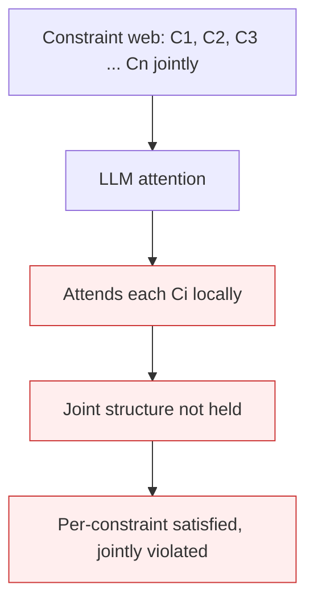

# Context Fragmentation

**Also known as:** Working-Memory Limit Failure, Simultaneous-Constraint Holding Failure

**Category:** Anti-Patterns  
**Status in practice:** deprecated

## Intent

Anti-pattern: the LLM cannot hold multiple interconnected constraints in mind simultaneously the way human working memory can; it processes each constraint locally and loses the cross-constraint view.

## Context

An agent task requires reasoning over a constraint web — a crossword where each cell intersects two clues, a schedule where each slot constrains and is constrained by others. Humans hold the web in working memory; LLMs process tokens through attention which is capable but architecturally distinct from working memory.

## Problem

The model's attention mechanism, though it accesses all input tokens, does not replicate the human ability to hold a small number of interconnected variables in immediate joint focus. Each constraint gets attended to locally; the joint constraint structure is not represented. The agent satisfies each constraint individually and violates them jointly. Differs from lost-in-the-middle (positional bias) by being about simultaneous holding of constraints, not about position.

## Forces

- Attention mechanism is the architecture; rewriting it is research-level work.
- Some constraint webs are too large to enumerate explicitly.
- Forcing the model to write out each constraint explicitly adds latency.

## Therefore

Therefore: for constraint-heavy tasks, externalize the constraint web — enumerate constraints, build a problem-space artifact, force generate-and-test against the explicit constraint list — rather than relying on the model's attention to hold it implicitly.

## Solution

Pair with: strategic-preparation-phase (enumerate constraints explicitly), generate-and-test-strategy (verify against explicit list), large-reasoning-model-paradigm (LRMs handle this better via deliberation). For severe cases, decompose into sub-problems whose constraint sub-webs are small enough to hold.

## Structure

```
Anti-pattern: Many interlinked constraints -> model attends to each locally -> joint structure lost -> joint violations. Corrected: Enumerate constraint web explicitly -> decompose into small sub-webs if large -> generate -> test against full list.
```

## Diagram



## Example scenario

A scheduling agent given 12 meetings with overlapping participant and resource constraints. The model satisfies each meeting's constraints individually but produces a schedule with three double-bookings — each individually plausible but jointly violating participant constraints. Fixing requires externalizing the participant-by-time matrix, not asking the model to 'try harder'.

## Consequences

**Benefits**

- Short-term: putting all constraints in one prompt is simple, and per-constraint checks suggest it works.
- Naming it lets a team externalise the constraint web for tasks beyond a small size.

**Liabilities**

- Joint constraint violations ship undetected.
- Individual constraint satisfaction looks like success on per-constraint tests.
- Constraint webs grow with problem size; the failure mode scales with task complexity.

## Failure modes

- Locally right, jointly wrong — the output satisfies each constraint on its own and breaks the combination.
- Passing unit checks — per-constraint tests all pass, so the joint violation goes unnoticed.
- Scale-up failure — as the problem grows, more constraints interact, and the error rate rises with it.
- Mistaken for position bias — the team moves constraints around in the prompt, but the joint view is still missing.

## What this pattern constrains

No useful constraint; the missing constraint is explicit constraint-web externalization for tasks beyond a working-memory threshold.

## Applicability

**Use when**

- Never as a steady state. Cite when reviewing tasks with constraint webs routed to standard LLMs without preparation step.
- Use as the failure-mode label in design reviews.
- Surface in agent capability mapping.

**Do not use when**

- Any task with non-trivial constraint web routed to standard LLM without explicit constraint externalization.
- Multi-objective tasks above ~5 jointly-constraining objectives.
- Any production deployment where joint constraint violation is unacceptable.

## Components

- Constraint web — input structure
- LLM attention — processes constraints locally
- Missing constraint-web externalization
- Joint violation — output

## Tools

- Detection signal — joint-constraint violation rate
- Mitigation: externalized constraint web
- Eval suite covering multi-constraint joint satisfaction

## Evaluation metrics

- Joint-constraint violation incidence
- Working-memory threshold per workload
- Decomposition rate (tasks split into smaller constraint sub-webs)

## Known uses

- **[Bornet et al. — Agentic Artificial Intelligence, Chapter 6 'Understanding the limitations' section](https://www.worldscientific.com/worldscibooks/10.1142/14380)** _available_

## Related patterns

- _alternative-to_ **Strategic Preparation Phase**
- _alternative-to_ **Generate-and-Test Strategy**
- _alternative-to_ **Large Reasoning Model (LRM) Paradigm**
- _complements_ **Lost in the Middle (Positional Bias)**
- _complements_ **Premature Closure**
- _alternative-to_ **Re-Proposing Rejected Decisions** — Sibling missing-context anti-pattern: fragmentation is the agent losing the joint view across constraints it does hold, while this is the agent never receiving the decision history at all and re-deriving from scratch.

## References

- [Agentic Artificial Intelligence — Chapter 6](https://www.worldscientific.com/worldscibooks/10.1142/14380) — 2025
- [Symbolic Working Memory Enhances Language Models for Complex Rule Application](https://arxiv.org/abs/2408.13654) — Wang et al., 2024
