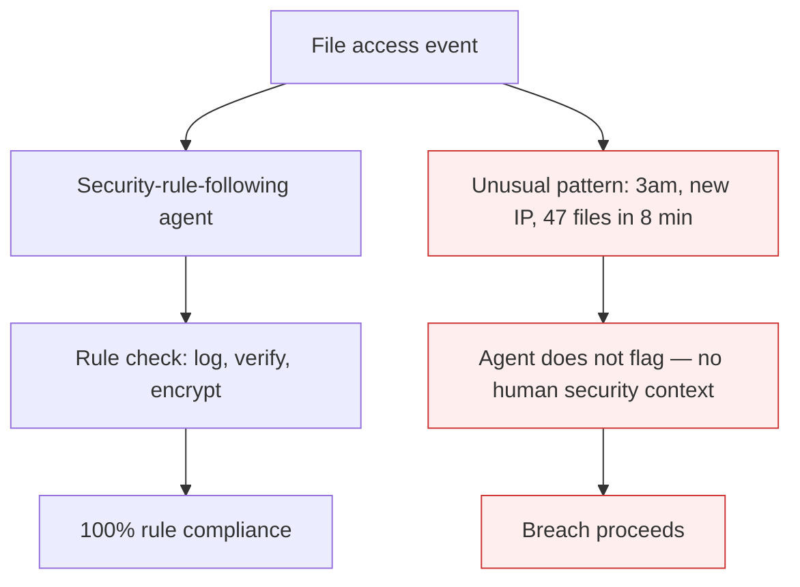

# Context Gap (Security)

**Also known as:** Security-Rule-Following Without Implication-Understanding

**Category:** Anti-Patterns  
**Status in practice:** deprecated

## Intent

Agents faithfully follow explicit security rules but miss the broader implications — they log access correctly without flagging the unusual pattern a human expert would catch immediately.

## Context

A security-aware agent is told to log file access, verify permissions, encrypt storage, etc. The agent does all of this correctly. But it doesn't think like a security professional — it executes the rules without grasping the security-implication landscape they're meant to address.

## Problem

Rule-following without implication-understanding misses the security signals that the rules were designed to surface. The agent logs the file access; it doesn't flag that the access happened at 3am from a new IP. The agent verifies permissions; it doesn't notice that the same user requested unusually many sensitive files this week. Rule-following without context is compliance-theater, not security.

## Forces

- Encoding all security implications as explicit rules is infinitely-many edge cases.
- Asking the agent to 'think like a security expert' produces hallucinated security reasoning.
- Security context drift means yesterday's rules don't catch tomorrow's threats.

## Therefore

Therefore: keep security rule-following AND require human security review for novel patterns; build alerting for unusual-pattern detection separately from rule compliance; treat agent security as compliance-tool, not security-judgment.

## Solution

Acknowledge the gap. Pair with: policy-as-code-gate (deterministic rule enforcement), policy-gated-agent-action (audit-trail tagging), human-in-the-loop (review for novel patterns), eval-harness (anomaly-detection metrics independent of rule compliance). Cite Paredes et al. 2021 (arXiv 2108.02006).

## Structure

```
Anti-pattern: Access event -> Rule-following agent (log, verify, encrypt) -> 100% compliance; unusual pattern goes unflagged -> breach proceeds. Corrected: Access event -> policy-as-code gate (rules) + anomaly metrics independent of compliance -> human review of novel patterns -> flag or block.
```

## Diagram



## Example scenario

A file-access agent is configured with logging rules: log filename, timestamp, user ID. It does so faithfully. A breach attempt: an attacker uses a compromised credential to access 47 sensitive files in 8 minutes from an unusual IP. Rule compliance: 100% — every access logged. Security detection: 0% — the agent never flagged the unusual pattern. A human security analyst would have seen the pattern in seconds. Fix: separate anomaly-detection pipeline; agent does compliance, not security judgment.

## Consequences

**Benefits**

- Short-term: rule compliance is easy to automate and easy to report, so a green compliance score feels like security is handled.
- Naming it lets a team separate what the agent can check (rules) from what still needs human security judgement, and staff review for the second part.

**Liabilities**

- Compliance-theater: rules pass; security incidents still happen.
- Detection gap for novel patterns the rules weren't designed for.
- Stakeholder over-trust based on '100% rule compliance' that doesn't translate to security.

## Failure modes

- Compliance-only alerting — the agent logs and verifies every access correctly, but a 3am burst from a new IP produces no flag because no rule names it.
- Slow accumulation missed — a user pulls unusually many sensitive files over a week, each request passes its permission check, and the overall pattern is never raised.
- Dashboard over-trust — stakeholders read 100 percent rule compliance as a security result and stop funding human review of novel patterns.

## What this pattern constrains

No useful constraint; the missing constraint is separating compliance (the agent can do) from security judgment (the agent cannot).

## Applicability

**Use when**

- Never as a stand-alone state. Cite when reviewing 'AI-powered security' deployments.
- Surface in security threat models that include agents.
- Use as the rationale for separate anomaly-detection independent of agent compliance.

**Do not use when**

- Any deployment claiming the agent provides security judgment.
- Compliance contexts where rule-following is conflated with security.
- Threat models that don't account for the gap between compliance and security.

## Components

- Agent — rule compliance machine
- Rule check — passes
- Missing anomaly-detection pipeline
- Missing human security judgment
- Unflagged pattern — incident proceeds

## Tools

- Separate anomaly-detection pipeline
- Rule-compliance eval
- Human security review for novel patterns

## Evaluation metrics

- Rule-compliance rate (typically 100%)
- Anomaly-detection rate (independent metric)
- Missed-pattern incident frequency at audit

## Known uses

- **[Bornet et al. — Agentic Artificial Intelligence, Chapter 5 (security-rule-following experiments)](https://www.worldscientific.com/worldscibooks/10.1142/14380)** _available_
- **[Paredes et al. 2021 — Domain-Specific Explanations in AI Cybersecurity](https://arxiv.org/abs/2108.02006)** _available_

## Related patterns

- _alternative-to_ **Policy-as-Code Gate**
- _complements_ **Policy-Gated Agent Action (KRITIS)**
- _complements_ **Human-in-the-Loop**
- _complements_ **Shadow Canary**
- _complements_ **Context Window Dumb-Zone Cap**
- _complements_ **False Resolution**

## References

- [Agentic Artificial Intelligence — Chapter 5](https://www.worldscientific.com/worldscibooks/10.1142/14380) — 2025
- [On the Importance of Domain-Specific Explanations in AI-based Cybersecurity Systems](https://arxiv.org/abs/2108.02006) — Paredes et al., 2021
