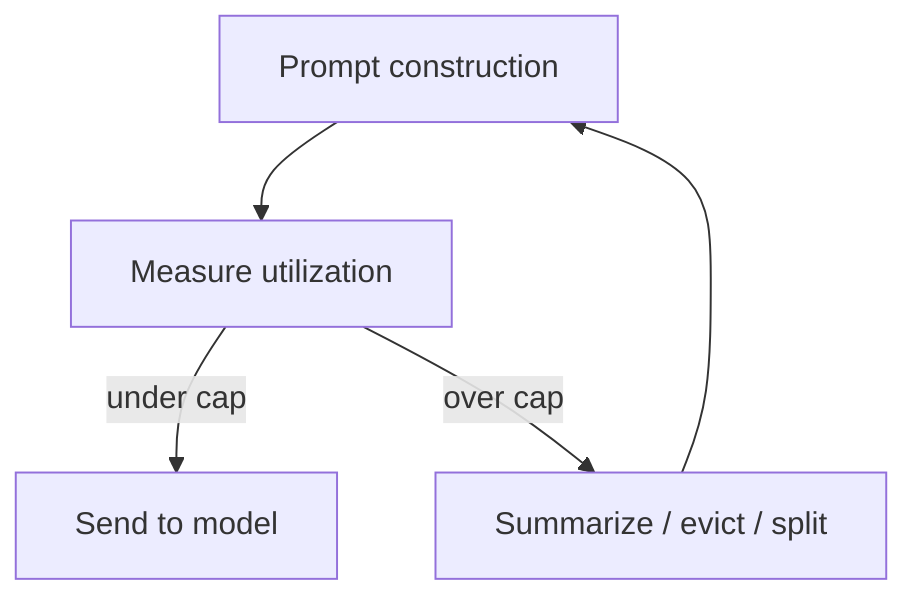

# Context Window Dumb-Zone Cap

**Also known as:** 40% Context Cap, 12-Factor Context Window

**Category:** Memory  
**Status in practice:** emerging

## Intent

Hold context-window utilization below a working threshold (~40%) to keep the model out of the 'dumb zone' where it begins ignoring earlier instructions and hallucinating.

## Context

A team uses long-context models and assumes the assumption 'the model has 200k tokens so the prompt can fill them'. The 2026 Polish 12-Factor-Agents source documents that beyond ~40% utilization, models begin to ignore earlier instructions and degrade in quality — even within the nominal context window.

## Problem

Filling context to nominal max degrades quality measurably. The 'dumb zone' starts well before the hard context limit. Without an explicit cap, engineers fill context with retrieved chunks, history, examples, and the model silently degrades. Differs from generic context engineering by naming the specific 40% threshold and the 'dumb zone' failure mode.

## Forces

- Large context windows are an advertised feature — capping at 40% feels wasteful.
- Cap forces harder retrieval/summarization work upstream.
- Threshold varies by model; 40% is a starting heuristic, not a fixed rule.

## Therefore

Therefore: enforce a working cap (~40% of nominal context) and treat over-cap as a signal to summarize, evict, or split the request; the model's 'usable context' is the cap, not the nominal window.

## Solution

Set a cap (40% as starting heuristic; tune per model). At prompt construction, measure utilization. If over cap: summarize older history, evict less-relevant retrieved chunks, or split the request. Track cap-hit rate as a signal. Pair with prompt-bloat (anti-pattern), context-window-packing, memgpt-paging, episodic-summaries.

## Structure

```
Prompt construction --> Measure utilization --under cap--> Send to model | --over cap--> Summarize / evict / split --> Prompt construction; cap-hit rate tracked
```

## Diagram



## Example scenario

An agent's nominal context is 200k tokens. Cap at 80k (40%). At prompt construction, retrieved chunks would push to 120k. Upstream: summarize the oldest 40k of history, evict the lowest-relevance retrieved chunks. Prompt lands at 78k. Quality is measurably better than the unbounded 120k baseline that silently triggers 'dumb zone' degradation.

## Consequences

**Benefits**

- Avoids 'dumb zone' degradation that silent context-filling produces.
- Forces explicit retrieval/summarization discipline.
- Cap-hit rate is a signal for context-engineering investment.

**Liabilities**

- 'Wasted' nominal context window capacity.
- Upstream summarization/eviction work to stay under cap.
- Threshold is model-dependent — needs tuning.

## Failure modes

- Untuned cap — the 40% starting value is kept for a model where degradation starts earlier or later, so quality drops or capacity is wasted.
- Eviction of the wrong chunk — the trim step drops a retrieved chunk the answer depended on to get under the cap.
- Unmeasured prompt — one code path builds prompts without the utilization check, and silent degradation returns.
- Ignored signal — the cap-hit rate climbs, but nobody acts on it, and trimming keeps hiding a context design problem.

## What this pattern constrains

Prompt construction may not exceed the declared cap; over-cap inputs are summarized, evicted, or split.

## Applicability

**Use when**

- Long-context models where 'we have lots of context' temptation exists.
- Quality drop is observable past the cap.
- Engineering capacity for upstream summarization/eviction.

**Do not use when**

- Short prompts well under any cap.
- Model has been measured stable beyond 40% in your task class.
- No upstream summarization/eviction mechanism available.

## Components

- Cap configuration — per-model threshold
- Utilization measurer — counts tokens at prompt construction
- Trim handler — summarize / evict / split when over cap
- Cap-hit rate metric — signals need for context-engineering work

## Tools

- Cap configuration per model
- Utilization measurer
- Trim handler (summarize/evict/split)

## Evaluation metrics

- Cap-hit rate
- Quality vs utilization curve — measure the dumb-zone
- Trim-action distribution (summarize vs evict vs split)

## Known uses

- **[devstockacademy: 12-Factor Agents (Polish roundup) — Own Your Context Window](https://devstockacademy.pl/blog/narzedzia-i-automatyzacja/12-factor-agents-jak-budowac-agenty-ai-w-produkcji/)** _available_
- **[humanlayer/12-factor-agents](https://github.com/humanlayer/12-factor-agents)** _available_

## Related patterns

- _complements_ **Context Window Packing**
- _complements_ **MemGPT-Style Paging**
- _complements_ **Episodic Summaries**
- _complements_ **Prompt Bloat**
- _complements_ **Agentic Context Engineering Playbook**
- _complements_ **Context Gap (Security)**
- _complements_ **Information Chunking for Agent Memory**
- _complements_ **Lost in the Middle (Positional Bias)**
- _complements_ **Context Anxiety** — Context anxiety is misperceived budget far from capacity; the dumb-zone is real degradation once the window fills.
- _complements_ **Set-and-Forget System Prompt** — A different axis of the same degradation: that one is a utilisation threshold measured by how full the window is, while instruction drift shows up at eight rounds of ordinary dialogue with the window nowhere near full.

## References

- [12-Factor Agents: jak budować agenty AI](https://devstockacademy.pl/blog/narzedzia-i-automatyzacja/12-factor-agents-jak-budowac-agenty-ai-w-produkcji/) — 2026
- [humanlayer/12-factor-agents](https://github.com/humanlayer/12-factor-agents) — 2026
