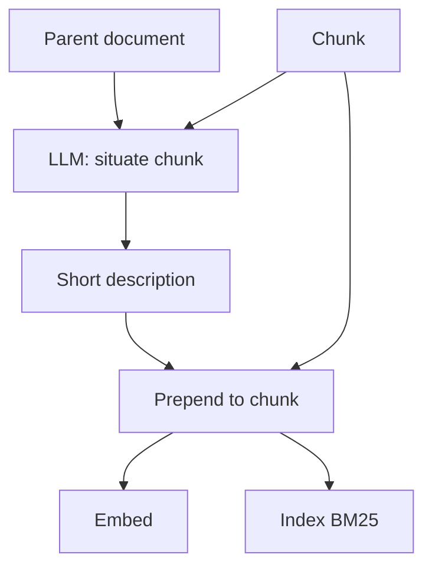

# Contextual Retrieval

**Also known as:** Chunk Contextualisation, Anthropic Contextual Embeddings

**Category:** Retrieval & RAG  
**Status in practice:** emerging

## Intent

Prepend a short LLM-generated description to each chunk before embedding so the chunk carries its situating context.

## Context

A team is using a retrieval-augmented system over a corpus that has been split into small chunks for embedding and indexing. Many of those chunks lose surrounding context at the split boundary: pronouns like 'they' or 'it' no longer have an antecedent in the chunk, references like 'the company' or 'that quarter' drop their referent, and time references become ambiguous. The embeddings of these decontextualised chunks land far from queries that name the entity or time period explicitly.

## Problem

When a user query names an entity by its full name and the corpus chunk that contains the answer only refers to that entity by pronoun, vector search finds the chunk distant and misses it. A naive chunk-and-embed pipeline therefore destroys exactly the context it most needs to preserve, and recall on otherwise-easy queries collapses. The chunks need to carry enough surrounding context that their embeddings stay close to the queries that should retrieve them, without inflating the corpus so much that indexing and retrieval cost become unaffordable.

## Forces

- An LLM call per chunk is expensive.
- Prompt caching of the parent document amortises the cost.
- Context generation must be deterministic enough to keep the index stable.

## Therefore

Therefore: prepend an LLM-generated situating description to each chunk before embedding it, so that retrieval recall depends on the chunk's context, not just its words.

## Solution

For each chunk, prompt an LLM with the parent document and the chunk; receive a short description that situates the chunk. Prepend that description to the chunk. Embed the prepended chunk. Store BM25 over both prepended chunks (Contextual BM25) and dense vectors (Contextual Embeddings). Compose with reranking for further gains.

## Structure

```
Parent document --> Chunker --> Chunk + parent document --> Contextualiser LLM --situating description--> Prepend to chunk --> Dense embedding + BM25 index --> retrieval (optionally reranked)
```

## Diagram



## Example scenario

A 200-page company handbook is split into 600 chunks for retrieval. One chunk says 'the deadline is the 15th of the following month' — but a query for 'invoice deadline' won't match because the chunk doesn't say 'invoice'. Contextual Retrieval prepends a one-sentence context to each chunk: 'This chunk discusses invoice payment timing.' Now the embedding carries the context the original chunk lost when it was split.

## Consequences

**Benefits**

- Reported retrieval-failure reductions: 35% (embeddings), 49% (+BM25), 67% (+reranking).
- Fully compatible with existing RAG pipelines.

**Liabilities**

- Indexing cost per chunk; only worth it for stable corpora.
- Chunk re-indexing required when context model changes.

## Failure modes

- Misleading context line — the contextualiser writes a description that names the wrong entity or section, and the chunk is now retrieved for the wrong queries.
- Unstable index — the context prompt or model changes, new chunks get differently worded descriptions, and old and new chunks no longer embed consistently.
- Cost on a moving corpus — documents change often, every change re-runs the LLM per chunk, and indexing cost outgrows the recall gain.
- Raw chunk slip-through — a bulk import path skips contextualisation, and those chunks miss queries that name entities by full name.

## What this pattern constrains

Chunks enter the index only after contextualisation; raw chunks are not indexed.

## Applicability

**Use when**

- Naive chunking destroys context and queries miss chunks that refer to entities by pronoun or shorthand.
- An LLM pass over each chunk to produce a situating description is affordable at index time.
- BM25 over prepended chunks and dense embeddings can both be wired into the retrieval stack.

**Do not use when**

- Documents are short or self-contained enough that chunks already carry their context.
- Index-time LLM cost is unaffordable for the corpus size.
- Retrieval quality is already adequate without the chunk-rewriting step.

## Components

- Chunker — splits the parent document into retrieval-sized chunks
- Contextualiser LLM — reads the parent document and a chunk, emits a short situating description
- Prepender — joins the situating description to the chunk before indexing
- Dense embedder — embeds the prepended chunk for vector retrieval (Contextual Embeddings)
- BM25 indexer — indexes the prepended chunk text for lexical retrieval (Contextual BM25)

## Tools

- LLM API with prompt caching — situates each chunk while amortising parent-document tokens across many calls
- Embedding model — produces dense vectors for the prepended chunks
- BM25 index — lexical retrieval over the prepended chunk text

## Evaluation metrics

- Retrieval-failure reduction vs naive chunking — Anthropic's headline metric (reported 35% embeddings, 49% with BM25, 67% with reranking)
- Recall@k uplift on entity-by-pronoun queries — targeted measurement of the context-loss problem this pattern fixes
- Index-time LLM cost per chunk — capex needed before any query is served, governs the corpus-stability decision
- Reindex cost when the contextualiser model changes — operational tax that bounds how often the contextualiser is updated

## Known uses

- **[Anthropic Contextual Retrieval blog post](https://www.anthropic.com/news/contextual-retrieval)** _available_

## Related patterns

- _specialises_ **Naive RAG**
- _composes-with_ **Hybrid Search**
- _composes-with_ **Cross-Encoder Reranking**
- _uses_ **Prompt Caching**
- _alternative-to_ **RAFT**
- _used-by_ **Citation Attribution**
- _alternative-to_ **Memory Poisoning**
- _composes-with_ **Hierarchical Retrieval**
- _complements_ **Information Chunking for Agent Memory**

## References

- [Introducing Contextual Retrieval](https://www.anthropic.com/news/contextual-retrieval) — Anthropic, 2024
