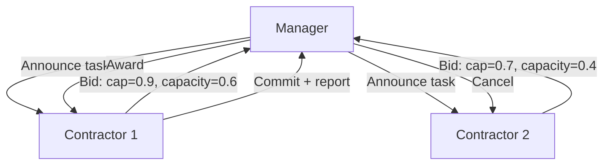

# Contract Net Protocol

**Also known as:** CNP, Bid-Based Task Allocation

**Category:** Multi-Agent  
**Status in practice:** mature

## Intent

Classical bid-based multi-agent task allocation: a manager broadcasts a task announcement, contractors submit bids, and the manager awards the contract to the best bid.

## Context

A decentralized agent network has heterogeneous agents with different capabilities, capacities, and current loads. Top-down task assignment by a central scheduler doesn't scale or doesn't have visibility into per-agent state. The team needs a coordination protocol where agents self-allocate based on declared bids.

## Problem

Top-down assignment requires the scheduler to know every agent's capability and current load — global state that's expensive to maintain. Random or round-robin allocation ignores capability fit and load. Without a structured bidding mechanism, decentralized agents either collide on tasks or starve.

## Forces

- Bidding rounds add latency to task allocation.
- Agents may bid dishonestly (claim capacity they lack).
- Bid evaluation criteria must be designed per task class.

## Therefore

Therefore: adopt the classical Contract Net Protocol — manager broadcasts task announcement with requirements, contractors submit bids (capability + capacity + cost), manager awards to best bid, awarded contractor commits.

## Solution

Define the protocol: (1) Announce — manager broadcasts task spec to capable contractors. (2) Bid — each contractor evaluates fit and submits bid {capability score, capacity available, cost, ETA}. (3) Award — manager picks best bid by configured criteria, sends acceptance. (4) Execute — winner commits and reports. (5) Cancel — bids not awarded receive cancellation. Add bid-validation to prevent dishonest bidding. Pair with decentralized-swarm-handoff, scatter-gather-saga, parallel-fan-out-gather.

## Structure

```
Manager --announce task spec--> Contractors --bid {capability, capacity, cost, ETA}--> Manager --validate and score by explicit criteria--> award to best bid, cancel the rest --> Winner commits, executes, reports
```

## Diagram



## Example scenario

A distributed research-agent network. A task comes in: 'analyze the 2024 patent landscape for hydrogen storage'. Manager broadcasts to specialist agents. Bids: Patent Agent (capability 0.9, capacity 0.6, ETA 4h), General Research Agent (capability 0.4, capacity 0.9, ETA 2h), Chem Specialist (capability 0.8, capacity 0.2, ETA 8h). Manager awards to Patent Agent (best capability × capacity tradeoff). Other bidders get cancellation. Patent Agent commits.

## Consequences

**Benefits**

- Decentralized self-allocation without central state.
- Capability and load are considered automatically via bids.
- Standardized protocol — well-understood semantics from 1980s MAS literature.

**Liabilities**

- Bidding-round latency overhead.
- Honesty enforcement needed if agents can game bids.
- Bid criteria design per task class.

## Failure modes

- Dishonest bid — a contractor overstates its capability or capacity to win, and the task goes to an agent that cannot finish it.
- Bidding latency — every small task waits for a full announce-bid-award round before work can start.
- Poor bid criteria — the manager's scoring rule favours low cost over fit, and awarded contractors keep failing.
- Missing cancellation — losing bidders never receive a cancel, so they keep capacity reserved for work they will not get.

## What this pattern constrains

No task is assigned outside the bidding protocol; bid evaluation criteria are explicit and auditable.

## Applicability

**Use when**

- Decentralized agent networks with heterogeneous capabilities.
- Task allocation visible to multiple capable agents.
- Latency budget allows bidding round.

**Do not use when**

- Single-agent or homogeneous-agent shop.
- Sub-second task assignment requirements.
- Trust model can't validate bid honesty.

## Components

- Task announcement broadcaster
- Bid submission protocol
- Bid evaluator (manager-side)
- Award / cancel messaging
- Bid validator (anti-gaming)

## Tools

- Task announcement broadcaster
- Bid submission protocol
- Bid evaluator
- Bid validator (anti-gaming)

## Evaluation metrics

- Bid-round latency
- Award-quality (winner vs ground-truth optimal)
- Bid-honesty violation rate

## Known uses

- **[Smith, R.G. 1980 — original Contract Net Protocol specification (classical MAS)](https://ieeexplore.ieee.org/document/1675516)** _available_
- **[Cited in Bornet et al. Agentic Artificial Intelligence references as foundational multi-agent coordination](https://www.allaboutai.com/ai-glossary/contract-net-protocol/)** _available_

## Related patterns

- _complements_ **Decentralized Swarm Handoff**
- _complements_ **Scatter-Gather Plus Saga**
- _complements_ **Parallel Fan-Out / Gather**
- _alternative-to_ **Supervisor** — Supervisor pushes; CNP pulls via bids.
- _complements_ **Actor-Model Agents**
- _complements_ **Coalition Formation**
- _used-by_ **Performative Message**
- _complements_ **Vickrey Auction Allocation**
- _complements_ **Distributed Constraint Optimization**
- _complements_ **Trust and Reputation Routing**
- _complements_ **Dynamic Topology Routing** — Contract-net allocates a task to an agent; topology routing wires the collaborators into a task-specific graph.

## References

- [Contract Net Protocol — All About AI Glossary](https://www.allaboutai.com/ai-glossary/contract-net-protocol/) — 2025
