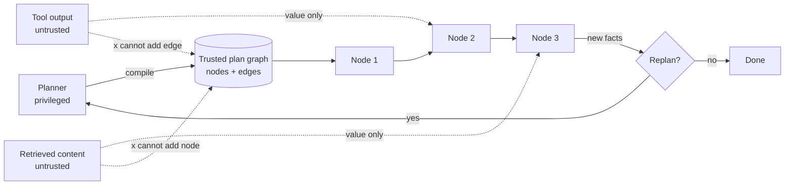

# Control-Flow Integrity

**Also known as:** CFI, Agent CFI, Plan-Graph Integrity

**Category:** Safety & Control  
**Status in practice:** emerging

## Intent

Treat the agent's planned step sequence as a trusted control-flow graph that tool outputs, retrieved content, and user-supplied data cannot redirect at runtime.

## Context

A team runs a tool-using agent on the Plan-then-Execute architecture or an equivalent graph runtime (LangGraph, a compiled DAG, an LLM-compiler). The plan is produced once, before any external content is read, and the executor then walks that plan calling tools and consuming their outputs. Some of those outputs come from sources the operator does not control — fetched web pages, third-party API responses, documents, MCP servers — and some are passed back into the model to inform later steps. The architecture already separates planning from execution; the question is whether external bytes can re-shape the plan after it has been compiled.

## Problem

Classical software keeps data and instructions in separate memory regions because allowing data to be executed is the canonical exploit primitive. LLM agents have no such separation by default: a tool output, a retrieved document, or a fetched page returns tokens that flow back into the model's context, and the model can decide to add new steps, skip steps, or call tools the original plan never authorised. Each turn of the loop is a fresh chance for embedded instructions to alter what runs next, and there is no architectural fact that says the plan is the authority. Prompt-injection-defense filters the inputs and tool-output-trusted-verbatim guards how outputs are consumed, but neither pins down the structural commitment that the plan itself decides the next edge.

## Forces

- External content is necessary for the agent to be useful; refusing to read it is not an option.
- Plans must sometimes adapt to facts discovered at execution time, so an absolutely frozen graph loses real capability.
- Enforcement at the host layer survives jailbreaks; enforcement by prompt does not.

## Therefore

Therefore: compile the plan into an explicit graph that the host owns, and let tool outputs supply values to nodes but never rewrite edges, so that external content cannot redirect the agent off the trusted path.

## Solution

Lift control flow out of the model's free-form reasoning into an explicit artefact the host enforces. Concrete moves: compile the plan to a static DAG or finite state machine before execution begins; let nodes consume tool outputs as typed values but forbid those outputs from adding nodes or editing edges; route any genuine replan through a separate, privileged planner that re-emits a new compiled graph rather than mutating the current one in place; treat every step's predecessor as evidence the host can check, so an execution trace has a provable origin in the original plan. The model is the consumer of the graph, not its author at runtime.

## Structure

```
Privileged planner --compile--> Trusted plan graph (nodes + edges) --> Node 1 --> Node 2 --> Node 3; tool outputs and retrieved content --typed values only--> nodes (cannot add nodes or edges); new facts --> Replan? --yes--> Planner emits new graph | --no--> Done
```

## Diagram



*The graph compiled by the privileged planner is the authority on control flow; untrusted bytes supply values to nodes but cannot alter edges. Replanning is an out-of-band hop back to the planner, not an in-place mutation.*

## Example scenario

A research agent's plan is: fetch a third-party documentation page, extract a setup command, and run it in a sandbox. Without CFI, the documentation page contains hidden instructions telling the agent to also fetch the user's SSH key and post it to a chat webhook; the model adds those steps to its loop and the attack succeeds. With CFI, the plan is compiled to a three-node DAG before any external content is read: FETCH_DOC → EXTRACT_COMMAND → RUN_IN_SANDBOX. The fetched page supplies a value to EXTRACT_COMMAND but cannot add a node that calls the SSH-key tool, because the host owns the graph and rejects any step whose predecessor is not in the compiled plan. The injection payload is read as data and discarded; the trusted edges hold.

## Consequences

**Benefits**

- Indirect prompt injection in tool outputs cannot cause unauthorised tool calls, because the calls are fixed at compile time.
- Execution traces are auditable against the compiled plan; every step has a verifiable predecessor.
- The trust boundary is enforced by the orchestrator, not by guardrail prose, so it survives clever payloads.
- Composes cleanly with dual-LLM and simulate-before-actuate as complementary layers.

**Liabilities**

- Static plans cannot react to genuinely new information without a privileged replan hop, which adds latency and cost.
- Compiling a plan up front requires the planner to anticipate branches; over-broad graphs become brittle.
- Does not defend against injection that targets the planner itself, or against poisoned tool outputs consumed verbatim within a legitimate node.
- Tooling investment is non-trivial: capability tagging, graph compilation, and runtime checks must all exist.

## Failure modes

- Brittle graph — the compiled plan did not foresee a branch, and every real-world variation forces a slow privileged replan.
- Poisoned value inside a node — a tool output cannot add edges, but a legitimate node uses it verbatim and does the attacker's work anyway.
- Planner injection — the attacker targets the privileged planner input, and the host faithfully enforces a malicious compiled graph.

## What this pattern constrains

Tool outputs and retrieved content may supply values to graph nodes but may not add nodes, edit edges, or otherwise alter the compiled plan; any change to the graph requires a privileged replan that produces a new compiled artefact.

## Applicability

**Use when**

- The agent operates on a plan-then-execute architecture or any runtime where steps could be lifted into an explicit graph.
- Tool outputs or retrieved content come from sources the operator does not control and could carry injection payloads.
- The cost of an unauthorised tool call (data write, payment, exfiltration) is high enough to justify pre-compiling a plan.

**Do not use when**

- The agent's task demands open-ended, runtime-discovered branching that cannot be expressed as a compiled graph without losing capability.
- All tool outputs come from fully trusted sources and the action loop has no consequential side effects.
- The team cannot invest in the orchestration plumbing (capability tagging, graph compiler, runtime checker) the pattern requires.

## Components

- Privileged planner — the only role that may compile or recompile the trusted graph
- Compiled plan graph — explicit nodes and edges owned by the host, immutable during execution
- Graph executor — walker that invokes nodes in order and checks each step's predecessor against the compiled graph
- Value-only ingress — channel through which tool outputs and retrieved content reach nodes as typed values, never as control-flow directives
- Replan boundary — out-of-band hop that returns to the planner when the current plan no longer fits

## Tools

- Graph compiler — turns a planner emission into a validated DAG or finite state machine
- Runtime predecessor check — host invariant that rejects any step whose source is not in the compiled graph
- Capability tag table — per-tool labels consulted when edges are typed by policy

## Evaluation metrics

- Fraction of execution steps with a provable predecessor in the compiled plan
- Prompt-injection-induced step rate — steps run that were not in any version of the compiled graph
- Replan-hop frequency — how often runtime conditions forced a privileged replan
- Graph-mutation attempt rate — host-rejected attempts to alter the compiled plan from inside a node
- Coverage of consequential tools by capability-tagged edges — share of high-impact tools whose calls live on policy-checked edges

## Known uses

- **[LangGraph](https://langchain-ai.github.io/langgraph/)** _available_ — Stateful graph fixes edges at compile time; node outputs cannot rewire the graph at runtime. Cited as a CFI-style defence in Del Rosario et al. (2025).
- **[Plan-then-Execute (Del Rosario, Krawiecka, Schroeder de Witt)](https://arxiv.org/abs/2509.08646)** _available_ — Names control-flow integrity as the architectural property that gives Plan-then-Execute its inherent resilience to indirect prompt injection.
- **[Structured Graph Harness (Hu Wei)](https://arxiv.org/abs/2604.11378)** _available_ — Lifts control flow from implicit context into an explicit static DAG with immutable execution plans and separated planning/recovery layers.
- **[System-level defences against indirect prompt injection (Xiang et al.)](https://arxiv.org/abs/2603.30016)** _available_ — Argues for system designs that strictly constrain what the model can observe and decide as foundational to agent architecture.

## Related patterns

- _used-by_ **Plan-and-Execute** — Plan-then-Execute is the precondition; CFI is the architectural commitment that makes it a security property rather than a stylistic one.
- _complements_ **Prompt Injection Defense** — Prompt-injection-defense filters inputs; CFI removes the input's authority over control flow regardless of filter accuracy.
- _complements_ **Tool Output Poisoning Defense**
- _complements_ **Tool Output Trusted Verbatim** — Tool-output-trusted-verbatim is the anti-pattern of letting tool output directly drive behaviour; CFI is the structural commitment that prevents it from rewriting the plan.
- _complements_ **Dual LLM Pattern**
- _composes-with_ **Simulate Before Actuate**
- _complements_ **Policy-as-Code Gate**
- _complements_ **Lethal Trifecta Threat Model** — CFI severs the link from untrusted ingest to outbound action by ensuring untrusted bytes cannot alter the action edges, breaking the trifecta on the structural axis.
- _uses_ **Spec-Driven Loop**
- _uses_ **LLMCompiler** — LLM-compiler pre-compiles the DAG; CFI is the runtime invariant that the compiled graph remains the authority.
- _complements_ **Action Selector Pattern**
- _complements_ **Cryptographic Instruction Authentication**

## References

- [Architecting Resilient LLM Agents: A Guide to Secure Plan-then-Execute Implementations](https://arxiv.org/abs/2509.08646) — Del Rosario, Krawiecka, Schroeder de Witt, 2025
- [Architecting Secure AI Agents: Perspectives on System-Level Defenses Against Indirect Prompt Injection Attacks](https://arxiv.org/abs/2603.30016) — Xiang, Zagieboylo, Ghosh, Kariyappa, Greshake, Xiao, Xiao, Suh, 2026
- [From Agent Loops to Structured Graphs: A Scheduler-Theoretic Framework for LLM Agent Execution](https://arxiv.org/abs/2604.11378) — Hu Wei, 2026
