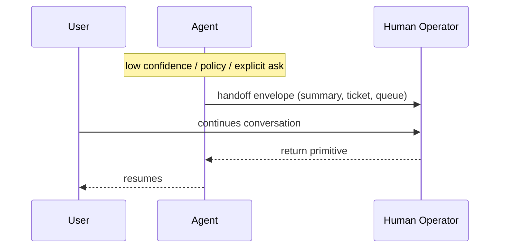

# Conversation Handoff to Human

**Also known as:** Escalation, Live-Agent Handoff, Human Takeover

**Category:** Safety & Control  
**Status in practice:** mature

## Intent

Transfer the entire conversation thread from agent to human operator, with state transfer and return primitive.

## Context

A team runs a customer-facing chat agent — support, sales, billing — that handles most conversations end to end, but some threads exceed what the agent can responsibly do alone: a refund above a policy threshold, a complaint with regulatory implications, a confused customer who explicitly asks for a person. The customer is mid-conversation, the agent has accumulated context across many turns, and the team needs a clean way to bring a human operator in without dropping the thread.

## Problem

Approving or rejecting a single tool call does not solve this case, because the whole conversation needs to change owners, not just one action. If the agent simply tells the customer to call a support line, all the accumulated context is lost and the customer has to start over with a person who knows nothing. If the agent stays in the loop and parrots whatever the human says, accountability gets muddy. Without a structured transfer of the whole thread, escalation either destroys continuity or smears responsibility between agent and operator.

## Forces

- Handoff loses context fidelity.
- Sticky routing (return to same operator on follow-up) needs auth + session plumbing.
- Return primitive (back to agent) requires re-grounding.

## Therefore

Therefore: transfer ownership of the whole thread to a human operator queue with a structured envelope and a return primitive, so that hard cases reach humans without losing the customer's continuity.

## Solution

On escalation trigger (low confidence, explicit user request, policy violation), the agent emits a structured handoff envelope with conversation summary, ticket number, and human operator queue assignment. Operator takes ownership; agent disengages. On return, agent resumes with operator's note in context.

## Structure

```
Escalation trigger (low confidence / policy / user ask) --> Agent --handoff envelope (summary, ticket, queue)--> Human operator (owns thread; agent disengages) --return primitive + note--> Agent resumes with User
```

## Diagram



## Example scenario

A customer-support agent has been resolving a billing issue for ten turns when it hits a refund threshold that requires a human. Approving a single tool call doesn't capture the situation — the operator needs the whole context. The team uses Conversation Handoff: the entire thread, plus a short hand-off note from the agent, transfers to a human operator's queue with a primitive to return ownership later. The customer keeps the same chat window; the operator picks up where the agent left off.

## Consequences

**Benefits**

- Hard cases reach humans.
- Customer experience preserved across the boundary.

**Liabilities**

- Operator queue capacity bounds scale.
- State transfer has fidelity loss.

## Failure modes

- Lossy envelope — the summary drops a detail the customer gave early on, and the operator asks for it again.
- Queue overflow — escalations arrive faster than operators can take them, and customers wait in a handoff queue with no one on the thread.
- Unclear owner — the agent keeps replying after the handoff, or resumes without reading the operator's note, so the customer gets two voices.

## What this pattern constrains

Once handed off, the agent does not generate to the user; the operator owns the thread until explicit return.

## Applicability

**Use when**

- Some triggers (low confidence, policy violation, explicit user request) demand transferring ownership of the whole thread, not just one action.
- A human operator queue exists with the capacity to take over conversations.
- A return primitive is needed so the agent can resume after the operator hands back.

**Do not use when**

- Discrete-action approval is sufficient and full thread transfer is overkill (use approval-queue).
- No human operator queue exists to hand the conversation to.
- The agent must remain the sole user-facing interface for compliance reasons.

## Components

- Agent — runs the conversation until an escalation trigger fires
- Handoff envelope — structured summary plus ticket id transferred to the operator
- Human Operator queue — routing destination where live agents pick up threads
- Return primitive — protocol step that re-grounds the agent when the operator hands back

## Tools

- Ticketing system — owns thread state across the agent-to-human boundary
- Confidence classifier — signals low-confidence turns that warrant escalation

## Evaluation metrics

- Escalation precision — fraction of handoffs operators agreed were warranted
- Context-fidelity score — operator-rated completeness of the handoff envelope
- Time-to-operator-pickup — wait between escalation emission and operator first reply
- Return-to-agent rate — share of handed-off threads the operator hands back versus closes

## Known uses

- **[Sierra agent escalations](https://sierra.ai/)** _available_
- **Intercom Fin handoffs** _available_
- **Zendesk AI handoffs** _available_

## Related patterns

- _alternative-to_ **Human-in-the-Loop**
- _complements_ **Approval Queue**
- _specialises_ **Handoff**
- _complements_ **Interrupt-Resumable Thought**
- _complements_ **Decentralized Swarm Handoff**
- _complements_ **Scope-of-Practice Boundary Gate** — When a request lands on a reserved act and no licensed human is present, the gate hands the conversation off to a credentialed practitioner rather than answering.
- _used-by_ **Mandatory Red-Flag Escalation** — The escalation fires the handoff: red-flag detection is the trigger, conversation-handoff is the transfer-and-state mechanism it invokes.
- _complements_ **SLA-Aware Triage Scoring** — A ticket the score flags as predicted-to-breach or sentiment-deteriorating is a prime candidate to hand off to a human agent before the window closes.
- _used-by_ **History-Dependent Admissibility** — When the posture falls below the floor for every remaining action, the thread is transferred to a human operator rather than continued at reduced authority.

## References

- [Intercom Fin: Set up Fin handoffs](https://www.intercom.com/help/en/articles/9357912-set-up-fin-handoffs)
- [Sierra agent escalations](https://sierra.ai)
