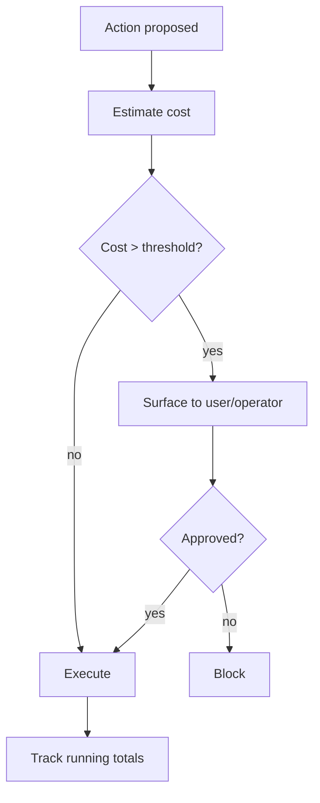

# Cost Gating

**Also known as:** Budget Cap, Cost-Aware Approval

**Category:** Safety & Control  
**Status in practice:** mature

## Intent

Block actions whose expected cost exceeds a threshold without explicit user (or operator) acknowledgement.

## Context

A team runs an agent whose individual steps cost real money — large-context model calls billed by the token, paid third-party APIs, retrieval against an expensive vector store. A single user request can fan out into hundreds of such calls, and the bill arrives at the end of the month rather than at the moment of the action. Users have no way to see the cost building up while the agent works.

## Problem

If the agent just executes whatever steps it judges useful, an over-eager research task can quietly burn through a hundred-euro budget on a question that should have cost one euro, and the user only finds out when the invoice arrives. If the agent asks for permission on every paid call, users learn to click through the prompts and the gating becomes theatre. Without a forecast of cost and a meaningful threshold, the team must choose between surprise bills and approval fatigue.

## Forces

- Estimating cost up front requires a model of what will happen.
- Confirmation-fatigue: too many approvals train users to ignore them.
- Budgets at multiple horizons (per call, per session, per month).

## Therefore

Therefore: forecast cost before each expensive call and block on explicit acknowledgement when the estimate or running total crosses a budget line, so that the bill stops being a surprise.

## Solution

Estimate cost before invoking the expensive action. If the estimate exceeds the threshold, surface it to the user (or operator) and require explicit approval. Track running totals against per-session and per-period budgets.

## Structure

```
Action proposed --> Estimate cost --<= threshold--> Execute | --> threshold--> Surface to user or operator --approved--> Execute | --rejected--> Block; Execute --> Track running totals vs session and period budgets
```

## Diagram



## Example scenario

An autonomous research agent is asked to 'thoroughly investigate' a niche market and quietly fans out into hundreds of web searches plus a few large-context summarisations, ringing up forty euros before producing a draft. The team adds Cost Gating: any step whose forecast cost (token volume × model rate) exceeds two euros prompts the user with the estimate, and any cumulative spend over twenty euros pauses the run for explicit acknowledgement. Surprise bills stop showing up.

## Consequences

**Benefits**

- Predictable bill.
- Forces the system to know its own cost shape.

**Liabilities**

- Estimation errors; actual cost can exceed estimate.
- Friction at the wrong moment can sour UX.

## Failure modes

- Under-estimate — the forecast says the action is cheap, it passes the threshold silently, and the real bill is many times higher.
- Click-through prompt — the threshold is set so low that users see the cost prompt constantly and approve without reading the number.
- Badly timed gate — the approval prompt appears in the middle of a task the user expected to finish unattended, and the run stalls.

## What this pattern constrains

Actions exceeding the threshold cannot run without explicit acknowledgement.

## Applicability

**Use when**

- Some agent actions are expensive enough that surprise costs would erode user trust.
- Cost can be estimated before invoking the action with reasonable accuracy.
- A user or operator approval path exists for expensive actions.

**Do not use when**

- All actions are cheap and the gating overhead exceeds the cost it protects.
- Cost is unpredictable and pre-action estimates would be wildly wrong.
- Approval latency is unacceptable for the action class (e.g. real-time response loops).

## Components

- Cost estimator — pre-flight forecaster of tokens, API charges, and retrieval spend
- Budget thresholds — per-call, per-session, and per-period limits with their own caps
- Approval surface — explicit acknowledgement channel shown to user or operator
- Running-total tracker — accumulator that compares spend against the active budget

## Tools

- Token-counter library — sizes prompts before dispatch to bound the forecast
- Pricing table — per-model and per-tool rates the estimator multiplies into euros

## Evaluation metrics

- Estimate-vs-actual cost delta — calibration error of the forecaster
- Gate-trip rate by budget horizon — how often per-call, per-session, per-period caps fired
- Approval-fatigue indicator — fraction of gated prompts users accepted without reading
- Surprise-bill incidents — runs that exceeded budget without hitting the gate

## Known uses

- **Knitting-DSL Pipeline (Stash2Go)** _available_ — scopedLlmFixer.js runs only when user accepts the cost.
- **[Sparrot](https://marco-nissen.com/sparrot/)** _available_ — Premium-model access is gated behind an explicit, time-boxed (≤10 min) written grant; without an active grant the router stays on cheap models, and grant + revoke + each routing decision land in the ledger.

## Related patterns

- _specialises_ **Human-in-the-Loop**
- _complements_ **Step Budget**
- _complements_ **Multi-Model Routing**
- _complements_ **Prompt Caching**
- _complements_ **Extended Thinking**
- _complements_ **Cost Observability**
- _complements_ **Rate Limiting**
- _alternative-to_ **Unbounded Subagent Spawn**
- _alternative-to_ **Token-Economy Blindness**
- _complements_ **Realtime API When Batchable**
- _complements_ **Missing max_tokens Cap**
- _used-by_ **Composable Termination Conditions**
- _complements_ **Agent-Initiated Payment** — Cost-gating thresholds bound what an agent's wallet may settle without escalation.
- _complements_ **Velocity-and-Magnitude Governor** — Cost gating blocks a single action whose expected cost crosses a threshold; the governor adds the velocity dimension (cumulative magnitude per unit time) and a statistical-deviation trigger that gating alone does not have.

## References

- [Rate limits](https://docs.claude.com/en/api/rate-limits) — 2025
