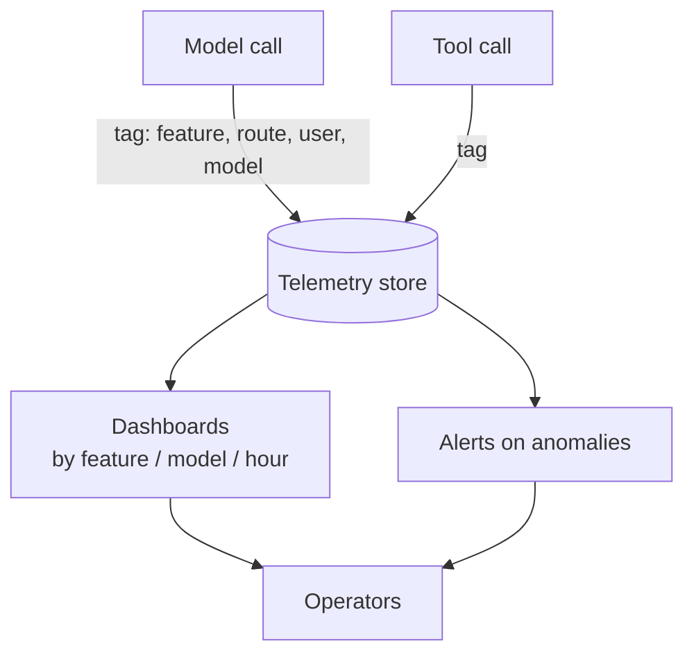

# Cost Observability

**Also known as:** Token Telemetry, Cost Dashboard

**Category:** Governance & Observability  
**Status in practice:** mature

## Intent

Surface per-request, per-user, and per-feature cost and token consumption to operators in near-real-time.

## Context

A team is running an agent product in production that calls one or more paid model providers and a set of paid tools. Spend depends on which feature the user touched, which model was routed to, how long the conversation got, and how many tool calls the agent decided to make. Operators need to know in close to real time where the money is going, not weeks later when the invoice arrives.

## Problem

Without per-feature, per-route, per-model attribution, an aggregate dashboard only shows that total tokens went up. A single bad routing decision, a chatty new prompt, or a runaway loop in one feature can multiply the bill for that feature ten times while the global average barely twitches. The team is forced to choose between learning about the problem from the monthly billing statement or building ad-hoc spreadsheets every time a number looks off.

## Forces

- Telemetry schema must capture which feature, which model, which user.
- Real-time vs daily aggregation.
- Privacy on per-user attribution.

## Therefore

Therefore: tag every model and tool call with feature, route, model id, and anonymised user, and stream those tags to a telemetry store with per-dimension dashboards, so that spend is attributable in near-real-time instead of discovered on the monthly bill.

## Solution

Tag every model and tool call with feature, route, user (anonymised), and model id. Stream to a telemetry store. Build dashboards by feature, by model, by tier, by hour. Set alerts on anomalies. Pair with cost-gating for prevention.

## Structure

```
Model call / Tool call --tagging middleware (feature, route, model id, anonymised user)--> Tag-or-reject gateway --> Telemetry store --> Dashboards (by feature, model, tier, hour) + Anomaly alerter --> Operators
```

## Diagram



## Example scenario

An ops team notices the monthly LLM bill has tripled but can't say which feature drove it — the dashboard only shows total tokens. By the time billing arrives the runaway feature has been live for weeks. They add Cost Observability: every request is tagged with feature, user, and tenant, and per-feature spend rolls up in near-real-time. Within an hour of a regression the team can see which feature now costs ten times what it did yesterday.

## Consequences

**Benefits**

- Fast detection of cost regressions.
- Inputs for capacity planning and pricing.

**Liabilities**

- Telemetry overhead.
- Per-user attribution has privacy implications.

## Failure modes

- Unattributed bucket growth — new call sites skip the tags, and a growing share of spend lands in the unattributed bucket where no feature owns it.
- Alert on the wrong grain — anomaly alerts watch total tokens, so a ten-fold rise in one feature stays under the global threshold.
- Re-identification through tags — the per-user tag is weakly anonymised, and the cost store becomes a record of what each person did.
- Detection without brakes — the dashboard shows a runaway loop clearly, but nothing stops it until an operator reads the alert.

## What this pattern constrains

Calls without telemetry tags fall into an 'unattributed' bucket; some internal gateways enforce tag-or-reject.

## Applicability

**Use when**

- Per-feature cost visibility is needed before billing reveals a problem.
- Telemetry can be tagged with feature, route, model id, and anonymised user.
- Operators will actually act on dashboards and alerts that surface cost anomalies.

**Do not use when**

- Total spend is small enough that aggregate metrics suffice.
- Telemetry pipeline cost exceeds the cost it would help you control.
- No operator owns cost — the dashboards would go unwatched.

## Components

- Tagging Middleware — attaches feature, route, model id, and anonymised user to every model and tool call
- Telemetry Store — receives the streamed tagged-cost events
- Per-Dimension Dashboards — slice spend by feature, model, tier, and hour
- Anomaly Alerter — fires when per-feature spend deviates from baseline
- Tag-or-Reject Gateway — refuses untagged calls so spend stays attributable

## Tools

- Langfuse — captures and aggregates per-feature token and cost telemetry
- Helicone — proxy-style cost and usage telemetry for LLM calls
- OpenAI usage dashboard — provider-side per-key spend visibility
- Anthropic Console usage — provider-side per-key spend visibility

## Evaluation metrics

- Attribution coverage — share of model and tool calls that carry the required tags
- Time-to-detect cost regression — minutes from spend spike to operator alert
- Per-feature cost variance week-over-week — surfaces chatty prompts and bad routing
- Unattributed-bucket spend share — fraction of cost the gateway could not assign
- Alert precision on cost anomalies — true-positive rate against confirmed regressions

## Known uses

- **Langfuse** _available_
- **Helicone** _available_
- **OpenAI usage dashboard** _available_
- **Anthropic Console usage** _available_
- **[Sparrot](https://marco-nissen.com/sparrot/)** _available_ — Per-tick and per-provider token / cost telemetry is surfaced so cheap-by-default routing can be audited and premium escalations stay accountable.

## Related patterns

- _complements_ **Cost Gating**
- _complements_ **Lineage Tracking**
- _alternative-to_ **Demo-to-Production Cliff**
- _alternative-to_ **Token-Economy Blindness**
- _complements_ **Realtime API When Batchable**
- _complements_ **Top-Tier Model For Everything (Cost)**
- _used-by_ **Agent Withdrawal Criteria** — The economic threshold is only evaluable if cost per case is measured continuously and compared against a maintained human baseline.

## References

- [Langfuse](https://langfuse.com/docs)
- [Helicone](https://docs.helicone.ai)
