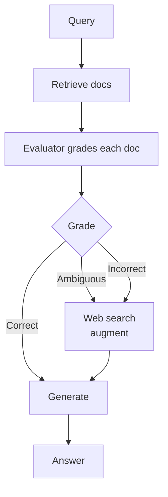

# CRAG

**Also known as:** Corrective RAG

**Category:** Retrieval & RAG  
**Status in practice:** emerging

## Intent

Add a lightweight retrieval evaluator that grades each retrieved document and triggers corrective web search on poor retrievals.

## Context

A team is running a retrieval-augmented system in production over a corpus where retrieval quality varies request by request. Sometimes the top chunks are exactly right; sometimes they are tangentially related; sometimes they miss the answer entirely. The team cannot guarantee that every query gets a clean retrieval, and the cost of a hallucinated or confidently wrong answer is high enough that they need an explicit recovery path.

## Problem

A naive retrieve-then-generate pipeline passes every retrieval — good or bad — straight into the generator without judging it. When the retrieval is poor, the generator either ignores it and falls back to parametric knowledge that may itself be wrong, or it incorporates it and produces an answer corrupted by irrelevant chunks. Either way, the user sees no signal that the retrieval was weak, and the system has no correction step that could fall back to a web search, refine the query, or refuse to answer when the evidence is insufficient.

## Forces

- Evaluator quality bounds correction accuracy.
- Web fallback adds latency and external dependency.
- Three-way grading (correct / ambiguous / incorrect) needs calibration.

## Therefore

Therefore: insert a lightweight evaluator after retrieval and let its three-way grade trigger pass-through, web search, or rejection, so that bad retrievals are caught before they reach the generator.

## Solution

After retrieval, a lightweight evaluator (T5-based or similar) grades each document as Correct, Ambiguous, or Incorrect. Correct documents go forward as-is. Ambiguous documents trigger a web search for additional evidence. Incorrect documents are discarded and replaced via web search. The generator receives the corrected document set.

## Structure

```
Query --> Retrieve docs --> Evaluator grades each doc --Correct--> (optional knowledge refiner) --> Generator | --Ambiguous--> keep doc + web search to augment --> Generator | --Incorrect--> discard + web search --> Generator --> Answer
```

## Diagram



## Example scenario

A RAG-powered legal assistant retrieves three statutes for a question about export controls; one of them is from the wrong jurisdiction. Naive RAG would hand all three to the generator and the wrong statute would corrupt the answer. The team layers in CRAG: a lightweight evaluator grades each retrieved document for relevance, the wrong-jurisdiction one falls below threshold, and the system triggers a corrective web search before generation. The final answer is grounded in two strong retrievals plus one fresh source instead of one bad one.

## Consequences

**Benefits**

- Robustness to poor retrievals.
- Plug-and-play with existing RAG.

**Liabilities**

- Two-stage retrieval increases latency.
- Web fallback has its own correctness questions.

## Failure modes

- Grader false Correct — the evaluator passes an off-topic document as Correct, and the generator answers from it with no correction.
- Over-eager web fallback — the evaluator marks good local documents Ambiguous, and the system spends latency on web searches it did not need.
- Bad web evidence — the corrective search brings back wrong or low-quality pages, and they replace local documents that were only weakly matched.
- Uncalibrated grades — the three-way thresholds were tuned on one domain, and on another the split between Correct and Ambiguous no longer means much.

## What this pattern constrains

The generator sees only retrieval-graded-Correct documents, optionally augmented with corrective-search results.

## Applicability

**Use when**

- Naive RAG passes bad retrievals through to the generator and corrupts outputs.
- A lightweight evaluator (e.g. T5-class) can grade documents as Correct, Ambiguous, or Incorrect cheaply.
- Web search is available as a corrective fallback for ambiguous or incorrect retrievals.

**Do not use when**

- Retrieval quality is already high enough that the evaluator step adds no measurable lift.
- No corrective fallback (e.g. web search) is available, so the evaluator's verdict has no recovery path.
- Latency budget cannot absorb the extra evaluator and fallback hops.

## Components

- Primary retriever — pulls candidate documents from the local index
- Lightweight evaluator — T5-class grader that labels each retrieved doc Correct, Ambiguous, or Incorrect
- Corrective web searcher — fires on Ambiguous or Incorrect grades to fetch fresh evidence
- Knowledge refiner — optionally decomposes Correct docs into strips and recomposes only the relevant strips
- Generator LLM — answers from the graded and possibly augmented document set

## Tools

- T5-based retrieval evaluator — small classifier that produces the three-way grade
- Web search API — corrective fallback when the local index returns weak evidence
- Vector or BM25 index — first-stage retriever feeding the evaluator

## Evaluation metrics

- Grader precision/recall against human relevance labels — bounds correction quality
- Web-fallback fire rate — share of queries that escalate to external search, signalling local-index health
- Answer-faithfulness lift vs naive RAG — does the corrective step reduce hallucination on weak retrievals
- Added latency from evaluator plus fallback — two-stage cost over single-shot retrieval
- False-incorrect rate — how often the grader rejects documents that were actually fine

## Known uses

- **CRAG paper baseline** _available_
- **LangGraph Corrective-RAG tutorial** _available_

## Related patterns

- _specialises_ **Agentic RAG**
- _uses_ **Evaluator-Optimizer**
- _complements_ **Canonical-Entity Grounding** — Corrective RAG checks evidence quality; this checks that an identifier maps to a real record.

## References

- [Corrective Retrieval Augmented Generation](https://arxiv.org/abs/2401.15884) — Yan, Gui, Xiao, Mei, Liu, Shang, Sun, Wang, 2024
