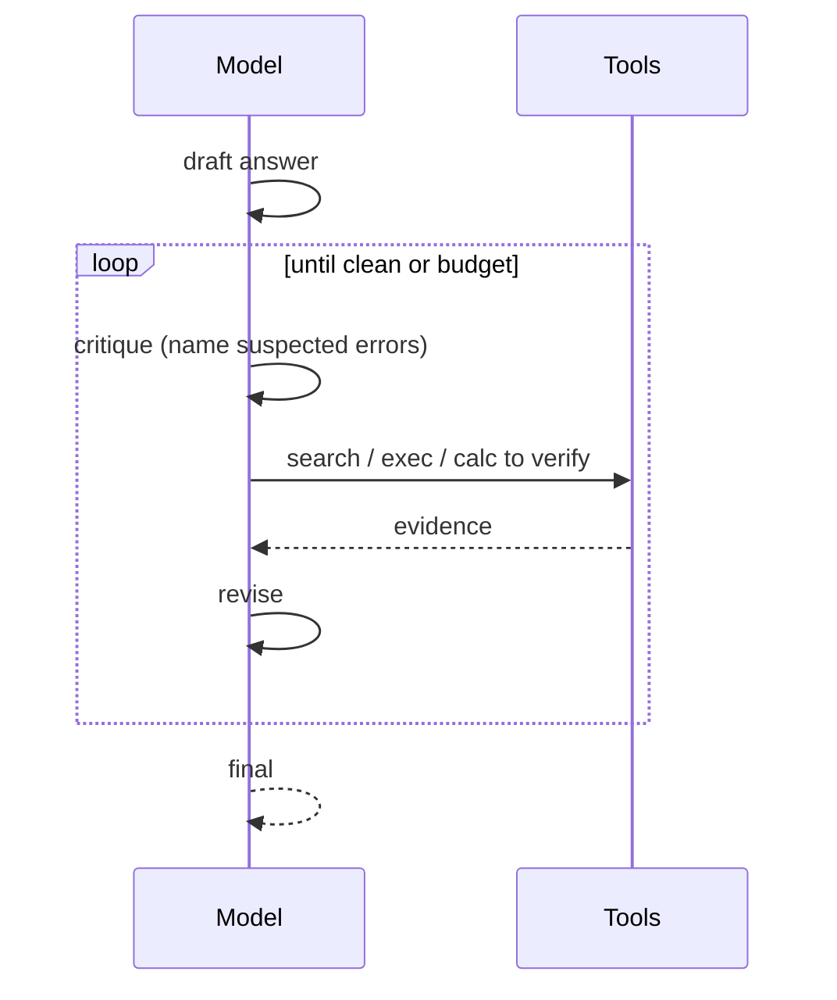

# Tool-Augmented Self-Correction

**Also known as:** Tool-Interactive Self-Correction, CRITIC

**Category:** Verification & Reflection  
**Status in practice:** emerging

## Intent

Self-correct LLM outputs by interactively critiquing them with external tools (search, code execution, calculator).

## Context

A team runs a large language model on a generation task where mistakes can in principle be caught by an external check: factual claims could be verified by a web search, generated code could be verified by actually running it, and arithmetic could be verified with a calculator. The agent has access to those tools but currently uses them only during drafting, not during review. After producing a draft the model is asked to self-critique, but the critique is itself a model call with no grounding outside the model's own beliefs.

## Problem

When self-critique is done by the same model that produced the draft and is not allowed to consult any external tool, the critique recycles the same blind spots that produced the original error. The model that confidently asserted a wrong fact will confidently agree with itself when asked to review the assertion. Without a way to compare the draft against an outside source of truth, the iterative loop is a model talking to itself and slowly converging on whatever it believed at the start. The team needs the critic to be able to actually test claims, not just re-read them.

## Forces

- Tool selection per critique step.
- Critique cost adds to generation cost.
- Tools may themselves be wrong or limited.

## Therefore

Therefore: let the draft be challenged by a critic that calls external tools to verify specific claims, so that errors are caught by ground truth rather than by the same prior that produced them.

## Solution

After draft generation, the model emits a critique that names suspected errors and queries tools to verify. Tool results inform the revised output. Iterate until tools find no more issues or budget exhausted.

## Structure

```
Draft answer -> critique (name suspected errors) -> query tools (search / code execution / calculator) -> evidence -> revise only where evidence shows a defect -> repeat until tools find no issue or budget is spent -> final
```

## Diagram



## Example scenario

A coding agent answers 'what's the time complexity of this sort?' confidently, but its self-critique just talks itself in circles using the same blind spots that produced the answer. The team wires in a Critic equipped with external tools: the critic runs the proposed code on benchmarks, queries an algorithms reference, and uses a calculator to double-check claimed bounds. When the critic has a measurement that contradicts the draft, the agent revises against an actual signal instead of recycling its own prior.

## Consequences

**Benefits**

- Grounded self-correction beats ungrounded reflection.
- Tool invocations during critique are auditable.

**Liabilities**

- Latency and cost per turn.
- Tool selection itself is a learning problem.

## Failure modes

- Wrong tool for the claim — the critic checks a fact with a tool that cannot settle it, gets a weak result, and treats it as confirmation.
- Ungrounded edit — the model revises a passage on its own hunch with no tool evidence, and introduces a new error.
- Budget burn — each round finds one more small issue, so the loop runs to the budget limit and adds latency on every turn.
- Unchecked claims — the critique names only the errors it already suspects, and claims it never doubted are never tested.

## What this pattern constrains

The critic may revise outputs only when an external tool corroborates a defect; ungrounded edits are forbidden.

## Applicability

**Use when**

- The model has external tools (search, code, calculator) that can produce grounded ground-truth signals.
- Self-critique without tools recycles the model's blind spots and fails to catch real errors.
- Iteration to convergence (or a budget cap) is acceptable in the latency model.

**Do not use when**

- No external tools exist that meaningfully verify the model's claims.
- Latency budget allows only one model call per output.
- Critique-and-revise loops collapse to no change and add cost without gain.

## Components

- Drafter — LLM producing the initial answer to be challenged
- Tool-augmented critic — same or different LLM that names suspected errors and queries tools to verify
- External tool set — search, code execution, calculator that supply ground-truth signals
- Reviser — pass that incorporates corroborated tool evidence into a new draft
- Iteration controller — stops the loop on no-issues or budget exhaustion

## Tools

- Web search API — verifies factual claims against external sources
- Code-execution sandbox — runs generated code to check for runtime or correctness errors
- Calculator or symbolic-math engine — checks arithmetic and algebraic claims
- LLM API — drives critique and revision turns

## Evaluation metrics

- Tool-corroborated correction rate — edits driven by an actual tool result, not ungrounded change
- Hallucination reduction over no-critic baseline — drop in confidently-wrong outputs
- Tool-call efficiency — useful evidence returned per critic-issued query
- Loop convergence rate — fraction of runs terminating on no-issues before budget cap
- Latency and cost overhead per resolved defect — per-issue cost of the tool-grounded loop

## Known uses

- **CRITIC paper baselines** _available_

## Related patterns

- _specialises_ **Reflection**
- _alternative-to_ **Chain of Verification**
- _uses_ **Tool Use**
- _alternative-to_ **Policy-Localizer-Validator**

## References

- [CRITIC: Large Language Models Can Self-Correct with Tool-Interactive Critiquing](https://arxiv.org/abs/2305.11738) — Gou, Shao, Gong, Shen, Yang, Duan, Chen, 2023
