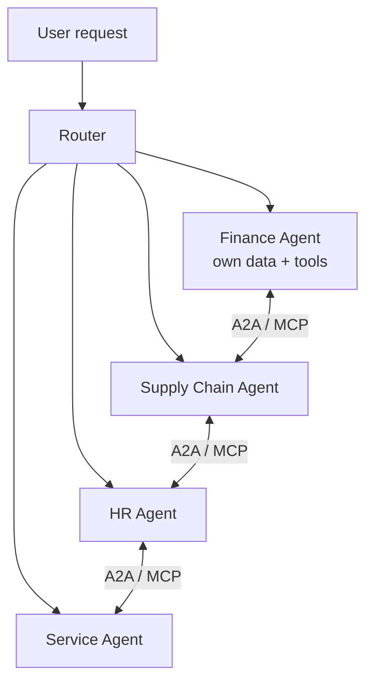

# Cross-Domain Enterprise Agent Network

**Also known as:** Domain-Specialised Agent Mesh, Joule-Style Agent Collaboration, Per-Function Agent Network

**Category:** Multi-Agent  
**Status in practice:** emerging

## Intent

Decompose enterprise agency into domain-specialised agents (finance, supply chain, HR, service), each grounded in its own system of record, and route artefacts between them through a standardised inter-agent protocol.

## Context

A large enterprise already runs its business across many backing systems — finance in an ERP, customers in a CRM, employees in an HR system, support in a ticketing system — and the end-to-end workflows it cares about cross those boundaries. A dispute moves from customer service into finance into supply chain; closing a quarter pulls data from half a dozen sources. Each domain has its own data model, vocabulary, compliance rules, and team that owns it.

## Problem

Building a single mega-agent grounded against every backing system produces an agent with a sprawling tool catalogue, no clear domain ownership, and no domain-specific guardrails. Recall drops as the catalogue grows: the agent picks the wrong tool, mixes up vocabularies between domains, and applies finance rules to an HR question. Compliance teams have nowhere to attach domain controls, and no single team can be made accountable for the whole thing. Flat tool-use agents over a flat catalogue degrade in exactly this regime.

## Forces

- Each domain has its own data model, vocabulary, and compliance rules.
- End-to-end workflows must cross domains.
- A single agent over all systems blows up the tool catalogue and the prompt.
- Domain teams want ownership and lifecycle of their own agents.

## Therefore

Therefore: build one grounded agent per business domain and route cross-domain work between them through a standardised inter-agent protocol, so that each domain stays small and ownable while end-to-end workflows still compose.

## Solution

Build one specialised agent per business domain, each with its own grounded data, tool palette, and acceptance criteria. Define a standardised inter-agent protocol for handoffs (e.g. A2A, MCP). When a task crosses domains, the source agent routes to the target via the protocol, passing a typed artefact. An optional supervisor or role-based assistant fronts the user and dispatches to the right entry agent.

## Structure

```
User -> Role Assistant -> Domain Agent A (own data + tools) -- protocol message --> Domain Agent B -- ... --> outcome.
```

## Diagram



## Example scenario

A large enterprise has separate teams for finance, supply chain, HR, and customer service, each with its own systems of record. A single mega-agent grounded against all of them has terrible recall and no clear ownership when something goes wrong. They build a Cross-Domain Agent Network: a domain-specialised agent per area, each grounded in its own data and bounded by domain-specific policies, and a standardised inter-agent protocol that lets a finance agent request a supplier risk score from the supply-chain agent. Each domain stays independently governed.

## Consequences

**Benefits**

- Each domain agent stays small, grounded, and ownable.
- Cross-domain workflows are auditable per agent.
- Domain teams ship and update their agents independently.

**Liabilities**

- Protocol design is the core engineering problem; bad protocol fossilises mistakes.
- Routing decisions become a second-order problem (who does what).
- Failure attribution across the chain is harder than for a monolith.

## Failure modes

- Fossilised protocol — an early design flaw in the inter-agent protocol is copied by every domain agent and becomes very hard to change.
- Misrouting — the router sends an HR question to the finance agent, which applies its own rules with full confidence.
- Blurred blame — a cross-domain workflow fails, and no one can tell which agent in the chain produced the bad artefact.
- Backdoor integration — two domain teams wire their agents together outside the protocol, and the domain controls no longer apply on that path.

## What this pattern constrains

An agent may only call across domains via the standardised protocol; ad-hoc backdoor integrations between domain agents are forbidden.

## Applicability

**Use when**

- Enterprise agency spans multiple domains (finance, supply chain, HR, service) each with its own system of record.
- A standardised inter-agent protocol (A2A, MCP) is available or can be adopted.
- Each domain benefits from its own grounded data, tool palette, and acceptance criteria.

**Do not use when**

- All work happens in one domain and a single specialised agent suffices.
- No inter-agent protocol is in place and the integration cost dominates the benefit.
- Domains share so much context that a single mega-agent is actually simpler.

## Components

- Role assistant — user-facing entry agent that dispatches to the right domain agent
- Domain agent — specialist grounded in one system of record with its own tool palette
- Inter-agent protocol envelope — typed A2A or MCP message carrying the cross-domain artefact
- Capability registry — directory of which domain agent advertises which actions
- Audit log — per-agent trace of cross-domain handoffs for compliance review

## Tools

- A2A protocol — standardised agent-to-agent task delegation across domains
- MCP — Model Context Protocol for capability advertisement and grounded tool calls
- Per-domain system of record — ERP, CRM, HR, ticketing as each agent's grounded data source
- Heterogeneous LLM APIs — different domain agents may use different models

## Evaluation metrics

- Cross-domain handoff success rate — share of routed tasks that the target agent accepts
- Per-agent tool-recall accuracy — does the smaller domain catalogue improve over the mega-agent
- End-to-end workflow latency — wall-clock for tasks that touch multiple domains
- Failure attribution clarity — share of failures correctly localised to one domain
- Domain-team change velocity — independent updates shipped per domain without coordinated release

## Known uses

- **[SAP Joule](https://www.sap.com/products/artificial-intelligence/ai-agents.html)** _available_ — Per-domain Joule Agents (finance, HR, supply chain, service) collaborating via SAP's collaborative agent architecture; A2A and MCP support announced 2025.
- **ServiceNow Now Assist** _available_ — Comparable pattern in ITSM/HR/CSM domain agents.

## Related patterns

- _uses_ **Supervisor**
- _uses_ **Handoff**
- _uses_ **Inter-Agent Communication**
- _uses_ **Model Context Protocol**
- _uses_ **Role Assignment**
- _alternative-to_ **Hero Agent**
- _alternative-to_ **Decentralized Agent Network**

## References

- [Joule Agents: How SAP Uniquely Delivers AI Agents That Truly Mean Business](https://news.sap.com/2025/02/joule-sap-uniquely-delivers-ai-agents/)
