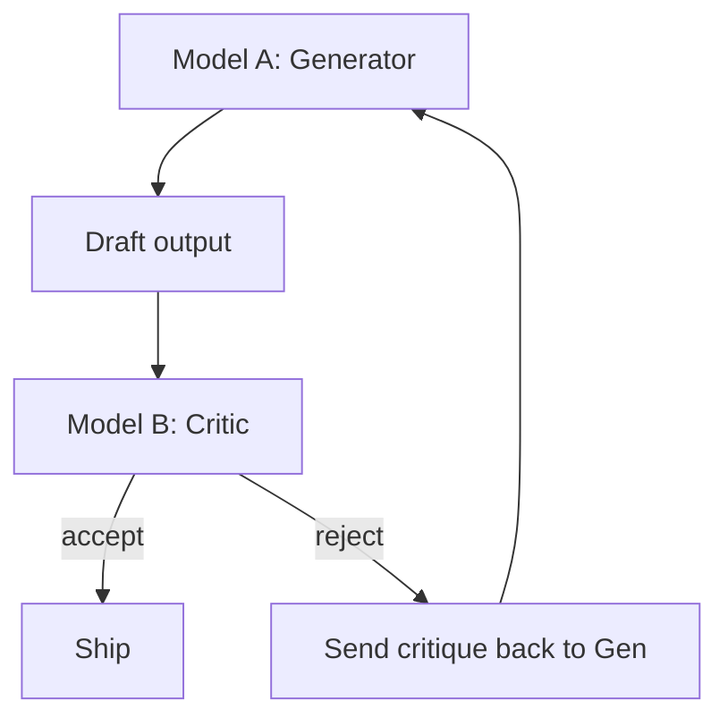

# Cross-Reflection

**Also known as:** Different-Model Reflection, Heterogeneous Critic

**Category:** Verification & Reflection  
**Status in practice:** emerging

## Intent

Reflection step performed by a *different* agent or foundation model from the original generator, so critique error is decorrelated from generation error.

## Context

A team uses reflection to improve agent outputs. Same-model self-critique is the default — the generator critiques its own draft. Errors in critique and errors in generation share the same blind spots when the same model performs both.

## Problem

Self-critique by the same model misses correlated failure modes: the generator's hallucinations get reproduced in its own review of those hallucinations. After one or two iterations, the loop self-approves. The fix requires a critic with different blind spots — a different model architecture, different training data, or both.

## Forces

- Same-model self-critique is cheaper (one model in production).
- Cross-model reflection requires running two models, doubling cost.
- Heterogeneous models may disagree on style/format issues that are not real errors.

## Therefore

Therefore: route the critique step through a different model (different vendor, different architecture, or different fine-tune) from the generator; treat their disagreement as a signal worth investigating.

## Solution

Generator (Model A) produces draft. Critic (Model B, distinct architecture) reviews draft against named criteria. If Model B accepts, ship. If Model B rejects, either revise (back to Model A with critique) or escalate. Pair with frozen-rubric-reflection so the critic uses fixed criteria, not free-form. Distinct from same-model-self-critique and llm-as-judge (which is judge-only without iteration).

## Structure

```
Model A (generator) -> draft -> Model B (different critic, named criteria) --accept--> ship; --reject--> critique back to Model A -> revise (or escalate) -> Model B again
```

## Diagram



## Example scenario

A legal-drafting agent uses Claude Opus as generator and GPT-5.x as cross-reflection critic. Generator drafts a contract clause. Critic reviews against a fixed checklist (governing law cited, parties named, severability present). On disagreement, the agent revises. Same-model self-critique missed a missing governing-law clause that Opus had hallucinated as 'standard'; the cross-model critic caught it because its training data weighted contract templates differently.

## Consequences

**Benefits**

- Decorrelates critique error from generation error.
- Catches issues that a same-model self-review would miss.
- Disagreement between models is itself a useful signal (low-confidence outputs).

**Liabilities**

- Two-model setup is more expensive and more complex to operate.
- Cross-model disagreement on style may create noise.
- Choosing the critic model is non-trivial — must be capable but different.

## Failure modes

- Too-similar critic — the second model shares training data or design with the generator, and their blind spots still overlap.
- Style noise — the critic rejects drafts over stylistic preference, and the loop churns on disagreements that do not affect correctness.
- Weak critic — the chosen critic is different but less capable, and misses errors the generator made.
- Fallback to same model — a provider outage routes critique to the generator model, and the loop quietly becomes self-critique.

## What this pattern constrains

The critic must be a different model from the generator; same-model critique falls back to same-model-self-critique.

## Applicability

**Use when**

- Output quality matters more than per-call cost.
- Two distinct capable models are available.
- Critique criteria can be expressed as a fixed rubric the critic checks.

**Do not use when**

- Cost or latency budget allows only one model.
- Only one model family is available.
- Critic criteria are too subjective for cross-model agreement to be meaningful.

## Components

- Generator — Model A produces drafts
- Critic — Model B (distinct architecture/vendor) reviews drafts
- Rubric — fixed criteria the critic applies
- Revise loop — generator revises against critic feedback

## Tools

- LLM A — generator
- LLM B — critic on different architecture
- Frozen rubric — fixed critic criteria

## Evaluation metrics

- Critic-flagged rate — share of drafts the critic rejects
- Cross-model agreement rate — generator-critic verdict overlap
- Quality lift vs same-model self-critique

## Known uses

- **[elcamy: 【論文紹介】LLMベースのAIエージェントのデザインパターン18選 (Japanese summary)](https://blog.elcamy.com/posts/20431baf/)** _available_

## Related patterns

- _specialises_ **Reflection**
- _alternative-to_ **Same-Model Self-Critique**
- _complements_ **LLM-as-Judge**
- _complements_ **Frozen Rubric Reflection**
- _complements_ **Heterogeneous-Model Council with Synthesis Judge**
- _complements_ **Generator-Critic Separation**
- _complements_ **Modality-Conflict Arbitration** — There a different model critiques the same input to decorrelate critique error from generation error; here one reasoner compares observations of different physical channels and the resolution rule is modality-typed rather than vote-based.

## References

- [【論文紹介】LLMベースのAIエージェントのデザインパターン18選](https://blog.elcamy.com/posts/20431baf/) — 2026
