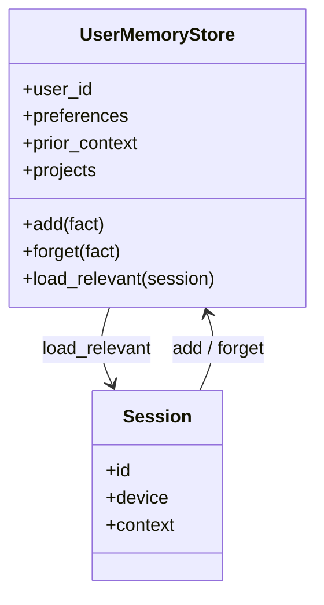

# Cross-Session Memory

**Also known as:** Persistent User Memory, Long-Lived User Profile, Beat Agent Amnesia, No-Forget Memory, Agent Forgets Between Sessions, Session-to-Session Memory

**Category:** Memory  
**Status in practice:** mature

## Intent

Persist user-specific facts, preferences, and prior context across all sessions, threads, and devices.

## Context

A team is building a user-facing assistant where the user expects continuity between visits. The user mentioned a preference last Tuesday, named a project two weeks ago, and told the assistant their pet's name a month ago. Today they expect the assistant to remember those facts without being re-told.

## Problem

Per-thread memory loses everything between sessions: every new conversation starts from a blank slate, the user has to repeat themselves about basic facts, and the assistant feels amnesic and impersonal. The team needs a mechanism that captures the right kind of information at the right time, stores it durably across sessions, and surfaces it back into context when relevant — without leaking private details, blurring sessions together, or storing every passing remark as if it were load-bearing.

## Forces

- What to remember vs forget; user agency.
- Privacy, deletion, portability requirements.
- Cost of always-on memory loading per turn.

## Therefore

Therefore: distil per-user facts into a separate store loaded per session with explicit forget controls, so that the agent remembers across threads without holding the user hostage to its memory.

## Solution

Maintain a per-user store of distilled facts (preferences, prior context, names, projects). Load relevant slices into each session's context. Provide explicit add/forget tools. Audit and surface memory entries to the user. Deletion controls and a user-visible memory inspector (delete / disable / export) satisfy regulatory and trust requirements.

## Structure

```
Session start --load_relevant(user)--> User memory store --> Session context; Session --add / forget tools--> User memory store; User --memory inspector (view / delete / disable / export)--> User memory store
```

## Diagram



## Example scenario

A user uses their personal assistant on the laptop in the morning, the phone at lunch, and a smart speaker in the evening. Without persistent memory, each device feels like a stranger — the user repeats their dietary restrictions three times in one day. The team adds Cross-Session Memory: stable user-specific facts (allergies, preferred name, default timezone) are stored centrally and loaded into every new session on every device. The assistant stops feeling amnesic and the user stops repeating themselves.

## Consequences

**Benefits**

- Continuity across sessions and devices.
- Compounding usefulness over time.

**Liabilities**

- Privacy obligations.
- Memory hallucinations are stickier than chat hallucinations.

## Failure modes

- Sticky false memory — the model stores a wrong fact about the user and repeats it in every later session.
- Over-capture — passing remarks are saved as lasting preferences, and the assistant acts on them long after they stopped being true.
- Cross-user bleed — a slice loaded for one user includes facts from another user's store.
- Unhonoured forget — the user deletes an entry in the inspector, but a cached copy keeps showing up in context.

## What this pattern constrains

Memory entries must be added through declared tools; the model cannot silently mutate persistent user state.

## Applicability

**Use when**

- Per-thread memory loses important user-specific facts between sessions and the assistant feels amnesic.
- A per-user store of distilled facts can be maintained with audit, deletion, and forget controls.
- Loaded memory slices meaningfully improve responses across sessions.

**Do not use when**

- Sessions are deliberately stateless for privacy or compliance reasons.
- No reliable distillation step exists and the store would fill with noise.
- Users expect a fresh agent per session and persistent memory would surprise them.

## Components

- Per-user memory store — durable store keyed by user identity, holding distilled facts across sessions and devices
- Distillation step — turns finished sessions into stable key-value facts, narrative summaries, or embedded chunks
- Add/forget tool — declared interface the model uses to mutate the store; silent writes are forbidden
- Session loader — selects the relevant slice for each new session and injects it into the prompt
- User-visible memory inspector — surface where the user can view, delete, disable, or export stored entries

## Tools

- Document or key-value store — Postgres, DynamoDB, or Letta-style memory blocks for distilled facts
- Embedding model + vector index — used by the embedded-session-retrieval variant for similarity recall
- Summarisation LLM — runs at session close to produce the narrative or fact-extraction summary
- Deletion/export tooling — GDPR-shaped endpoints that satisfy forget-me and data-portability requirements

## Evaluation metrics

- Repeat-question rate — how often users restate facts the system was supposed to remember
- Memory precision — fraction of stored facts that human review confirms as correct and worth keeping
- Forget compliance latency — time from user delete request to verified removal from all retrieval paths
- Memory hallucination rate — sampled cases where the agent acts on a fact never said by the user
- Per-session memory load cost — tokens added to each session prompt by injected memory slices

## Known uses

- **ChatGPT Memory** _available_
- **Claude Projects + memory** _available_
- **[Letta](https://docs.letta.com/)** _available_
- **Lindy memory** _available_

## Related patterns

- _complements_ **Short-Term Thread Memory**
- _alternative-to_ **MemGPT-Style Paging**
- _complements_ **Session Isolation**
- _used-by_ **Sleep-Time Compute**
- _generalises_ **Semantic Memory**

## References

- [OpenAI: Memory and new controls for ChatGPT](https://openai.com/index/memory-and-new-controls-for-chatgpt/) — 2024
