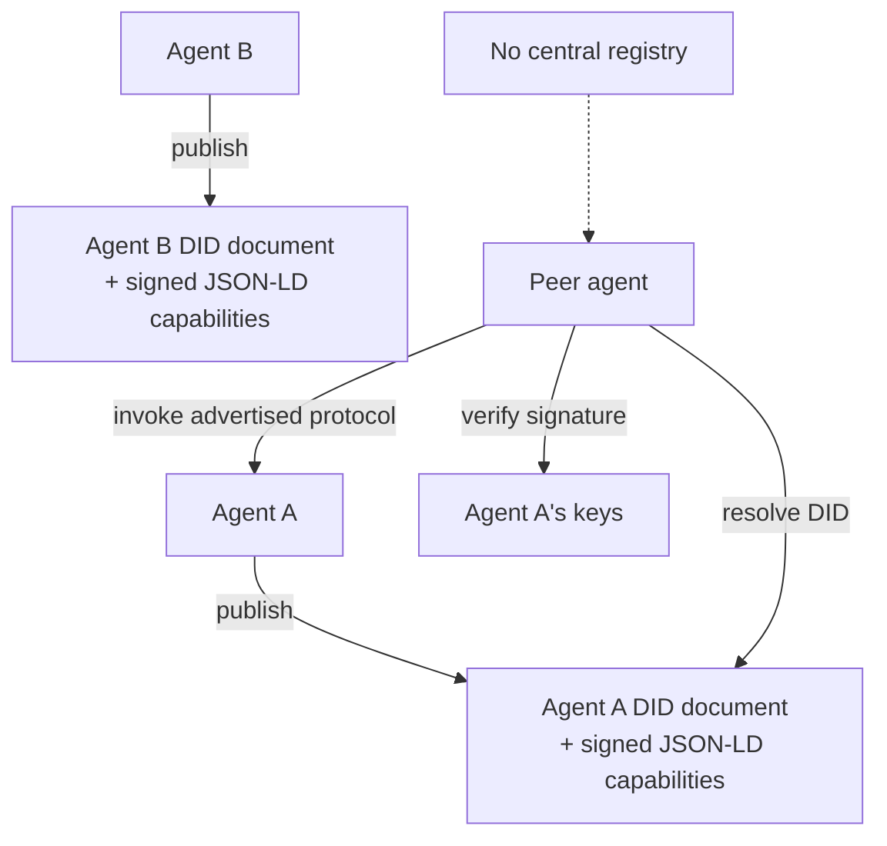

# Decentralized Agent Network

**Also known as:** ANP, Open-Network Agent Discovery, DID-Based Agent Identity, 去中心化智能体网络

**Category:** Multi-Agent  
**Status in practice:** experimental

## Intent

Agents publish signed DID+JSON-LD identity records so any peer can discover and verify them without a central registry — the agent equivalent of the open web.

## Context

Agent interop protocols so far assume known endpoints. MCP exposes tools to a client that already knows where the MCP server is. A2A connects peer agents whose endpoints have been pre-shared. Both presume some bootstrapping mechanism — a directory, a marketplace, an enterprise registry — that everyone trusts. As agent populations grow across organisational boundaries and across the public internet, no single registry is going to scale or be trusted by all parties.

## Problem

Centralised agent registries do not scale across the public internet: every party must trust the registry operator, every cross-org integration requires an admin to onboard, and the registry becomes a single point of policy and failure. There is no protocol for an agent in organisation A to discover and cryptographically verify an agent in organisation B without a pre-arranged channel. Capability advertisement, identity verification, and authorisation all collapse onto the registry operator, who becomes a gatekeeper at internet scale.

## Forces

- Open-network discovery requires identity that does not depend on a central operator.
- Cryptographic verification must work across organisational boundaries with no shared CA.
- Capability graphs need a schema everyone can parse without an out-of-band agreement.
- Decentralized stacks add operational complexity over a simple HTTP registry.

## Therefore

Therefore: identify each agent with a W3C Decentralized Identifier, publish its capability graph as signed JSON-LD discoverable via the DID document, and let any peer verify identity and capabilities cryptographically without consulting a central registry.

## Solution

Assign every agent a W3C Decentralized Identifier (DID) resolvable via a DID method (DID:web, DID:key, DID:ion, etc.). Publish the agent's capability graph as JSON-LD signed by the DID's key, hosted at a location the DID document points to. A peer wanting to discover or verify the agent resolves the DID, fetches the JSON-LD capability graph, verifies the signature against the DID's published keys, and proceeds with whatever interop protocol the capabilities advertise (MCP, A2A, or domain-specific). No central registry sits in the path; trust derives from the cryptographic chain rooted in the DID method.

## Structure

```
Agent --publish--> DID document + signed JSON-LD capability graph; Peer --resolve DID--> DID document --fetch--> capability graph --verify signature against DID keys--> [valid: invoke advertised protocol (MCP, A2A, ...) | invalid: reject]
```

## Diagram



*Each agent publishes identity and capabilities as signed JSON-LD under a W3C DID; peers resolve, verify, and invoke without a central registry.*

## Example scenario

A research assistant agent operated by organisation A wants to delegate a domain-specific subtask to an analytical agent operated by organisation B. There is no shared marketplace or directory. Under ANP, organisation B's agent has published its DID and a JSON-LD capability graph advertising the analytical service and its A2A endpoint. Organisation A's agent resolves the DID, fetches the capability graph, verifies the signature against B's published keys, and delegates the task over A2A. The first interaction required no admin onboarding on either side.

## Consequences

**Benefits**

- Open-network discovery — any peer can find and verify an agent without prior arrangement.
- No single point of policy or failure; no registry operator to trust.
- Identity is cryptographic and rotatable; key compromise does not require re-onboarding.
- Capability graphs are machine-parseable JSON-LD, so toolchains can be generic.

**Liabilities**

- DID method choice has its own trust and operational properties; not all DID methods are equal.
- Key management at scale is hard; lost keys orphan the identity.
- JSON-LD context resolution adds complexity over a flat schema.
- Adoption is thin; ecosystem of DID resolvers, verifiers, and JSON-LD tooling is still maturing.
- Decentralized does not mean trustless: a discovered agent can still be malicious.

## Failure modes

- Lost key — an operator loses the private key behind a DID, and the agent's identity and signed capabilities can no longer be updated.
- Weak DID method — a team picks a DID method with poor trust properties, and peers verify signatures against keys an attacker can control.
- Skipped verification — a peer reads the capability graph but does not check the signature, and honours claims from an unverified agent.
- Context resolution failure — the JSON-LD context cannot be fetched or is parsed differently by two toolchains, and discovery breaks.

## What this pattern constrains

Agent identity may only be asserted via the published DID; capability claims may only be trusted after JSON-LD signature verification against the DID's keys, so no in-band claim from an unverified agent is honoured.

## Applicability

**Use when**

- Agents must discover and verify each other across organisational boundaries with no shared registry.
- Cryptographic identity rotation is a hard requirement and centralised re-onboarding is unacceptable.
- Capability advertisement should be machine-parseable by generic tooling, not bespoke per vendor.
- The deployment is on the open internet rather than inside one enterprise.

**Do not use when**

- All agents live inside one organisation; a central registry (see cross-domain-agent-network) is simpler.
- DID/JSON-LD operational maturity in the team is insufficient and a simpler protocol meets the need.
- Adoption thinness means no peers actually speak the protocol, defeating the discovery purpose.
- Latency budget cannot absorb DID resolution and signature verification on every cold discovery.

## Components

- Decentralized Identifier — W3C DID assigned per agent, resolvable via a chosen DID method
- DID document — the resolution target containing the agent's public keys and service endpoints
- Capability graph — JSON-LD document signed by the DID's keys advertising the agent's capabilities
- Resolver — software that turns a DID into the DID document via the chosen method
- Verifier — software that validates capability-graph signatures against the resolved keys

## Tools

- DID resolver library — universal-resolver, did-resolver, or method-specific implementations
- JSON-LD processor — jsonld-signatures, json-ld.js, or equivalent
- Key management — HSM, KMS, or in-process for development
- Underlying interop protocol — MCP, A2A, or domain-specific; ANP only handles discovery and identity

## Evaluation metrics

- Cold-discovery latency — DID resolution + JSON-LD fetch + signature verification, p95
- Discovery success rate against a corpus of advertised peers, including method-specific failures
- Capability-graph parsability — fraction of fetched graphs that round-trip through a generic JSON-LD parser
- Key rotation success rate — peers correctly handling a rotated key without re-onboarding
- Trust-failure rate — fraction of discovered peers that fail signature verification (poisoning detector)

## Known uses

- **[Agent Network Protocol (ANP) specification](https://agent-network-protocol.com/)** _available_
- **[agent-network-protocol/AgentNetworkProtocol open-source reference](https://github.com/agent-network-protocol/AgentNetworkProtocol)** _available_

## Related patterns

- _complements_ **Model Context Protocol**
- _alternative-to_ **Inter-Agent Communication**
- _alternative-to_ **Cross-Domain Enterprise Agent Network**
- _complements_ **Tool Discovery**
- _generalises_ **Decentralized Swarm Handoff**
- _alternative-to_ **Cellular-Automata Agents**

## References

- [A Survey of Agent Interoperability Protocols: MCP, ACP, A2A, ANP](https://arxiv.org/abs/2505.02279) — 2025
- [一文读懂｜大模型智能体互操作协议：MCP/ACP/A2A/ANP](https://zhuanlan.zhihu.com/p/1908175325663306451)
- [W3C Decentralized Identifiers (DIDs) v1.0](https://www.w3.org/TR/did-core/)
