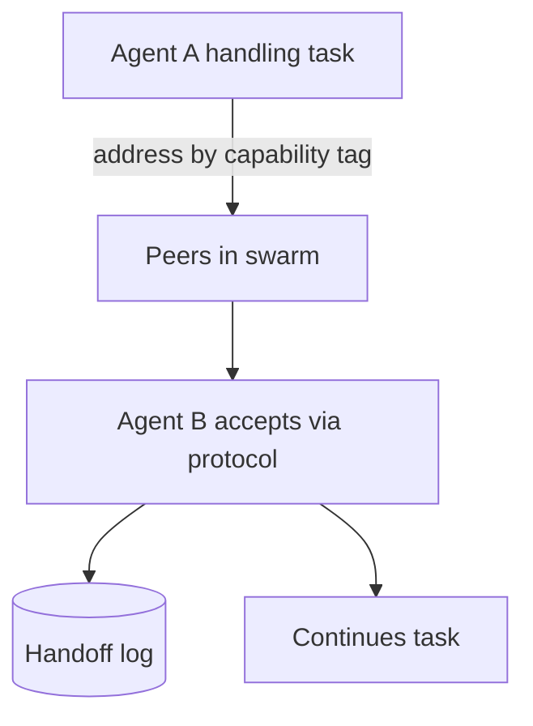

# Decentralized Swarm Handoff

**Also known as:** Peer-Initiated Handoff, Protocol-Based Swarm

**Category:** Multi-Agent  
**Status in practice:** emerging

## Intent

Agents in a swarm decide handoffs to peers based on a shared protocol with no central coordinator; specifically about agent-initiated handoff protocols, not topology.

## Context

A team has a swarm/decentralized agent network. Handoffs between agents happen either through a central router (defeating the decentralized topology) or through implicit handoffs in shared memory (defeating accountability). The protocol by which one agent hands off to another is not first-class.

## Problem

Without a named handoff protocol, handoffs are either centralized (router) or implicit (shared memory). Centralized handoff defeats the swarm topology's scaling. Implicit handoff makes the trace of 'who handed work to whom' impossible to reconstruct. Distinct from existing swarm/decentralized-agent-network by naming the handoff *protocol* explicitly.

## Forces

- Decentralized handoff requires agents to know peers and their capabilities.
- Handoff protocols add coordination overhead.
- Without a protocol, decentralized swarms either re-introduce central routing or lose accountability.

## Therefore

Therefore: define an explicit handoff protocol — message schema, acceptance criteria, capacity signals — that agents in the swarm use to delegate work to peers; no central router, no implicit handoff.

## Solution

Each agent in the swarm exposes a handoff endpoint (accept_handoff(task) → {accept, defer, decline, with_reason}). Handoff initiator addresses peers by capability tag, not by identity. Protocol includes acceptance, decline-with-reason, capacity back-pressure. The trace of handoffs is logged per-agent and reconstructable. Pair with swarm, decentralized-agent-network, handoff, conversation-handoff.

## Structure

```
Agent A (holding task) --address peers by capability tag--> Peers --accept_handoff(task) → accept | defer | decline with reason (capacity back-pressure)--> Agent B accepts --> continues task; every handoff written to per-agent log
```

## Diagram



## Example scenario

A customer-support swarm has agents tagged {refunds, technical, account, sales}. A refunds agent receives a query that turns out to be technical. It addresses peers with capability tag 'technical' (not by identity); the first peer to accept_handoff(task) → accept takes the conversation. The refunds agent logs the handoff. The conversation continues under the technical agent.

## Consequences

**Benefits**

- Decentralized topology preserved (no router bottleneck).
- Handoff trace is reconstructable per-agent.
- Protocol allows decline-with-reason, enabling back-pressure and load distribution.

**Liabilities**

- Protocol design and maintenance is engineering work.
- Handoff coordination adds overhead vs implicit/shared-memory handoffs.
- Capability-tag scheme must be agreed across the swarm.

## Failure modes

- Tag mismatch — agents use different capability tags for the same skill, and a handoff finds no peer even though one could do the work.
- Decline cascade — every peer defers or declines under load, and the task circles the swarm without being accepted.
- Missing log entry — an agent hands off without logging, and the trace of who handed work to whom has a hole.
- Hidden router — a team adds a central dispatcher to fix routing problems, and the swarm loses the scaling it was built for.

## What this pattern constrains

No central router; handoffs only via the declared peer-to-peer protocol; all handoffs logged for trace reconstruction.

## Applicability

**Use when**

- Swarm/decentralized topology where handoffs are routine.
- Agents have distinguishable capability tags.
- Handoff trace reconstruction is needed for audit or debugging.

**Do not use when**

- Centralized router is acceptable (use supervisor instead).
- All agents have identical capabilities (no need for capability-tag addressing).
- Handoff trace is not needed.

## Components

- Handoff protocol — schema for handoff message and response
- Capability tag registry — agents advertise their tags
- Per-agent handoff endpoint — accept/defer/decline interface
- Handoff log — append-only record of peer-to-peer handoffs

## Tools

- Per-agent handoff endpoint (accept/defer/decline)
- Capability tag registry
- Handoff log — per-agent append-only

## Evaluation metrics

- Handoff success rate
- Decline-with-reason distribution — load-balance signal
- Trace reconstruction completeness

## Known uses

- **[OpenAI Agents SDK (handoffs)](https://openai.github.io/openai-agents-python/handoffs/)** _available_ — Handoffs are exposed to the model as tools, so the acting agent itself decides to transfer the conversation to a named peer; there is no central coordinator choosing the next agent.
- **[Google ADK: 8 multi-agent design patterns (Korean roundup)](https://nextplatform.net/best-ai-architecture-google-multi-agent-eight-design-patterns/)** _available_

## Related patterns

- _specialises_ **Swarm**
- _specialises_ **Decentralized Agent Network**
- _specialises_ **Handoff**
- _complements_ **Conversation Handoff to Human**
- _complements_ **Cellular-Automata Agents**
- _complements_ **Reflexive Metacognitive Agent**
- _complements_ **Contract Net Protocol**
- _complements_ **Dynamic Topology Routing** — Handoff transfers control along existing links; topology routing decides which links exist.

## References

- [OpenAI Agents SDK — Handoffs](https://openai.github.io/openai-agents-python/handoffs/)
