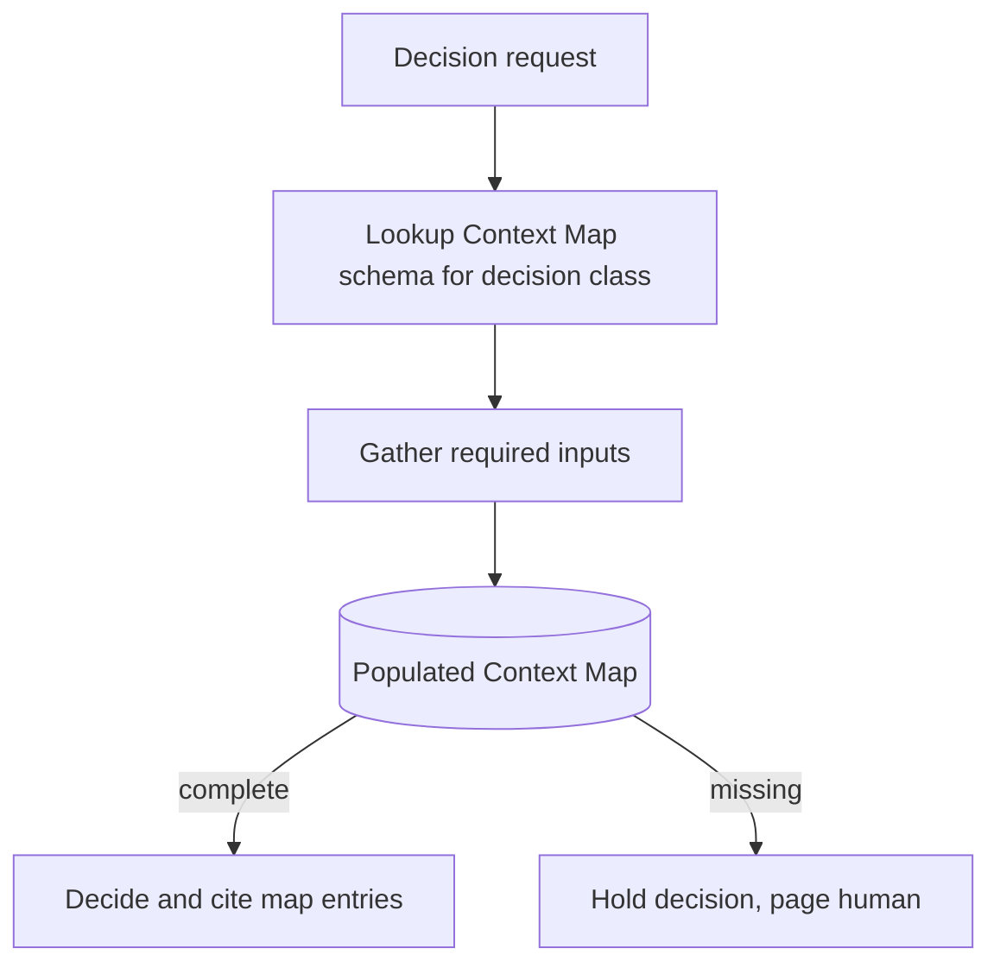

# Decision Context Maps

**Also known as:** Pre-Decision Context Gathering

**Category:** Planning & Control Flow  
**Status in practice:** emerging

## Intent

Before any consequential decision, require the agent to gather a declared set of contextual inputs (resource availability, schedules, downstream dependencies) into a 'context map' the decision must cite.

## Context

An agent makes consequential decisions (production routing, treatment plan, capital allocation). Default behavior is to decide from the immediate prompt context plus whatever the model 'thinks' it knows — which routinely misses out-of-prompt operational state.

## Problem

Decisions made without gathered context cascade errors downstream — the agent routes production assuming a machine is available that is actually down for maintenance; it schedules a treatment forgetting a contraindication in a record it never queried. The error is invisible at decision time because the agent lacks the relevant input it did not bother to gather.

## Forces

- Gathering all possibly-relevant context for every decision is expensive.
- Context schemas must be designed per decision class; one size does not fit all.
- Some context sources (legacy systems, slow APIs) add real latency.

## Therefore

Therefore: define per-decision-class Context Map schemas that enumerate which inputs must be gathered before that decision class fires; the agent is forbidden to commit a decision without populating its Context Map.

## Solution

For each decision class (production-routing, treatment-plan, etc.), publish a Context Map schema: list of required inputs (data sources, who/what to query, freshness requirements). At decision time the agent populates the map — querying APIs, checking schedules, retrieving records. The decision step receives the populated map as input and cites entries when justifying its choice. Pair with strategic-preparation-phase (which contains Context Maps for one-off problems), policy-as-code-gate.

## Structure

```
Decision request --> Context Map schema for decision class --> Context gatherer (query sources, check freshness) --> Populated Context Map --complete--> Decide and cite map entries. Populated Context Map --missing entries--> Hold decision and escalate to human
```

## Diagram



## Example scenario

A manufacturing-routing agent is asked to route a new production order. The 'production-routing' Context Map schema requires: machine availability, maintenance schedule, worker shift roster, downstream-line capacity, current WIP queue depth. The agent queries each, populates the map. If any required entry comes back null or stale, the decision is held and a human is paged. With Context Maps in place, the cascading-routing-error rate drops sharply.

## Consequences

**Benefits**

- Cascading errors from under-informed decisions are caught at gathering time.
- Decision audits can confirm the agent had the right context.
- Per-decision-class schemas become reusable governance artifacts.

**Liabilities**

- Schema design per decision class is upfront engineering.
- Context gathering adds latency proportional to the slowest source.
- Stale-context risk if freshness requirements are not enforced.

## Failure modes

- Stale entry — a context source is read from a cache past its freshness limit, and the decision uses a machine status that changed.
- Incomplete schema — the Context Map for a decision class omits an input, so the map is complete on paper but misses the contraindication.
- Slow source — one data source responds slowly, and every decision in that class waits on it.
- Silent proceed — a required entry is missing, but the agent decides anyway instead of holding and escalating.

## What this pattern constrains

No decision in a declared decision class may commit without a fully-populated Context Map; missing required entries fail the decision, not the agent silently proceeding.

## Applicability

**Use when**

- Consequential decisions whose quality depends on out-of-prompt context.
- Per-decision-class context schemas can be specified.
- Latency budget allows context gathering.

**Do not use when**

- Decisions where all needed context is in-prompt already.
- No reliable way to gather the declared inputs.
- Sub-second decision latency requirement.

## Components

- Context Map schema registry — per decision class
- Context gatherer — queries data sources, applies freshness requirements
- Populated Context Map — gathered evidence the decision cites
- Hold-and-escalate path — for incomplete maps

## Tools

- Per-decision-class Context Map schemas
- Context-gatherer
- Hold-and-escalate path

## Evaluation metrics

- Per-decision-class schema coverage
- Context-gathering latency
- Held-decision rate by missing-entry cause

## Known uses

- **[Bornet et al. — Agentic Artificial Intelligence, Chapter 6 (manufacturing client deployment)](https://www.worldscientific.com/worldscibooks/10.1142/14380)** _available_

## Related patterns

- _complements_ **Strategic Preparation Phase**
- _complements_ **Policy-as-Code Gate**
- _complements_ **Agent Evaluator**
- _complements_ **Decision Log**
- _complements_ **Policy-Gated Agent Action (KRITIS)**
- _complements_ **Re-Proposing Rejected Decisions** — Decision Context Maps gates a decision on a declared set of gathered inputs; recorded prior decisions and their rejected alternatives are one such required input, so requiring the map closes the re-derivation gap this anti-pattern exploits.

## References

- [Agentic Artificial Intelligence — Chapter 6](https://www.worldscientific.com/worldscibooks/10.1142/14380) — 2025
