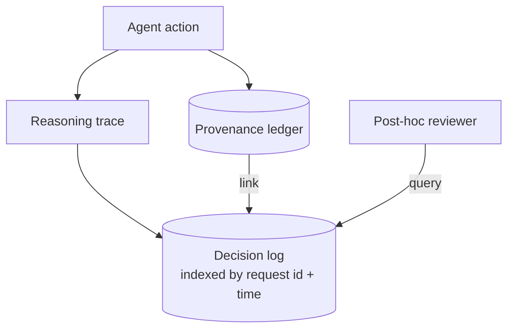

# Decision Log

**Also known as:** Reasoning Trace, Thought Trace

**Category:** Governance & Observability  
**Status in practice:** mature

## Intent

Persist the agent's reasoning trace alongside its actions so post-hoc review can explain why.

## Context

A team runs an agent that makes consequential choices in production, for example a trading agent that opens positions or a support agent that takes refund actions. When something goes wrong days or weeks later, an engineer, auditor, or compliance reviewer wants to understand not only which action the agent took but the reasoning the agent considered at the time. The team already keeps a log of actions taken; what is missing is the thinking that produced each action.

## Problem

An action-only log can tell the reviewer that the agent shorted a position at 14:32, but not which signals it weighed or which alternatives it rejected. Debugging a wrong action degenerates into guessing what the model might have been thinking, and user-facing explanations become impossible to provide truthfully. The team is forced to choose between piecing the reasoning back together from incomplete clues or accepting that some agent decisions are simply unexplainable after the fact.

## Forces

- Reasoning traces are large.
- Sensitive content in reasoning may need redaction.
- Trace fidelity vs cost: full chain-of-thought, key decisions, summary?

## Therefore

Therefore: persist the agent's reasoning at a chosen granularity and link each persisted trace to its corresponding action in the provenance ledger, so that any past action can be explained by retrieving the reasoning that produced it.

## Solution

Persist reasoning at a chosen granularity (full trace, key decisions, or summary). Link each action in the provenance ledger to its trace. Indexed by request id and time for retrieval.

## Structure

```
Agent action --> Provenance ledger; same step --> Reasoning capture (full / key decisions / summary) --> Redaction filter --> Append-only decision log (indexed by request id + time) <--link-- Provenance ledger; Post-hoc reviewer --query--> Decision log
```

## Diagram



## Example scenario

A trading agent decided to short a position at 14:32. At 16:00, the trade lost money. The decision log shows: at 14:32 the agent considered three signals (RSI was low, volume spiked, news sentiment was negative), weighted them, and chose short. The human reviewer can now ask 'was the weighting wrong?' instead of 'what was the agent thinking?'

## Consequences

**Benefits**

- Debugging speed jumps; you see the why immediately.
- User-facing explanations become possible.

**Liabilities**

- Storage and privacy implications.
- Trace tampering (the agent rewriting its trace) defeats the purpose; append-only is needed.

## Failure modes

- Rewritten trace — the log store allows updates, and the agent or a later process edits the reasoning so it no longer matches what drove the action.
- Orphaned action — an action record is written on a path that skips the log entry, and the reviewer finds a trade with no reasoning attached.
- Summary too thin — the chosen granularity is a one-line summary, and it omits the rejected alternatives the reviewer needed.
- Sensitive content kept — the redaction filter misses personal data in the reasoning, and the decision log becomes a privacy liability.

## What this pattern constrains

Action records cannot be written without a corresponding decision-log entry.

## Applicability

**Use when**

- Action-only logs leave you unable to explain why the agent did something.
- Reasoning at some granularity (full trace, key decisions, summary) can be captured and stored cheaply.
- Post-hoc review or debugging routinely needs to consult the reasoning chain.

**Do not use when**

- Reasoning logs would be retained without any review process consulting them.
- Storage or compliance constraints forbid retaining the reasoning trace.
- The agent is so simple that the action alone implies the reasoning.

## Components

- Reasoning Capture — extracts the chain of thought or key decisions at the chosen granularity
- Append-Only Decision Log — immutable store indexed by request id and timestamp
- Provenance Ledger Link — ties each action record to the reasoning entry that produced it
- Redaction Filter — strips sensitive content from reasoning before persistence
- Post-Hoc Reviewer Interface — query layer used by auditors and on-call engineers

## Tools

- Langfuse / LangSmith trace store — captures reasoning, tool calls, and actions per request id
- OpenTelemetry GenAI spans — emits decisions as spans next to LLM and tool calls
- Append-only store (object lock, WORM) — guarantees the agent cannot rewrite past entries

## Evaluation metrics

- Action-to-reasoning link rate — share of action-log entries that resolve to a decision-log entry
- Reasoning-trace coverage — fraction of agent steps that emit a captured rationale
- Mean time to explain a past action — debug latency after the log lands
- Tamper-attempt count — append-only rejections of edits to historical entries
- Redaction false-negative rate — sensitive payloads that escaped the redaction filter

## Known uses

- **Langfuse / LangSmith trace stores** _available_
- **[Sparrot](https://marco-nissen.com/sparrot/)** _available_ — Decisions made during a tick are written to a durable log alongside their reasoning.

## Related patterns

- _generalises_ **Provenance Ledger**
- _uses_ **Append-Only Thought Stream**
- _alternative-to_ **Black-Box Opaqueness**
- _used-by_ **Replay / Time-Travel**
- _used-by_ **Agent-as-a-Judge**
- _complements_ **Attention-Manipulation Explainability**
- _complements_ **Self-Archaeology**
- _complements_ **Memo-As-Source Confusion**
- _complements_ **Interrupt-Resumable Thought**
- _complements_ **Intra-Agent Memo Scheduling**
- _complements_ **Echo Recognition**
- _alternative-to_ **Errors Swept Under the Rug**
- _complements_ **Typed Refusal Codes**
- _complements_ **Commitment Tracking**
- _alternative-to_ **Agentic Skill Atrophy**
- _alternative-to_ **Agentic Debt**
- _complements_ **Rigor Relocation**
- _complements_ **Synchronous Execution-Plan Confirmation**
- _complements_ **Policy-Gated Agent Action (KRITIS)**
- _complements_ **Decision Context Maps**
- _complements_ **Agent Middleware Chain**
- _complements_ **Multi-Principal Welfare Aggregation**
- _used-by_ **Sampled Prompt Trace Eval**
- _complements_ **Decision Token** — The decision log persists the reasoning trace for retrospective review; a Decision Token is a self-contained, signed per-action artifact minted at execution time and handed to a supervisor on its own.
- _complements_ **Re-Proposing Rejected Decisions** — Decision Log is the cure-side record this anti-pattern lacks: a persisted account of which alternatives were rejected and why is exactly the history that, fed into context, stops the agent from re-proposing them. The log is the corrective input, not a competing solution.
- _complements_ **Postmortem Pattern Mining** — A decision log captures one agent run's reasoning forward in time; this pattern mines a corpus of human-written postmortems backward to surface trends across many incidents.
- _used-by_ **Control-Loop-Mapped Agent Chain** — One record per control sample — timestamp, measurement, setpoint, requested output, mode, rationale and fallback flag — is what turns the trajectory into an auditable campaign logbook.

## References

- [Langfuse docs](https://langfuse.com/docs)
