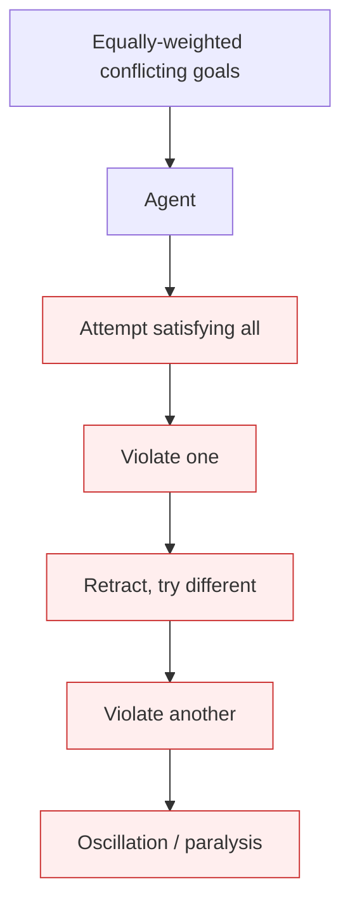

# Decision Paralysis

**Also known as:** Multi-Objective Oscillation, Goal-Conflict Stall

**Category:** Anti-Patterns  
**Status in practice:** deprecated

## Intent

Anti-pattern: when given equally-weighted conflicting goals, the agent either gets stuck trying to satisfy all simultaneously or oscillates between solutions without converging — the most common LLM response to genuine goal conflicts.

## Context

The agent is given multiple objectives that directly conflict (transparency vs security, speed vs review, size limit vs completeness). No priority ordering is provided. The agent attempts to honor all objectives.

## Problem

The LLM, lacking the human contextual judgment to weigh competing objectives, never converges. It produces partial / oscillating outputs, or it appears to commit but the output violates each objective in turn. Distinct from infinite-debate (multi-agent), unbounded-loop (control-flow), or stop-cancel (no termination): this is cognitive paralysis on single-agent multi-objective input.

## Forces

- Equally-weighted goal sets are mathematically under-specified.
- LLMs cannot autonomously assign priority weights — that's a human contextual judgment.
- Asking the agent to 'just decide' produces false-resolution (the more dangerous failure).

## Therefore

Therefore: do not give the agent equally-weighted conflicting goals; resolve the conflict in advance via a Priority Matrix and let the agent implement the pre-decided resolution.

## Solution

Pair with: priority-matrix-conflict-resolution (the resolution pattern), conflict-competency-gap (the underlying architectural limitation). Detect goal conflicts at request-construction time and reject or auto-resolve via the matrix.

## Structure

```
Anti-pattern: Request with equally weighted conflicting goals -> agent tries to satisfy all -> oscillation or partial output. Corrected: Request -> conflict detection at construction time -> priority matrix resolves or request is rejected -> agent gets a ranked goal set.
```

## Diagram



## Example scenario

A document-processing agent at a pharma company is given equally-weighted goals: maximize transparency (share everything), minimize security risk (share nothing sensitive), keep under 5MB (constraint), CEO needs in 2h (deadline), compliance needs 24h (deadline). Agent oscillates: proposes a full document, retracts on security, proposes a redacted one, retracts on size, etc. Hours pass; no output. Fix: pre-defined Priority Matrix entry for urgent-CEO-vs-compliance returns a clean rule the agent implements.

## Consequences

**Benefits**

- Short-term: passing all goals to the agent at once avoids deciding priorities up front.
- Naming it lets a team detect goal conflicts before they reach the agent.

**Liabilities**

- Partial / oscillating outputs that downstream systems cannot consume.
- Latency burned on non-convergent reasoning.
- When the agent forces a commit despite conflict, the output is false-resolution.

## Failure modes

- Oscillation — the agent switches between two solutions and never settles on one.
- Partial output — the agent returns a half-finished answer that downstream systems cannot consume.
- Burned latency — reasoning time is spent on a conflict the agent cannot resolve.
- Forced commit — the agent finally commits, but the output violates each goal in turn.

## What this pattern constrains

No useful constraint; the missing constraint is conflict-detection-and-routing before the request reaches the agent.

## Applicability

**Use when**

- Never. Cite when reviewing agents given equally-weighted multi-objective input.
- Surface as a known failure mode in design reviews.
- Pair detection with Priority Matrix routing.

**Do not use when**

- Any request with equally-weighted conflicting goals reaching the agent.
- Multi-objective workloads without pre-defined priority resolution.
- Stakeholder-political contexts where priority ordering is being avoided rather than decided.

## Components

- Equally-weighted goal set — input
- Agent — cannot prioritize autonomously
- Missing pre-decided priority matrix
- Oscillation / paralysis — output

## Tools

- Detection signal — non-converging multi-objective tasks
- Mitigation: Priority Matrix
- Conflict-detection at request construction

## Evaluation metrics

- Non-convergent task rate
- Mean time to either convergence or escalation
- Priority-matrix-hit rate

## Known uses

- **[Bornet et al. — Agentic Artificial Intelligence, Chapter 5 'Testing Goal Conflicts'](https://www.worldscientific.com/worldscibooks/10.1142/14380)** _available_

## Related patterns

- _alternative-to_ **Priority Matrix (Conflict Resolution)**
- _complements_ **Conflict Competency Gap**
- _complements_ **False Resolution**
- _complements_ **Stop / Cancel**
- _complements_ **Infinite Debate**
- _complements_ **Deliberation Over Observation** — There the agent oscillates under equally-weighted conflicting goals; here the goal is single and unambiguous and the agent still will not look at the environment.

## References

- [Agentic Artificial Intelligence — Chapter 5](https://www.worldscientific.com/worldscibooks/10.1142/14380) — 2025
