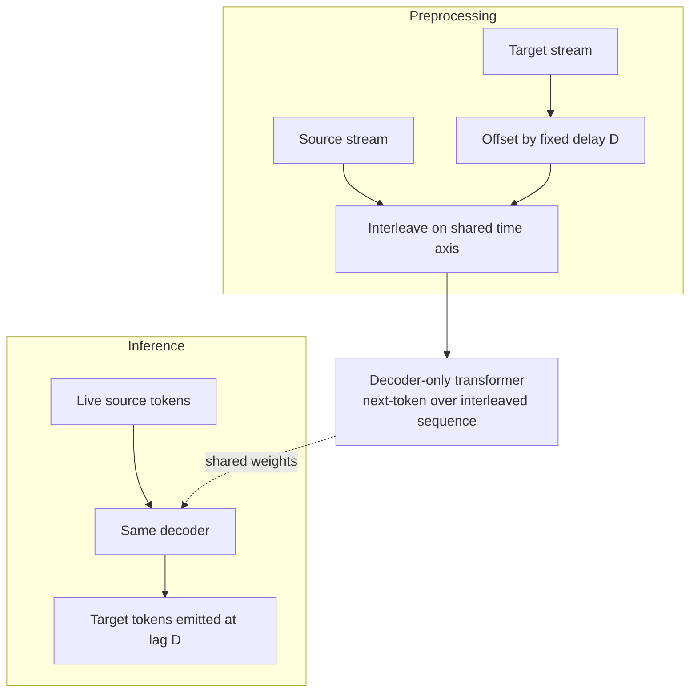

# Delayed Streams Modeling

**Also known as:** DSM, Modélisation à flux décalés, Time-Aligned Stream Decoder, Single-Decoder Speech Agent

**Category:** Streaming & UX  
**Status in practice:** emerging

## Intent

Convert streaming speech tasks into a single decoder-only autoregressive problem by time-aligning the parallel input and output streams with a fixed offset in preprocessing, eliminating the learned read/write policy that cascade pipelines require.

## Context

A team is building a low-latency speech system — a real-time translator, a voice assistant that has to hold a conversation, or a full-duplex dialogue agent where the human and the agent can talk over each other. The conventional architecture is a cascade: a speech-to-text (STT) model transcribes the user's audio, a language model reasons about the text, and a text-to-speech (TTS) model produces the reply audio. Simultaneous-translation systems usually add a separate "read/write policy" that decides at each moment whether to wait for more input or emit the next chunk of output.

## Problem

Cascading three models adds the latency of each stage to the user-perceived delay, and every handoff between them is a place where errors compound or interruptions break the pipeline. The language model cannot start reasoning until the speech-to-text stage commits to a transcription, and the text-to-speech stage cannot start speaking until the language model commits to a reply. The learned read/write policy added on top of this in simultaneous translators is itself a separate model that is hard to train, sensitive to the chosen delay budget, and has its own failure modes. None of these architectures handle full-duplex dialogue — both sides talking and listening at once — without further hacks.

## Forces

- Streaming low-latency speech requires emitting output before input is finished.
- Cascade architectures accumulate latency across stages.
- Learned read/write policies are extra training problems with their own failure modes.
- A single decoder-only model is simpler to train and deploy than a cascade.
- Time-alignment between streams (e.g. translated speech lagging source speech by a fixed offset) can be enforced in preprocessing instead of learned at inference.

## Therefore

Therefore: time-align the input and output streams with a fixed offset during data preprocessing and train one decoder-only model that autoregressively predicts the offset-aligned target stream from the source stream, collapsing read/write policy into pure positional structure.

## Solution

In preprocessing, represent each training example as parallel token streams (source and target) interleaved on a shared time axis, with the target stream offset by a fixed delay (the chosen latency budget, e.g. 1-3 seconds for translation, ~80ms for full-duplex dialogue). Train a standard decoder-only transformer to autoregressively predict the next interleaved token. At inference, feed source tokens as they arrive and read off target tokens at the offset position — no learned policy decides when to emit, the offset structure does. The same architecture handles speech-to-text (text stream offset behind audio), text-to-speech (audio stream offset behind text), simultaneous translation (target language offset behind source), and full-duplex dialogue (each speaker's stream offset behind the joint conversation).

## Structure

```
Preprocessing: source stream || target stream offset by D tokens, interleaved on shared time axis. Training: single decoder-only model, next-token prediction over interleaved sequence. Inference: source tokens stream in, target tokens stream out at fixed lag D. No separate STT, LLM, TTS, or read/write policy.
```

## Diagram



*Fixed-offset interleaving turns streaming speech into a single next-token problem with no learned read/write policy.*

## Example scenario

A simultaneous translator app needs French speech out within two seconds of English speech in, on-device. The team trains a single delayed-streams decoder with target French audio offset 2s behind source English audio. At inference the user speaks; French tokens stream out two seconds later from the same model — no separate STT, no separate LLM, no learned read/write policy. The same architecture, retrained with a tiny offset and both speakers' audio as parallel streams, powers their full-duplex dialogue assistant.

## Consequences

**Benefits**

- Single model replaces a cascade; one training pipeline, one deployment target.
- Latency is a preprocessing knob, not a learned behaviour — easy to tune.
- Naturally supports full-duplex (both sides as parallel offset streams).
- Eliminates learned read/write policy and its failure modes.
- Stream alignment is interpretable: the offset is the latency.

**Liabilities**

- Requires time-aligned paired data, which is hard to obtain for some language pairs and modalities.
- Fixed offset means latency cannot adapt to easy vs hard segments — a learned policy could.
- Single model couples STT, LLM, and TTS quality; weakness in one role is hard to isolate.
- Long-context behavioural shaping (instruction-following, refusals) is less clean than in a separate LLM stage.
- Architecture commits to streaming use; batch tasks gain little from the offset structure.

## Failure modes

- Offset too short for hard segments — a fixed delay that suits easy speech forces the model to emit before the needed context has arrived, and output quality drops on difficult passages.
- Missing aligned data — a language pair or modality lacks time-aligned paired data, so the model is trained on thin or poorly aligned examples and drifts out of sync.
- Entangled weakness — transcription, reasoning and speech share one model, so a regression in one role shows up as a vague quality drop that the team cannot pin on a stage.
- Weak behaviour shaping — instruction-following or refusals tuned for a separate LLM stage do not carry over cleanly, and the joint model answers in ways a text-only stage would have blocked.

## What this pattern constrains

The model must not predict output tokens ahead of the configured offset — emission position is structural, not learned. The architecture forbids inserting a separate read/write policy or cascade stage; the offset is the policy.

## Applicability

**Use when**

- Latency budget is tight (sub-second to few-second).
- Task is naturally a stream-to-stream transduction (speech, translation, dialogue).
- Time-aligned paired data is available or can be synthesized.
- Cascade complexity (STT+LLM+TTS) is dominating engineering cost or latency.

**Do not use when**

- Task is batch-shaped (transcribe a finished audio file).
- Paired time-aligned data is unobtainable.
- Per-stage modularity (swap the LLM independently) is a hard requirement.
- Variable per-segment latency (longer pause on hard sentences) is needed; fixed offset cannot do this.

## Components

- Source stream — live input tokens (audio frames, source-language text) arriving on a shared time axis
- Target stream — output tokens offset by a fixed delay D and interleaved with the source
- Preprocessing aligner — produces the interleaved time-aligned training sequence from paired data
- Decoder-only transformer — single autoregressive model trained on the interleaved sequence
- Offset emitter — reads off target tokens at the configured lag D during inference

## Tools

- Decoder-only transformer framework — trains and serves next-token prediction over interleaved streams
- Audio codec or tokenizer — discretises speech into the token stream the model consumes
- Time-aligned paired corpus — source/target data alignable on a shared time axis

## Evaluation metrics

- End-to-end first-output latency — wall-clock from source onset to first emitted target token
- Effective offset D versus configured D — drift between intended and observed lag
- Task quality at offset (BLEU, WER, MOS) — does the fixed-lag constraint hold output quality
- Full-duplex overlap handling — fraction of overlapping-speech windows the model emits cleanly
- Parameter and compute cost versus cascade baseline — savings from collapsing STT+LLM+TTS into one model

## Known uses

- **[Kyutai Moshi](https://kyutai.org/)** _available_ — Full-duplex spoken dialogue model trained as a delayed-streams decoder.
- **[Kyutai Hibiki](https://kyutai.org/)** _available_ — Simultaneous speech-to-speech translation via DSM.
- **[Kyutai Unmute](https://kyutai.org/)** _available_ — Real-time speech interaction stack on DSM.

## Related patterns

- _alternative-to_ **Streaming Typed Events** — Streaming-typed-events is a transport-layer SSE pattern; DSM is a model-architecture pattern that produces streamable output.
- _alternative-to_ **Multilingual Voice Agent Stack** — Cascade STT->LLM->TTS vs single-decoder offset streams; DSM trades modularity for latency and simplicity.

## References

- [Delayed Streams Modeling](https://arxiv.org/abs/2509.08753) — Kyutai Labs, 2025
- [Simultaneous, on-device, high fidelity speech-to-speech translation with Hibiki](https://kyutai.org/blog/2025-02-10-hibiki) — Kyutai, 2025
- [delayed-streams-modeling](https://github.com/kyutai-labs/delayed-streams-modeling) — Kyutai Labs, 2025
