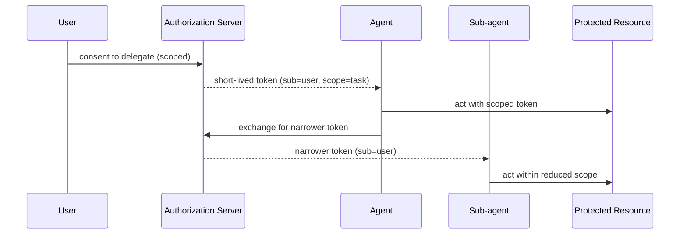

# Delegated Agent Authorization

**Also known as:** On-Behalf-Of Agent, Scoped Agent Delegation, 認証付き委任

**Category:** Safety & Control  
**Status in practice:** emerging

## Intent

Have an agent act for a principal using scoped, short-lived, revocable delegated credentials rather than the principal's own static secrets, so each action stays attributable across the principal-to-agent-to-subagent chain and a compromise is contained.

## Context

A team is deploying an agent that performs real actions for a user — reading mailboxes, calling internal services, moving money, editing records — and often delegates parts of the task to sub-agents or tools. Each of those calls hits a system that needs to know who is acting and with what authority. The team has to decide how the agent proves it is allowed to do what it is attempting, on whose behalf, and within what limits.

## Problem

Sharing the user's own credentials or a long-lived broad API key with the agent is the path of least resistance and the most dangerous one: the agent inherits everything the user can do, the key cannot be scoped to the task, and when it leaks — into logs, a prompt, or a compromised sub-agent — it cannot be cleanly revoked. It also collapses the principal chain: a downstream service sees only the borrowed credential and cannot tell whether the user, the agent, or a sub-agent three hops away initiated the action. Without a way to express bounded, attributable delegation, every agent action is either over-privileged or unauditable.

## Forces

- An agent acting for a user needs authority, but inheriting the user's full credentials over-privileges it.
- Static long-lived secrets cannot be scoped to a single task and cannot be revoked cleanly when they leak.
- Downstream services need to know the real initiator across a principal-to-agent-to-subagent chain.
- Delegation must be narrow enough to contain a compromise yet broad enough to complete the task.
- Each sub-agent needs its own narrower slice of authority, not a copy of the parent's.

## Therefore

Therefore: exchange the principal's identity for scoped, short-lived, revocable tokens issued per task — narrowing the scope again at each sub-agent hop — and carry the originating principal in the token, so every downstream action is bounded and traceable to who authorised it.

## Solution

Use a delegation flow (an on-behalf-of grant, token exchange, or workload-identity federation) in which the agent trades a proof of the user's consent for an access token scoped to just the task's needs, with a short lifetime and a claim identifying the delegating principal. The agent never holds the user's primary credentials. When the agent spawns a sub-agent or calls a tool, it exchanges its token for a further-narrowed one, so authority only shrinks down the chain. Tokens are revocable centrally, and every issued token and the action it authorised are logged, reconstructing the full principal chain (user, agent, sub-agents) for audit and dispute.

## Structure

```
User --consent--> authorization server --scoped short-lived token (sub=user)--> agent --act--> resource; agent --exchange--> authorization server --narrower token--> sub-agent --act within reduced scope--> resource. Revocation and audit log sit at the authorization server.
```

## Diagram



*The principal delegates a scoped, short-lived token; authority only narrows as it passes from agent to sub-agent, and the originating principal travels in every token.*

## Example scenario

A scheduling agent needs to read one user's calendar and send invites, nothing more. Instead of taking the user's account credentials, it exchanges a consent token for an access token scoped to calendar read-write, valid for fifteen minutes, stamped with the user as the delegating principal. When it hands the drafting step to a sub-agent, that sub-agent gets a token scoped to draft-only. If either token leaks, it expires fast, reveals nothing about the user's password, and can be revoked without touching the user's account.

## Consequences

**Benefits**

- A leaked token is scoped and short-lived, so a compromise is contained to one task and expires on its own.
- Every action is attributable to the originating principal across the full delegation chain.
- Authority can only narrow at each sub-agent hop, never widen.
- Tokens can be revoked centrally without rotating the user's own credentials.

**Liabilities**

- Delegation infrastructure (issuer, exchange, revocation) is non-trivial to stand up and operate.
- Over-narrow scopes break tasks mid-run; over-broad scopes recreate the problem the pattern solves.
- A deep sub-agent chain multiplies token exchanges and the surface where one could be smuggled or replayed.
- Standards for agent on-behalf-of flows are still settling, so implementations may diverge.

## Failure modes

- Scope too narrow — the token lacks a permission a later step needs, and the task fails halfway through the run.
- Scope too broad — a convenience scope grants most of what the user can do, and a leaked token carries nearly the same risk as the user's own key.
- Replayed exchange — in a deep sub-agent chain one exchanged token is captured and reused outside the task it was issued for.

## What this pattern constrains

The agent must not hold or reuse the principal's primary credentials; it may act only under a scoped token whose authority is no broader than the task, and each sub-agent hop may only narrow that scope, never widen it.

## Applicability

**Use when**

- The agent performs real actions for a user against systems that enforce access control.
- The task needs only a slice of the user's authority, not all of it.
- Sub-agents or tools each need their own narrower authority.
- Actions must be attributable to the originating principal for audit or dispute.

**Do not use when**

- The agent operates only on public data with no privileged actions.
- It runs purely as its own first-class principal with no user to act for (use a plain workload identity).
- No identity provider or token-exchange capability is available in the environment.
- The interaction is a single short-lived call where a static scoped key already suffices.

## Components

- Authorization server — issues and exchanges scoped, short-lived tokens and records the delegating principal
- Consent capture — the point at which the user delegates bounded authority to the agent
- Token exchanger — narrows scope when the agent delegates to a sub-agent or tool
- Revocation service — invalidates a token centrally without touching the user's own credentials
- Principal-chain audit log — reconstructs user, agent, and sub-agent for every authorised action

## Tools

- OAuth 2.0 / OpenID Connect provider — issues on-behalf-of and exchanged tokens
- Token-exchange endpoint (RFC 8693) — trades a subject token for a scoped delegated token
- Workload-identity federation — gives the agent process a verifiable machine identity
- Short-lived token store — caches issued tokens without persisting the user's primary credentials

## Evaluation metrics

- Over-scope rate — share of issued tokens granting more authority than the task used
- Token lifetime distribution — how short-lived issued tokens actually are in production
- Revocation latency — time from a revoke request to the token no longer being accepted
- Principal-chain completeness — fraction of actions whose full principal chain is reconstructable
- Static-credential leakage — count of times a primary or long-lived credential reached an agent or log

## Known uses

- **[Auth0 for AI Agents](https://auth0.com/ai/docs)** _available_ — Token vault and asynchronous (CIBA) authorization so an agent receives scoped, user-approved access instead of shared credentials.
- **[Microsoft Entra Agent ID](https://learn.microsoft.com/en-us/entra/agent-id/)** _available_ — Distinct, governed identities for agents within the enterprise directory.
- **[OAuth 2.0 Token Exchange (RFC 8693)](https://datatracker.ietf.org/doc/html/rfc8693)** _available_ — Standard mechanism for trading a subject token for a scoped delegated access token without exposing the principal's primary credential.

## Related patterns

- _complements_ **Policy-Gated Agent Action (KRITIS)** — The policy gate checks the scoped token's authority against rules before the action proceeds.
- _complements_ **Secrets Handling** — Scoped short-lived tokens are the mechanism that keeps the principal's primary secrets out of the agent.
- _complements_ **Agent Credential Vault**
- _complements_ **Deontic Token Delegation** — Pairs duty delegation with the permission and credential delegation this pattern carries.
- _alternative-to_ **Static Role for a Dynamic Agent** — Runtime, scoped, short-lived, revocable per-action credentials are the positive model against static-role standing privilege.
- _complements_ **Tenant-Scoped Tool Binding** — Delegated authorization scopes what the agent may do; tenant binding scopes whose data it sees.
- _complements_ **Ephemeral Agent Identity** — Delegation scopes the authority an agent exercises on behalf of a principal; ephemeral identity scopes the agent's own self that carries that authority, and gives it a task-bounded lifecycle.
- _alternative-to_ **Identity Impersonation** — Scoped on-behalf-of delegation under the agent's own identity is the positive model this impersonation anti-pattern fails to use.
- _alternative-to_ **Blanket-Authorization Accountability Rupture** — Scoped, short-lived, revocable delegated credentials are the corrective that keeps each action attributable; blanket authorization is the failure of one broad standing grant that dissolves attribution.
- _complements_ **Verifiable Purchase Mandate** — Delegated authorization scopes the agent's credentials; the purchase mandate is the per-transaction, network-verifiable evidence layered on top for commerce.
- _complements_ **Signed Agent Card** — Verifying the card precedes safe delegation; delegated authorization then scopes what credentials the now-trusted agent receives.
- _generalises_ **Attenuating Delegation Chain** — That pattern gives an agent a scoped, short-lived, revocable credential from an issuer and states that scope should only narrow downstream; this one makes the narrowing a verifiable relation between parent and child links, checkable at the enforcement point without the issuer, and extends it to facets an access scope has no vocabulary for such as remaining depth and spend.

## References

- [OAuth 2.0 Extension: On-Behalf-Of User Authorization for AI Agents (IETF draft)](https://datatracker.ietf.org/doc/html/draft-oauth-ai-agents-on-behalf-of-user-00) — 2026
- [OAuth 2.0 Token Exchange (RFC 8693)](https://datatracker.ietf.org/doc/html/rfc8693) — 2020
- [Identity Management for Agentic AI (OpenID Foundation)](https://openid.net/wp-content/uploads/2025/10/Identity-Management-for-Agentic-AI.pdf) — 2025
- [認証された委任と認可されたAIエージェント](https://zenn.dev/nomhiro/articles/authorized-ai-agents) — 2025
