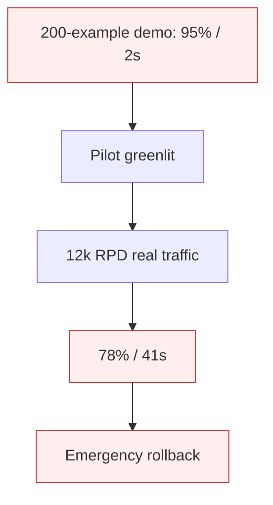

# Demo-Production Cliff (Multi-Agent)

**Also known as:** Pilot-to-Production Multi-Agent Collapse, Demo-Day Multi-Agent Cliff

**Category:** Anti-Patterns  
**Status in practice:** deprecated

## Intent

Anti-pattern: multi-agent pilot benchmarks at 95% accuracy / 2s latency on a curated demo set, then degrades to ~80% / 40s under realistic 10k-RPD load.

## Context

A team prototypes a multi-agent system on a hand-curated demo dataset (~50–500 examples). Pilot metrics look strong — 95% accuracy, 2s latency. The team commits to production rollout. Real traffic shape is broader: more languages, more edge cases, more ambiguity.

## Problem

Under realistic load (>10k requests/day), accuracy drops to ~80% and latency to ~40s. The demo set did not capture the long-tail distribution. Multi-agent coordination overhead compounds: each agent's small accuracy loss multiplies across the chain. Engineers cannot debug because no single agent is 'wrong' — the system is just worse. Differs from existing demo-to-production-cliff by being specifically multi-agent and 2026-quantified per German t3n reporting.

## Forces

- Demo sets are small and curated; real traffic is large and adversarial.
- Multi-agent chains multiply individual error rates.
- Stakeholder pressure to ship from impressive pilots is intense.

## Therefore

Therefore: pilot multi-agent systems against production-shaped traffic from day one (shadow mode, sample-from-prod), measure both accuracy and tail latency, and reject rollouts whose tail-latency growth exceeds the chain depth.

## Solution

Use real production traffic (shadow mode, sampled replay) as the pilot benchmark, not curated demo sets. Track p50, p95, p99 latency and accuracy by traffic class. Decompose per-agent accuracy and chain depth analysis to predict aggregate behavior. Reject rollouts whose tail-latency or accuracy degradation under shadow load exceeds preset thresholds. Pair with demo-to-production-cliff awareness and shadow-canary patterns.

## Structure

```
Anti-pattern: Curated demo set -> multi-agent pilot looks strong -> production load -> accuracy drops and latency rises across chain. Corrected: Shadow mode / sampled replay of real traffic -> per-agent accuracy + chain-depth + p50/p95/p99 -> rollout gate on thresholds.
```

## Diagram



## Example scenario

A 4-agent classification chain hits 95% accuracy and 2s latency on a 200-example demo dataset. Pilot is greenlit. At 12,000 RPD on real traffic, accuracy drops to 78% and median latency rises to 41s. Each agent individually still hits ~94%, but 0.94^4 ≈ 0.78 aggregate, plus realistic queue contention adds 20× latency.

## Consequences

**Benefits**

- Short-term: a curated demo set is quick to build and gives impressive numbers for stakeholders.
- Naming it lets a team insist on production-shaped traffic as the pilot benchmark.

**Liabilities**

- Production launch reveals 15+ point accuracy drop and 20× latency spike.
- Rollbacks damage user trust and burn political capital with stakeholders who saw the demo.
- Chain-depth analysis comes too late to influence architecture decisions.

## Failure modes

- Curated-set mirage — the pilot shows high accuracy and low latency on a hand-picked demo set that misses the long tail.
- Compounding loss — small accuracy losses in each agent multiply across the chain under real traffic.
- No guilty agent — engineers cannot find one wrong agent because the whole system is just worse.
- Painful rollback — the launch is pulled back, and stakeholders who saw the demo lose trust.

## What this pattern constrains

No useful constraint; the missing constraint is production-shaped traffic as the pilot benchmark.

## Applicability

**Use when**

- Never. Cite when reviewing multi-agent pilot results.
- Benchmark against production-shaped (shadow) traffic from day one.
- Decompose per-agent accuracy and predict chain aggregate before rollout.

**Do not use when**

- Any multi-agent pilot benchmarked only on curated demo data.
- Any rollout decision based on small-dataset metrics.
- Any chain whose aggregate metric was not predicted from per-agent metrics.

## Components

- Curated demo dataset — narrow, hand-selected
- Multi-agent chain — accuracy compounds, latency queues
- Missing shadow-traffic pilot — would surface real shape
- Missing chain-depth aggregate prediction — would catch issue pre-rollout

## Tools

- Detection signal — monitors or audits that surface this anti-pattern in the wild
- Mitigation pattern infrastructure — the positive pattern that resolves this anti-pattern
- Incident-response playbook — what to do when the anti-pattern fires

## Evaluation metrics

- Incident rate — occurrences per period
- Mean time to detection — how long the anti-pattern runs unobserved
- Cost / damage per incident — measurable impact of each occurrence

## Known uses

- **[t3n: KI-Agenten scheitern nicht am Modell](https://t3n.de/news/ki-agenten-scheitern-an-architekturfehlern-1730278/)** _available_

## Related patterns

- _specialises_ **Demo-to-Production Cliff**
- _complements_ **Shadow Canary**
- _complements_ **Multi-Agent on Sequential Workloads**
- _complements_ **Automating a Broken Process**
- _complements_ **Eval as Contract**

## References

- [KI-Agenten scheitern nicht am Modell – sondern an diesen fünf Architekturfehlern](https://t3n.de/news/ki-agenten-scheitern-an-architekturfehlern-1730278/) — 2026
