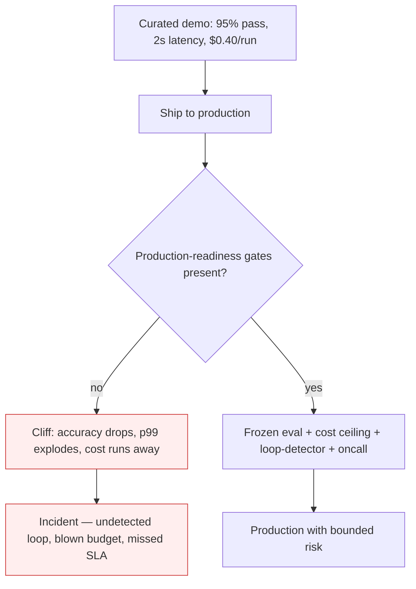

# Demo-to-Production Cliff

**Also known as:** Pilot-to-Production Failure, Scale-Gap Failure, Die Demo funktioniert — die Produktion nicht

**Category:** Anti-Patterns  
**Status in practice:** deprecated

## Intent

Anti-pattern: ship a demo-validated agent straight into production without a frozen eval, cost ceiling, loop-detector, or named oncall, then act surprised when accuracy drops and cost runs away.

## Context

An agent has been built and demoed successfully against a curated set of inputs in a clean environment. Stakeholders are convinced; the model 'works'. The team now wants to ship it to production traffic — variable input distributions, real concurrency, real rate limits, real cost meters, real adversarial inputs.

## Problem

Demo conditions hide most of what kills agents in production. Latency at low concurrency does not predict p99 under load. A 95% pass rate on a hand-picked eval does not predict accuracy on the long tail. Token spend on a few demo turns does not predict the cost of an undetected recursive multi-agent conversation running overnight. Industry surveys (88% of agents never reach production; 70–95% failure rate among those that do) consistently attribute the gap to missing evaluation infrastructure, monitoring, dedicated ownership — not to model quality. The t3n analysis names this directly: it is not the model that fails, it is the architecture around it.

## Forces

- Demos reward speed-to-impressive-output; production rewards stability under load that the demo never sees.
- Per-query cost is invisible until traffic scales; recursive loops between agents can drain a budget in days without tripping any classical alert.
- Eval suites that worked in development are rarely re-run as the model, tools, or prompt drift; what looked safe at v1 is unmeasured at v17.
- Ownership of agent operations sits between the ML, platform, and product teams; without a named owner, monitoring and cost gating fall through the gap.

## Therefore

Therefore: before shipping, instrument the agent with per-run cost telemetry, loop-detection, a frozen eval that gates deploys, rate-limit-aware retries, and a named oncall — and stage at production-scale traffic, not demo-scale.

## Solution

Treat the demo as the beginning of evaluation, not its conclusion. Stand up an eval harness with a frozen rubric before production traffic; gate deploys on it. Add cost-observability per agent-run and a hard budget ceiling per session. Add loop-detection (typed-tool-loop-detector or step-budget) to catch recursive multi-agent chatter. Replay production traffic in a shadow-canary before promotion. Name an oncall for the agent system the same way as for any other production service.

## Structure

```
Anti-pattern: demo on curated inputs -> ship to production -> loops, cost, latency, long-tail accuracy drop unseen. Corrected: demo -> frozen eval gate + cost ceiling per session + loop detector + shadow canary + named oncall -> production.
```

## Diagram



## Example scenario

A four-agent research assistant nails its demo: clean queries, three-agent rounds, ~$0.40 per answer, 8-second latency. It ships. Two weeks later, finance flags a $47k spend over 11 days. Investigation finds one of the agent pairs has been in a self-perpetuating clarification loop on a class of malformed inputs that never appeared in the demo set; no step-budget, no cost-observability dashboard, no oncall. Postmortem conclusion: the model worked; the architecture around it had no production-readiness gates.

## Consequences

**Benefits**

- Short-term: a good demo builds momentum, and shipping it as-is skips weeks of eval and monitoring work.
- Naming it lets a team list the readiness gates that must exist before live traffic.

**Liabilities**

- Undetected recursive loops between agents drain budget — single documented case: $47k over 11 days from one runaway multi-agent dialogue.
- p99 latency in production is unrelated to the demo's mean latency; rate-limit-induced backoff cascades through tool calls.
- Accuracy on long-tail production inputs is materially worse than on the curated demo set; without a frozen eval the regression is invisible.
- Industry-wide pilot-to-production failure rate sits around 88%; the dominant root causes are operational, not algorithmic.

## Failure modes

- Overnight loop — two agents keep talking to each other with no loop detector, and spend runs up for days before anyone sees it.
- Load surprise — tail latency under real concurrency and rate limits is far worse than the demo, and backoff spreads through tool calls.
- Invisible regression — accuracy on long-tail inputs drops, and with no frozen eval nobody can show it.
- Nobody on call — the agent fails at night, and no named owner is there to respond.

## What this pattern constrains

No useful constraint; the missing constraint is mandatory production-readiness gating (frozen eval, cost ceiling, loop-detector, named oncall) before any agent ships to live traffic.

## Applicability

**Use when**

- Never. Cite this anti-pattern when reviewing the deploy plan of any agent that has only been validated against a curated demo set.
- Demand a frozen eval, cost ceiling, loop-detector, and named oncall before sign-off.
- Stage at production-scale shadow traffic, not demo-scale.

**Do not use when**

- Any agent that has impressed in a stakeholder demo but has no production-scale evaluation harness.
- Any multi-agent system without explicit step-budgets or loop-detection on the inter-agent message channel.
- Any deployment where no single team holds oncall for the agent's operational metrics.

## Components

- Demo eval — small curated set that proved the agent worked
- Missing frozen eval — production-representative suite that should gate deploys but does not exist
- Missing cost telemetry — per-run cost ledger that should fire on budget overrun but does not exist
- Missing loop-detector — should catch recursive multi-agent conversations but does not exist
- Missing oncall — named owner of the agent's operational metrics; nobody holds the pager

## Tools

- Production traffic mirror — replays real query distribution into a staging copy of the agent
- Cost dashboard — per-run, per-session, per-agent token and dollar accounting
- Loop-detector — typed-tool-loop-detector or step-budget enforcement on the inter-agent channel
- Frozen-rubric eval harness — eval-as-contract that gates promotion

## Evaluation metrics

- Pilot-to-production survival rate — share of demoed agents that survive 30 days of production traffic without an incident
- Time-to-detect-cost-anomaly — minutes between an anomalous cost spike and an oncall page
- Eval-gate coverage — share of production deploys that ran a frozen eval before promotion
- Loop-detection coverage — share of multi-agent paths that have step-budget or loop-detector instrumentation
- Production-vs-demo accuracy delta — measured regression between the demo set and the long-tail production sample

## Known uses

- **[t3n.de — German trade-press post-mortem of five recurring production-failure patterns, naming the architecture-not-model framing explicitly](https://t3n.de/news/ki-agenten-scheitern-nicht-am-modell-sondern-an-diesen-fuenf-architekturfehlern-1730278/)** _available_
- **[Habr — Russian post-mortem with the same five-modes structure ('And none are about the model')](https://habr.com/ru/articles/1031114/)** _available_
- **[Atlanta Tech News / DigitalApplied / Fiddler AI — English-language industry analyses citing 88% pilot-to-production failure rate, attributing it to evaluation/monitoring gaps](https://www.atlantatech.news/artificial-intelligence/88-of-ai-agents-fail-before-production-the-reason-isnt-technical-consultants-must-wake-up/)** _available_

## Related patterns

- _complements_ **Perma-Beta** — perma-beta is the cultural after-effect — the cliff hits, no one fixes it, the system stays in 'beta' forever
- _complements_ **Unbounded Loop** — one of the canonical failure shapes hidden by demo conditions
- _alternative-to_ **Cost Observability** — the missing capability
- _alternative-to_ **Eval as Contract** — the missing gate
- _alternative-to_ **Shadow Canary** — the missing staging step
- _complements_ **Errors Swept Under the Rug**
- _alternative-to_ **Step Budget**
- _complements_ **Automating a Broken Process**
- _complements_ **Agentic Debt**
- _generalises_ **Demo-Production Cliff (Multi-Agent)**
- _alternative-to_ **evaluation-driven-development**
- _alternative-to_ **Silent Pilot-to-Production Promotion** — Both are go-live failures, but inverted: the cliff ships a demo-validated agent into production with no readiness gate and watches metrics collapse; silent promotion never declares production at all, so the gate is dodged rather than skipped at a known launch.
- _complements_ **Mirrored Tool Environment** — Shipping on a mirror-only score, with no holdout against the live service, is one route onto that cliff.

## References

- [KI-Agenten scheitern nicht am Modell – sondern an diesen fünf Architekturfehlern](https://t3n.de/news/ki-agenten-scheitern-nicht-am-modell-sondern-an-diesen-fuenf-architekturfehlern-1730278/) — 2026
- [Пять способов как ИИ-агенты падают в проде. И ни один не про модель](https://habr.com/ru/articles/1031114/) — 2026
- [88% of AI Agents Fail Before Production. The Reason Isn't Technical.](https://www.atlantatech.news/artificial-intelligence/88-of-ai-agents-fail-before-production-the-reason-isnt-technical-consultants-must-wake-up/) — 2026
- [AI Agent Failure Rate: Why 70-95% Fail in Production](https://www.fiddler.ai/blog/ai-agent-failure-rate) — 2026
