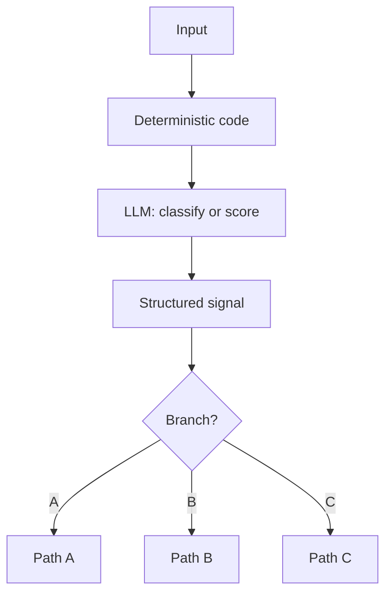

# Deterministic Control Flow, Not Prompt

**Also known as:** Own Your Control Flow, 12-Factor Control Flow

**Category:** Planning & Control Flow  
**Status in practice:** emerging

## Intent

Branching decisions live in deterministic application code while the LLM is invoked at strategic points to produce structured signals that the code branches on.

## Context

A team has an LLM-driven agent. The default temptation is to put branching logic in prompts ('if X then do Y, else do Z'). This makes control flow stochastic, hard to test, and hard to debug. The Polish/12-Factor-Agents 2026 source explicitly names this as a factor.

## Problem

LLM-driven control flow is unreliable: the model may take the wrong branch, skip a branch, invent a branch. Tests cannot enumerate the paths. Debugging requires reading prompt traces. Distinct from spec-driven-loop (which specifies what the agent does at each step) by being specifically about keeping if/else logic out of prompts.

## Forces

- LLM-driven branching is convenient — write 'choose action' in the prompt.
- Deterministic control flow requires the engineer to enumerate paths.
- Some branching legitimately depends on LLM judgment (intent classification).

## Therefore

Therefore: branching logic lives in deterministic code; the LLM is invoked at each branch to produce a structured signal (classification, score, decision) that the deterministic code branches on.

## Solution

Structure: deterministic application code drives the control flow. At each branching point, call the LLM to produce a structured signal (typed enum, numeric score). Deterministic code reads the signal and branches. The LLM never sees 'choose the team's next branch' as a prompt; it sees 'classify this' or 'score this'. Pair with structured-output, json-only-action-schema, spec-driven-loop, stateless-reducer-agent.

## Structure

```
Input --> Deterministic code --> LLM at branch point (classify or score) --> Structured signal (typed enum / number) --> Deterministic branch router --> Path A / Path B / Path C. Unexpected signal --> Fallback handler
```

## Diagram



## Example scenario

A support agent has paths: refund / technical / sales / escalate. Naive: prompt says 'choose path A/B/C/D'. With this pattern: LLM is asked 'classify intent as one of {refund, technical, sales, escalate}'. The deterministic router reads the enum and dispatches. Tests cover all 4 paths; if the LLM classifies as 'other' the deterministic code has an explicit fallback.

## Consequences

**Benefits**

- Control flow is testable, debuggable, and reproducible.
- LLM is used for what it's good at (judgment) not what it's bad at (deterministic branching).
- Prompt traces are about content, not about flow.

**Liabilities**

- Engineering work to enumerate branches.
- Structured signals require structured-output discipline.
- Some natural-language flexibility lost when LLM cannot 'just figure it out'.

## Failure modes

- Off-schema signal — the LLM returns a label outside the enum, and with no fallback handler the code crashes or takes a default branch.
- Branch logic creeps into prompts — a new case is handled by telling the model what to do next, and the untestable path returns.
- Overly coarse signal — the enum has too few values for the real cases, and inputs are forced into the nearest wrong branch.
- Missed branch enumeration — a real-world case has no code path, and it falls through to whatever branch handles unknowns.

## What this pattern constrains

LLM is invoked at branching points to produce structured signals only; no if/else logic in prompts.

## Applicability

**Use when**

- Agent has well-defined branching points.
- LLM judgment is needed at the branch but the branching itself is deterministic.
- Testability and debuggability are priorities.

**Do not use when**

- Branching is fundamentally open-ended (no enumerable set).
- Prototype phase where deterministic structure is premature.
- LLM 'figure it out' is acceptable for the use case.

## Components

- Deterministic code — drives control flow
- LLM invocation point — produces structured signal at branch
- Structured signal schema — typed enum or numeric
- Deterministic branch router — reads signal, branches
- Fallback handler — covers signals outside the expected set

## Tools

- LLM API — classify/score at branch points only
- Structured-signal schema
- Deterministic branch router

## Evaluation metrics

- Branch distribution — coverage of each path
- Signal-outside-set rate — fallback fires
- Test coverage % of declared branches

## Known uses

- **[devstockacademy: 12-Factor Agents (Polish roundup) — 'Own Your Control Flow'](https://devstockacademy.pl/blog/narzedzia-i-automatyzacja/12-factor-agents-jak-budowac-agenty-ai-w-produkcji/)** _available_
- **[humanlayer/12-factor-agents](https://github.com/humanlayer/12-factor-agents)** _available_

## Related patterns

- _complements_ **Spec-Driven Loop**
- _complements_ **JSON-Only Action Schema**
- _complements_ **Structured Output**
- _complements_ **Stateless Reducer Agent**
- _complements_ **Own Your Prompts (12-Factor Agents)**
- _complements_ **Hybrid HTN + Generative Agent**
- _complements_ **BPMN/DMN Deterministic Shell Around Agent**
- _complements_ **Production Failure Triage Loop** — The remediation target for the logic/tool failure class — repeat logic failures are converted into deterministic code rather than re-prompted.

## References

- [12-Factor Agents: jak budować agenty AI, które naprawdę działają w produkcji](https://devstockacademy.pl/blog/narzedzia-i-automatyzacja/12-factor-agents-jak-budowac-agenty-ai-w-produkcji/) — 2026
- [humanlayer/12-factor-agents](https://github.com/humanlayer/12-factor-agents) — 2026
