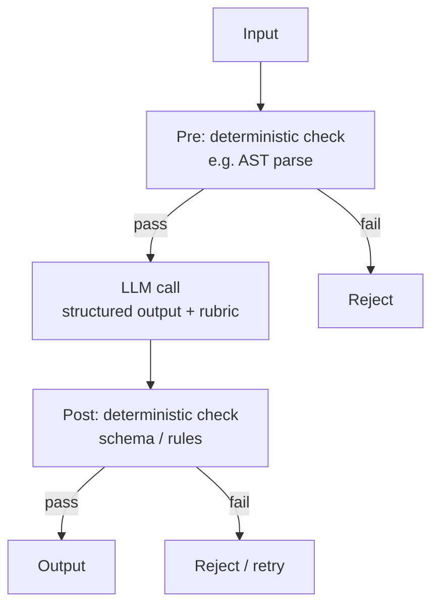

# Deterministic-LLM Sandwich

**Also known as:** Verification-and-Grounding Loop, Bracketed LLM Call, Verify LLM Output, Pre/Post Validation

**Category:** Verification & Reflection  
**Status in practice:** emerging

## Intent

Bracket every LLM call with deterministic checks on both sides.

## Context

A team uses a large language model at a point in the system where wrong output causes real damage: a knitting pattern with a wrong stitch count that wastes a customer's yarn, a database migration that breaks production, an insurance quote that omits a required coverage line. The model is genuinely useful at this step (it talks to the user fluently, or it transforms messy input into a tidy form) so removing it entirely is not the right answer. But every output is one hallucination away from causing harm.

## Problem

Trusting the model's output unconditionally accepts hallucination at exactly the moment where mistakes are most expensive, and there is no signal at the boundary distinguishing a correct generation from a confidently wrong one. Banning the model entirely loses everything it was good at and forces the team back to brittle templated text. Simple downstream validation (a try/catch on the database call, for example) catches some failures but only after side effects have begun or only by failing loudly to the user. The team needs a way to keep the model in the loop while bounding what kinds of output it can land.

## Forces

- Bracketing adds latency per call.
- Pre-checks must be cheap to be worth running.
- Post-checks must catch what the model gets wrong, not what is merely surprising.

## Therefore

Therefore: wrap the LLM call in cheap deterministic gates on both sides and only accept its output if the post-check passes, so that probabilistic generation is contained inside a verifiable envelope.

## Solution

Three layers. Pre: deterministic check decides whether the LLM should run at all (e.g. AST parse must succeed). LLM: produces a candidate output with structured-output schema and frozen rubric. Post: deterministic re-validation (parse, type-check, run tests). If post fails, the original is returned unchanged.

## Structure

```
Pre(input) -> {pass, fail} ; if pass: LLM(input) -> candidate ; Post(candidate) -> {accept, reject}.
```

## Diagram



## Example scenario

A regulated insurance assistant generates policy quotes that occasionally include a coverage line the customer never asked for. Trusting the LLM blindly is unacceptable; banning it loses the conversational explanation users like. The team adopts a Deterministic LLM Sandwich: a deterministic step parses the user's request into a typed schema, the LLM operates only within that schema, and a deterministic post-step validates the quote against rule-engine-checked coverage limits before it's shown. The LLM still talks like an LLM, but cannot smuggle a coverage line past the brackets.

## Consequences

**Benefits**

- Confidence at the correctness boundary; the model cannot land an unsafe artefact.
- Bug fixes go into the deterministic layer where they are testable.

**Liabilities**

- Building the deterministic checks is itself the bulk of the work.
- Over-strict post-checks reject valid outputs.

## Failure modes

- Over-strict post-check — the validator rejects valid outputs, the original is always returned, and the LLM step adds cost with no effect.
- Weak post-check — the check only parses the output, so a well-formed but wrong change passes and lands.
- Pre-check skipped — a caller invokes the LLM directly for speed, and inputs that should never reach the model do.
- Check debt — building the deterministic checks is put off, and the sandwich ships with only one side in place.

## What this pattern constrains

An LLM-produced artefact lands only after passing the post-check; otherwise the prior state is preserved.

## Applicability

**Use when**

- LLM output must be checked deterministically before being trusted (e.g. AST parse, type-check, test run).
- A pre-check can decide whether the LLM should run at all.
- Returning the original input on post-check failure is acceptable behaviour.

**Do not use when**

- No deterministic check exists for the output type (free-form prose, subjective ranking).
- Pre and post checks together cost more than the LLM call they bracket.
- There is no fallback when the post check fails and silent rejection would mislead.

## Components

- Pre-check — deterministic gate that decides whether the LLM should run at all
- LLM call — generator constrained by structured-output schema and a frozen rubric
- Post-check — deterministic re-validation (parse, type-check, run tests) against rules
- Fallback handler — returns the original input unchanged when the post-check fails
- Schema and rule library — codified constraints both checks read from

## Tools

- Parser or AST library — runs the deterministic shape check on input and output
- Type-checker or schema validator — enforces the structured-output contract
- Test runner or rule engine — executes the post-check against domain rules
- LLM API with structured output — generator step bracketed by the gates

## Evaluation metrics

- Post-check rejection rate — fraction of LLM outputs blocked before they land
- Bracket-caught defect rate — wrong outputs caught by the post-check that the LLM did not flag
- Pre-check skip ratio — share of inputs that never reach the LLM and the latency saved
- Over-strict rejection rate — valid outputs wrongly blocked by the post-check
- End-to-end pass-through latency overhead — added time the two gates cost per call

## Known uses

- **Knitting-DSL Pipeline (Stash2Go)** _available_ — deterministicReview.js -> scopedLlmFixer.js -> parse and revalidate.

## Related patterns

- _uses_ **Frozen Rubric Reflection**
- _uses_ **Structured Output**
- _composes-with_ **Code Execution** — Post-check often runs code (parse/test) to validate output.
- _composes-with_ **Frozen Rubric Reflection**
- _complements_ **LLM as Periphery**
- _complements_ **Hybrid Symbolic-Neural Routing**
- _alternative-to_ **Workflow-Success vs Business-Validity Gap** — Bracketing the run with a deterministic post-check against business rules is the corrective; relying on the bare exit status is the failure it prevents.
- _complements_ **Verify-Before-Cite Resolution Gate** — The gate is the post-generation deterministic slice of the sandwich, specialised to resolving citations against an authority registry.
- _complements_ **Behavior-Pinning Test Before Agent Edit** — The sandwich brackets each runtime call with deterministic checks; here the same deterministic-versus-model partition is applied at authoring time so pinned values are exact and model prose is compared loosely.

## References

- [Guardrails AI — Input and Output Guards](https://www.guardrailsai.com/docs) — Guardrails AI, 2024
