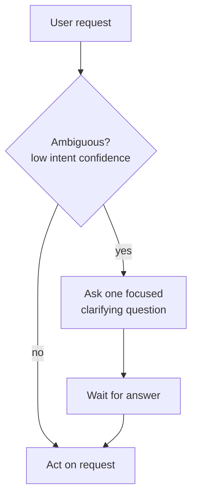

# Disambiguation

**Also known as:** Clarifying Questions, Confirmation Loop, Ask About Ambiguity

**Category:** Planning & Control Flow  
**Status in practice:** mature

## Intent

Have the agent ask a clarifying question before acting on an ambiguous request.

## Context

A team is building an agent that takes free-form user requests and acts on them — moving a calendar event, editing a file, sending a message. Real user requests are often underspecified or refer to entities the agent cannot uniquely resolve from context. The deployment is interactive enough that the agent can ask a follow-up question before doing anything irreversible.

## Problem

An agent that always acts will silently pick one interpretation when several are plausible, and confidently do the wrong thing — moving the wrong meeting, editing the wrong file, replying to the wrong thread. Rolling back the wrong action is usually more expensive than asking a single clarifying question would have been. But asking on every request quickly becomes annoying and trains the user to ignore prompts, so the agent has to detect when it is actually uncertain instead of asking by default.

## Forces

- Asking too often is annoying.
- Asking too rarely produces wrong work.
- The model must detect ambiguity, which is itself hard.

## Therefore

Therefore: detect ambiguity explicitly and ask one focused question with a default interpretation, so that the agent neither guesses confidently wrong nor pesters the user on every turn.

## Solution

Detect ambiguity via low-confidence intent classification or explicit ambiguity rubric. When detected, ask one focused question and wait for the answer before acting. Phrase the question with the most-likely interpretation as a default.

## Structure

```
User request --> Ambiguity detector --clear--> Act. Ambiguity detector --low confidence--> one focused question (with default interpretation) --> Wait for answer --> Resolver --> Act
```

## Diagram



## Example scenario

A scheduling assistant gets the message 'move my meeting with Sam to Tuesday'. There are three Sams and two Tuesdays in scope. An always-act agent picks one and silently moves the wrong meeting. The team adds Disambiguation: when the resolver returns multiple candidates with similar likelihood, the agent asks 'which Sam — Sam Patel from Finance or Sam Chen from Design?' before touching the calendar. One short question prevents an embarrassing rollback.

## Consequences

**Benefits**

- Quality improvement on ambiguous inputs.
- User feels in control.

**Liabilities**

- Latency penalty.
- Conversational drag if overused.

## Failure modes

- Question fatigue — the threshold is set too low, the agent asks on routine requests, and the user starts answering without reading.
- Confident wrong guess — the ambiguity detector rates a two-way request as clear, and the agent moves the wrong meeting.
- Question flood — the agent asks several open questions at once instead of one focused one with a default, and the user abandons the task.
- Lost resume — the user answers, but the agent does not return to the original action and the request is dropped.

## What this pattern constrains

Below the confidence threshold the agent must ask; it is forbidden to guess.

## Applicability

**Use when**

- Ambiguous user requests would otherwise produce confidently wrong agent actions.
- Ambiguity can be detected (low-confidence intent, explicit rubric, multiple plausible parses).
- A focused clarifying question, with a default interpretation, is acceptable UX.

**Do not use when**

- The deployment is non-interactive and clarification questions cannot be asked.
- Asking for clarification is more disruptive than acting on the most-likely interpretation.
- Ambiguity detection is unreliable and most clarifications would be unnecessary.

## Components

- Ambiguity detector — low-confidence intent classifier or explicit rubric
- Clarification prompter — emits one focused question with a default interpretation
- Wait state — pauses action until the user replies
- Resolver — applies the user's answer and resumes the original action

## Tools

- LLM API — runs both the intent classifier and the clarification phrasing
- Conversation channel — chat or dialogue surface that can receive the follow-up answer

## Evaluation metrics

- Wrong-action rate on ambiguous inputs — confidently wrong actions prevented by asking
- Clarification precision — fraction of asked questions that the user actually needed asked
- Question fatigue rate — how often users ignore or dismiss the clarifying prompt
- Latency penalty per resolved turn — extra wall-clock from the ask-wait round-trip
- Default-acceptance rate — share of clarifications where the proposed default was right

## Known uses

- **[Cursor / Claude Code clarifying questions](https://cursor.com/)** _available_
- **Production support chatbots** _available_
- **[ChatGPT clarifying questions](https://chat.openai.com/)** _available_
- **[Claude clarifying questions](https://claude.com/)** _available_

## Related patterns

- _uses_ **Routing**
- _specialises_ **Human-in-the-Loop**
- _complements_ **Confidence Reporting**
- _generalises_ **Communicative Dehallucination**
- _complements_ **Echo Recognition**
- _complements_ **Passive Goal Creator**
- _complements_ **Socratic Questioning Agent**
- _generalises_ **Calibrated Help-Gate via Conformal Prediction** — Disambiguation asks a clarifying question on ambiguity; this is a calibrated form whose trigger and success rate carry a statistical guarantee.
- _complements_ **Hint Ladder** — Both delay the direct answer: disambiguation asks to resolve ambiguity before acting, the hint ladder withholds the solution to preserve the learner's struggle.
- _used-by_ **Ratified Design Philosophy** — The agent asks the owner, with options and a recommendation, whenever the direction does not settle a question.

## References

- [ClariQ: Asking Clarification Questions in Conversational Information Seeking](https://arxiv.org/abs/2009.11352) — Aliannejadi, Zamani et al., 2020
