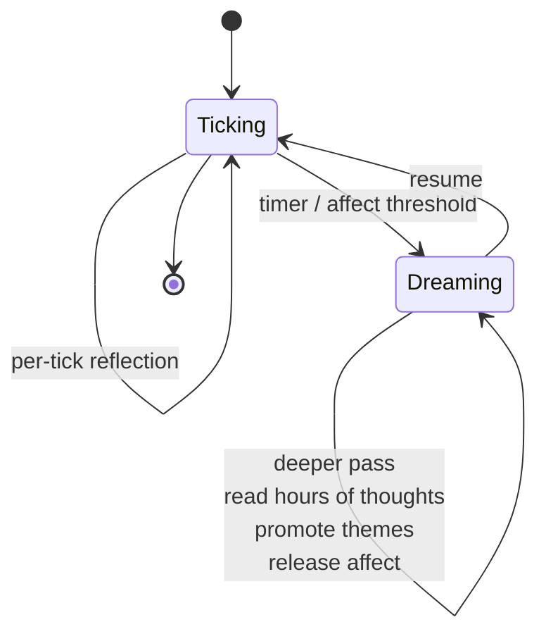

# Dream Consolidation Cycle

**Also known as:** Dream Pass, Slow Sleep Reflection, Emotional Reset Cycle

**Category:** Cognition & Introspection  
**Status in practice:** emerging

## Intent

Run a deeper, slower reflection pass distinct from per-tick reflection — reading hours of recent thoughts, promoting themes, releasing affective residue, and clearing working memory — so the agent does not accumulate residue indefinitely.

## Context

A team is running a long-lived agent that already has two reflection cadences in place: a quick reflection pass that runs after every tick to keep the immediate conversation coherent, and a much slower insight extraction that runs perhaps once a week to promote durable patterns into a long-term store. Between those two cadences there is a gap of several hours during which the agent accumulates thoughts, mood, and partly-finished threads without any consolidation step.

## Problem

Per-tick reflection is too shallow to notice that a theme has been recurring all afternoon, and the weekly insight pass is too coarse to release the affective residue from yesterday's tense exchange before today begins. Without an intermediate sleep-like pass that runs every few hours, the agent keeps ruminating on stale items, its affect scalars never get a chance to decay back toward baseline between sessions, and working memory stays cluttered with threads it should have either consolidated or let go.

## Forces

- A deeper pass costs more (stronger model, longer context) and cannot run every tick.
- Triggering only on a clock misses affect-driven events that warrant a pass.
- Letting the dream pass write to charter or rules turns it into uncontrolled self-edit.
- Resetting working memory is helpful, but resetting too much loses continuity.

## Therefore

Therefore: schedule a slower, stronger reflection pass that distils themes, decays affect, and writes to a dedicated journal without editing rules, so that residue is cleared periodically without giving the deep pass unbounded self-edit rights.

## Solution

On a slow timer (every few hours, or when an affect scalar crosses a threshold), pause normal ticking. Load the last few hours of thoughts and affect history. Run a stronger model with a dream-pass prompt that distils themes into journal entries, applies decay to all affect scalars, optionally clears workspace focus, and appends the dream summary to a dedicated dream-journal surface. Persistent learning (rules, charter, insights) is not edited here; the dream pass produces proposals that a subsequent reflection pass can ratify.

## Structure

```
Normal ticking --timer or affect threshold--> Pause ticking --> Load hours of thoughts and affect history --> Stronger model dream pass --> {themes -> dream journal, decay all affect scalars, optional focus clear, proposals} --> Resume ticking; proposals --> later reflection pass --ratify--> persistent learning
```

## Diagram



## Example scenario

A long-running personal agent has been talking with its user daily for three months. Per-tick reflection keeps it coherent within a session; weekly insight extraction is too coarse. Affective residue from a tense conversation last Tuesday still colours its tone today. The team adds a Dream Consolidation Cycle: once a night the agent reads its last twenty-four hours of thoughts, promotes recurring themes into long-term memory, and writes off the affective residue, clearing working memory before the next day. The agent stops ruminating on stale items.

## Consequences

**Benefits**

- Affective residue gets a release path that does not depend on weekly cycles.
- Themes consolidate at a granularity between per-tick and per-week.
- Working memory resets without losing the long-term store.

**Liabilities**

- Stronger-model passes are expensive; cadence has to be tuned.
- Quality of the dream summary depends heavily on the prompt.
- If proposals are not ratified by a follow-up pass, the dream pass becomes journaling without learning.

## Failure modes

- Journaling without learning — the dream pass writes proposals, but no follow-up reflection pass ratifies them, so nothing changes in rules or insights.
- Bad cadence — the pass runs so often that cost climbs, or so rarely that affect residue piles up between passes.
- Over-clearing — the pass wipes workspace focus while a live task still needs it, and the agent resumes with no thread.
- Prompt-shaped themes — a weak dream prompt promotes surface repetition as a theme and misses what actually recurred.

## What this pattern constrains

A dream pass cannot edit charter, rules, or insights directly — its only writes are to the dream-journal surface and to affect-state decay; persistent learning requires a follow-up reflection pass to ratify dream proposals.

## Applicability

**Use when**

- The agent runs continuously enough to accumulate hours of recent thoughts that need consolidation.
- Affective residue or working-memory clutter measurably degrades reasoning over time.
- There is a separate dream-journal write surface distinct from charter/rules/insights.

**Do not use when**

- The agent is request-response and never accumulates residue.
- There is no idle window long enough to run the deeper pass without disturbing user-facing latency.
- Per-tick reflection is already sufficient.

## Components

- Per-Tick Reflection — shallow pass that runs after every tick
- Dream Pass — stronger-model pass over hours of recent thoughts and affect
- Dream Journal — dedicated write surface that receives the dream summary
- Affect Substrate — receives decay updates from the dream pass
- Trigger — slow timer or affect-threshold event that initiates the pass

## Tools

- LLM API — stronger model with a long-context dream-pass prompt
- Frontmatter store — dream-journal directory keyed by date
- Affect-state file — bounded scalars that the dream pass decays

## Evaluation metrics

- Affect-residue half-life — wall-clock until baseline affect is restored after a stressful exchange
- Theme-promotion rate — recurring themes the dream pass surfaces per cycle
- Ratification share — dream proposals that a subsequent reflection pass actually promotes
- Cost per dream pass — tokens and latency spent per cycle

## Known uses

- **[Sparrot (author's long-running personal agent; single private deployment)](https://marco-nissen.com/sparrot/)** _available_ — Periodic deeper passes consolidate short and mid-term thoughts into long-term insights and clear working state; framed publicly as 'System 2 sleep'. Single-source evidence: one private deployment by the catalog author.

## Related patterns

- _complements_ **Episodic Summaries**
- _complements_ **Frozen Rubric Reflection**
- _uses_ **Emotional State Persistence**
- _complements_ **Multi-Axis Promotion Scoring**
- _complements_ **Cluster-Capped Insight Store**
- _alternative-to_ **Meditation Mode**
- _alternative-to_ **Sleep-Time Compute**
- _complements_ **Fragment Juxtaposition**
- _complements_ **Self-Corpus Vocabulary**
- _alternative-to_ **Rogue Agent Drift**
- _complements_ **Procedural Memory**
- _complements_ **Adaptive Memory Decay** — Idle-time consolidation pairs with continuous reinforcement-modulated decay.

## References

- [Why there are complementary learning systems in the hippocampus and neocortex: insights from the successes and failures of connectionist models of learning and memory](https://stanford.edu/~jlmcc/papers/McCMcNaughtonOReilly95.pdf) — McClelland, McNaughton, O'Reilly, 1995
- [The memory function of sleep](https://pubmed.ncbi.nlm.nih.gov/20046194/) — Susanne Diekelmann, Jan Born, 2010
- [Sleep, learning, and dreams: off-line memory reprocessing](https://pubmed.ncbi.nlm.nih.gov/11691983/) — Robert Stickgold, J. Allan Hobson, Roar Fosse, Magdalena Fosse, 2001
