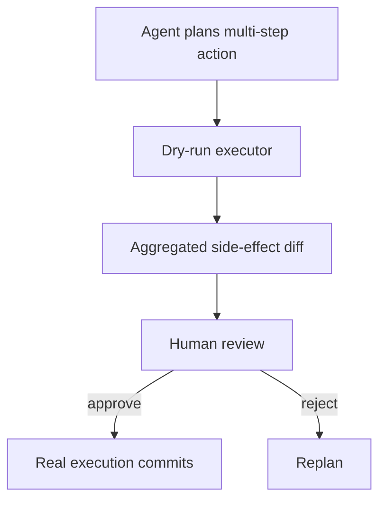

# Dry-Run Harness

**Also known as:** Action Preview Harness, Side-Effect Diff Preview

**Category:** Safety & Control  
**Status in practice:** emerging

## Intent

Simulate planned actions (and their projected side effects) without committing them, surfacing a reviewable diff before any commit.

## Context

An agent plans a sequence of actions that will mutate external state (database writes, API calls, file edits, infrastructure changes). The team wants to keep human-in-the-loop for risky actions, but reviewing every step is too costly.

## Problem

Reviewing each individual action lacks context — humans need to see the projected end-state, not isolated steps. Naive simulate-before-actuate runs only the next action in dry-run; humans cannot evaluate the aggregate effect of a multi-step plan. Differs from simulate-before-actuate by presenting the candidate side-effect set as a unified reviewable artifact.

## Forces

- Per-step review imposes prohibitive cognitive load on humans.
- Whole-plan simulation requires modeling all side-effects, which may be impossible for some tools.
- Dry-run results must be faithful to what real execution would do — otherwise the review is misleading.

## Therefore

Therefore: run the entire plan in a dry-run mode that records (not commits) every side-effect call; present the aggregated diff (what would change, what would be called) as a single artifact for human review before any commit fires.

## Solution

Build a tool wrapper that supports dry-run mode: every action returns the projected side-effect (the SQL it would run, the API call it would make, the file diff it would write) without actually committing. The agent runs end-to-end in dry-run; the resulting collection of projected side-effects is presented to a human as a unified diff (or change-list). Human approves, edits, or rejects the plan as a whole. Only on approval do the actions commit for real. Pair with approval-queue, simulate-before-actuate, human-in-the-loop.

## Structure

```
Agent plans multi-step action --> Dry-run executor (each tool returns projected side effect) --> Aggregated side-effect diff --> Human review --approve--> Real execution commits | --edit--> revised plan | --reject--> Replan
```

## Diagram



## Example scenario

An infrastructure agent plans 'migrate cluster A to region B'. Dry-run produces: 'will create 12 EC2 instances ($2.4k/month), modify 3 security groups, drain 200 connections from cluster A, run 4 DNS updates'. Human reviews the aggregated diff in one screen, approves, and commit phase fires. Without dry-run, the agent would have made all 19 changes individually with no chance for aggregate review.

## Consequences

**Benefits**

- Human reviews the aggregate effect, not isolated steps — much higher cognitive efficiency.
- Plans can be revised before any side-effect commits.
- Dry-run trace is a self-documenting plan record.

**Liabilities**

- Requires tool wrappers to support dry-run mode — not all tools natively do.
- Some plans depend on state that only exists post-commit (later steps depend on earlier writes); dry-run must model this.
- Review workflow adds latency between plan generation and execution.

## Failure modes

- Missing post-commit state — a later step reads a row an earlier step would have written, the dry run has no such row, and the diff shows the wrong outcome.
- Partial dry run — one tool wrapper lacks a dry-run mode and commits for real during the simulation.
- Diff too large to read — a long plan produces a change list the reviewer cannot follow, so approval becomes a formality.

## What this pattern constrains

No real side-effect commits until the dry-run diff is approved as a unit; tools must implement dry-run faithfully or be excluded from dry-run-eligible plans.

## Applicability

**Use when**

- Multi-step plans whose aggregate effect needs human review.
- Tools support (or can be wrapped to support) dry-run mode.
- Review latency budget allows for plan-then-approve cycle.

**Do not use when**

- Tools cannot be wrapped to dry-run faithfully.
- Per-step latency budget is too tight for plan-then-approve.
- Plans depend on real-time data that dry-run cannot capture.

## Components

- Dry-run tool wrappers — return projected side-effect without committing
- Side-effect collector — aggregates projected effects across all plan steps
- Diff renderer — presents the collection in human-reviewable form
- Approval queue — gates commit on human decision
- Commit executor — fires real side-effects only on approval

## Tools

- Dry-run tool wrappers — return projected side-effects
- Side-effect collector — aggregates across plan steps
- Approval queue UI — human-reviewable diff

## Evaluation metrics

- Approval rate — plans humans approve as-is
- Revision rate — plans humans revise post-dry-run
- Drift rate — dry-run projection vs actual execution outcome

## Known uses

- **[Joakim Vivas: 17 Patrones de Arquitecturas Agénticas de IA](https://www.joakimvivas.com/tech/17-patrones-arquitecturas-agenticas-ia/)** _available_

## Related patterns

- _specialises_ **Simulate Before Actuate**
- _complements_ **Approval Queue**
- _complements_ **Human-in-the-Loop**
- _complements_ **Mental-Model-In-The-Loop Simulator**
- _complements_ **Compensating Action**
- _complements_ **Synchronous Execution-Plan Confirmation**
- _complements_ **Phantom Action Completion** — Dry-run previews the projected effect before commit; phantom action is the missing post-commit read-back that confirms the effect actually landed.

## References

- [17 Patrones de Arquitecturas Agénticas de IA y su Rol en Sistemas de Gran Escala](https://www.joakimvivas.com/tech/17-patrones-arquitecturas-agenticas-ia/) — 2026
