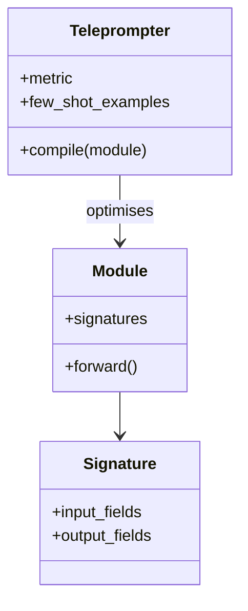

# DSPy Signatures

**Also known as:** Prompt Programs, Compiled Prompts

**Category:** Structure & Data  
**Status in practice:** emerging

## Intent

Specify agent behaviour as declarative typed signatures and modules; compile prompts and few-shot examples automatically against a metric.

## Context

A team is building an agent pipeline made of several language-model calls — retrieve a passage, summarise it, answer a question against it, check the answer — and wants the system to behave reliably across model upgrades without rewriting each prompt by hand every time. They are using DSPy, a framework from Stanford that lets the team describe each step as a typed input/output specification and then compiles the actual prompt strings and few-shot examples from those specifications. The compilation is driven by a metric the team cares about, the way an optimising compiler is driven by a benchmark.

## Problem

When prompts are hand-written strings glued into application code, they drift over time and break in ways that are expensive to track down. A wording change that helps one model hurts another; small edits to phrasing change behaviour without anyone noticing; every pipeline reinvents the same prompt-engineering loop with no shared discipline. Without a way to express what each step expects and produces in a structured form, the team has no compiler to lean on and no metric-driven way to know whether a prompt change is an improvement or a regression.

## Forces

- Declarative coverage vs signature expressivity ceiling.
- Compile-time optimization vs metric/data availability.
- Portability vs per-model compilation gains.

## Therefore

Therefore: declare each step as a typed signature and let a metric-driven compiler produce the prompts, so that prompts become a reproducible build artefact instead of hand-tuned strings.

## Solution

Define each step as a typed signature (input fields → output fields). Compose signatures into modules. Run a teleprompter (optimizer) that generates few-shot examples and refines instructions against a held-out metric. The compiled artefact replaces hand-tuned prompts.

## Structure

```
Typed signatures (input fields -> output fields) -> composed into Modules -> Teleprompter compiles against held-out metric (generates few-shot examples, refines instructions) -> compiled artefact replaces hand-written prompts -> recompile on model or data change
```

## Diagram



## Example scenario

A team has six prompts across their pipeline and every model upgrade means rewriting all of them by hand against a vague vibes-test. They migrate to DSPy Signatures: each step is declared as a typed input/output module — for example summarise(article: str) -> Summary — and a compiler generates prompts and few-shot examples automatically against a metric they care about. When they swap models, the compiler re-optimises the prompts; the team stops hand-tuning strings.

## Consequences

**Benefits**

- Prompts become a reproducible build artefact.
- Metric-driven optimisation replaces vibes-based prompting.

**Liabilities**

- Compilation requires labelled or auto-evaluable data.
- Compiled artefacts drift with model upgrades; recompile regularly.

## Failure modes

- Stale compiled prompts — the model is upgraded but the module is not recompiled, and the few-shot examples tuned for the old model now hurt quality.
- Weak metric — the held-out metric rewards surface features, and the optimizer compiles prompts that score well but answer poorly.
- Too little data — compilation runs on a handful of labelled examples, and the chosen few-shot set fits them rather than the real task.
- String escape hatch — a developer patches behaviour with ad-hoc prompt text outside the signature, and the next compile silently overwrites or conflicts with it.

## What this pattern constrains

Module behaviour is constrained by its declared signature; ad-hoc string manipulation is replaced by typed input/output fields.

## Applicability

**Use when**

- Hand-crafted prompts are brittle and drift across model versions.
- A held-out metric exists that the optimizer can refine against.
- Composing pipelines from typed signatures fits the team's mental model.

**Do not use when**

- The pipeline is a single prompt and the DSPy machinery is overkill.
- No metric is available to drive optimisation and compiled prompts cannot be evaluated.
- The team needs full hand-control over prompt wording for compliance or explainability.

## Components

- Signature — typed declaration of a step's input fields and output fields
- Module — composable unit that holds one or more signatures and a forward() method
- Teleprompter (optimiser) — compiles modules against a metric, generating prompts and few-shot demonstrations
- Metric function — held-out scorer that drives compilation; without it the compiler has nothing to optimise
- Compiled prompt artefact — the build output that replaces hand-tuned prompt strings

## Tools

- DSPy framework — declares signatures, runs teleprompters, and emits compiled artefacts
- Labelled or auto-evaluable dataset — required input for metric-driven compilation
- LLM API with deterministic settings — backend the compiler can call repeatedly during optimisation

## Evaluation metrics

- Held-out metric score before vs after compilation — does the teleprompter actually beat the hand-written baseline
- Compilation cost in LLM calls — how expensive one optimisation pass is, since it dominates iteration time
- Recompilation delta on model upgrade — how much score moves when the same signatures are recompiled against a new model
- Assertion-violation rate at inference — for assertion-guarded signatures, how often dspy.Assert triggers backtracking
- Signature coverage — fraction of pipeline steps expressed as signatures vs ad-hoc prompt strings

## Known uses

- **[Stanford DSPy](https://github.com/stanfordnlp/dspy)** _available_
- **DSPy production deployments at Replit, Databricks, Klarna** _available_

## Related patterns

- _uses_ **Structured Output**
- _uses_ **Eval Harness**
- _complements_ **Agent Skills**
- _alternative-to_ **Prompt/Response Optimiser**
- _alternative-to_ **Agentic Context Engineering Playbook**

## References

- [DSPy: Compiling Declarative Language Model Calls into Self-Improving Pipelines](https://arxiv.org/abs/2310.03714) — Khattab, Singhvi, Maheshwari, Zhang, Santhanam, Vardhamanan, Haq, Sharma, Joshi, Moazam, Miller, Zaharia, Potts, 2023
