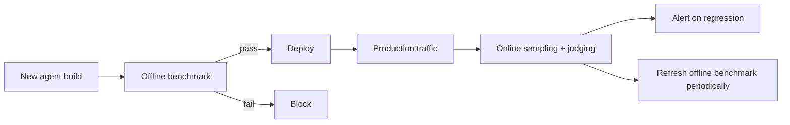

# Dual Evaluation (Offline + Online)

**Also known as:** Offline+Online Eval Bands, Pre-Deploy + Post-Deploy Eval

**Category:** Governance & Observability  
**Status in practice:** emerging

## Intent

Run two parallel evaluation tracks — offline benchmark gates before deploy AND online production-traffic monitoring after — so drift is caught even when pre-deploy benchmarks pass.

## Context

A team evaluates agent quality. Common patterns: (a) offline eval only — benchmark before deploy, then nothing; (b) online monitoring only — react to production signal but cannot gate deploys.

## Problem

Offline-only eval cannot catch drift between benchmark traffic and production traffic. Online-only eval cannot prevent bad deploys. Either alone misses failure modes the other catches.

## Forces

- Two eval tracks means two infrastructures to maintain.
- Offline and online may disagree (different traffic shapes), creating triage burden.
- Online monitoring requires sampling and labeling discipline.

## Therefore

Therefore: maintain both — offline benchmark eval as a deploy gate AND online production monitoring continuous; agreed thresholds on each; disagreements trigger investigation.

## Solution

Offline track: a curated benchmark suite that runs pre-deploy; gates rollout on score. Online track: production traffic sampling with delayed labeling (human review, LLM-as-judge); rolling metrics with alerting. Disagreement between offline pass and online regression is itself a signal — indicates benchmark-vs-production gap. Pair with eval-harness, artifact-evaluation, shadow-canary, scorer-live-monitoring.

## Structure

```
New agent build --> Offline benchmark suite --fail--> Block / --pass--> Deploy --> Production traffic --> Online sampler --> Online labeler (LLM-as-judge + human spot-check) --> Alert on regression; online results --periodic--> Refresh offline benchmark
```

## Diagram



## Example scenario

A support agent's offline eval is 200 hand-curated tickets (88% pass). Deploy gate: ≥85%. Passes. Online: rolling 7-day pass rate on production sample (LLM-as-judge + weekly human spot-check). Week 2 online drops to 81%. Track disagreement: offline didn't catch a new traffic class (account-merging questions) that production has. Benchmark refreshed to include the new class.

## Consequences

**Benefits**

- Bad deploys caught pre-rollout AND drift caught post-deploy.
- Disagreement between tracks surfaces benchmark/production gap.
- Continuous online signal informs benchmark refresh cycles.

**Liabilities**

- Two eval infrastructures to maintain.
- Online labeling cost (humans or LLM-as-judge).
- Track-disagreement triage adds operational overhead.

## Failure modes

- Ignored disagreement — the offline gate passes while online scores drop, and the gap is filed as noise instead of a sign the benchmark is out of date.
- Benchmark never refreshed — online findings never feed back into the offline suite, and the gate keeps testing last year's traffic.
- Online track unstaffed — online labels need human review that nobody has time for, so the online track runs on judge scores only and drifts.
- One track dropped — keeping two eval systems is costly, one is quietly turned off, and the failure modes only it caught return.

## What this pattern constrains

No deploy without offline gate pass AND no live system without online monitoring; both tracks have defined thresholds and alerting.

## Applicability

**Use when**

- Production deployment of consequential agents.
- Both pre-deploy gating and post-deploy monitoring matter.
- Engineering capacity for two eval infrastructures.

**Do not use when**

- Pre-production-only systems (no online to monitor).
- No capacity for online labeling.
- Track-disagreement triage cost is prohibitive.

## Components

- Offline benchmark suite — curated, versioned, gate-able
- Deploy gate — blocks rollout on offline fail
- Online sampler — pulls production traffic for labeling
- Online labeler — LLM-as-judge + human spot-check
- Alarm + benchmark-refresh loop

## Tools

- Offline benchmark suite
- Deploy gate
- Online sampler + judging

## Evaluation metrics

- Offline-online agreement rate
- Online regression detection latency
- Benchmark-refresh cycle from online signal

## Known uses

- **[r_kaga (Zenn): 2025年の年始に読み直したいAIエージェントの設計原則とか実装パターン集](https://zenn.dev/r_kaga/articles/e0c096d03b5781)** _available_

## Related patterns

- _complements_ **Eval Harness**
- _complements_ **Shadow Canary**
- _complements_ **Scorer Live Monitoring**
- _complements_ **Intermediate Artifact Evaluation**
- _complements_ **Agent Evaluator**
- _complements_ **Compliance-Certified Launch Gate** — Dual evaluation runs offline-before-deploy plus online-after; the certification gate is the offline-before-deploy obligation made external and legally binding, and online monitoring still backs it after launch.
- _complements_ **Served-Policy Anchoring** — Both refuse to trust a single pre-deploy number, but the split there is offline benchmark against live traffic, and here it is the training engine against the serving engine on the same checkpoint.
- _complements_ **Mirrored Tool Environment** — Mirror results are the offline track; the live-service holdout and production monitoring are what keep a mirror score honest.
- _complements_ **Simulated-User Rollout Evaluation** — Simulated-user rollouts sit on the offline track; the online track is what catches the failure patterns the simulator does not reproduce.

## References

- [2025年の年始に読み直したいAIエージェントの設計原則とか実装パターン集](https://zenn.dev/r_kaga/articles/e0c096d03b5781) — 2026
