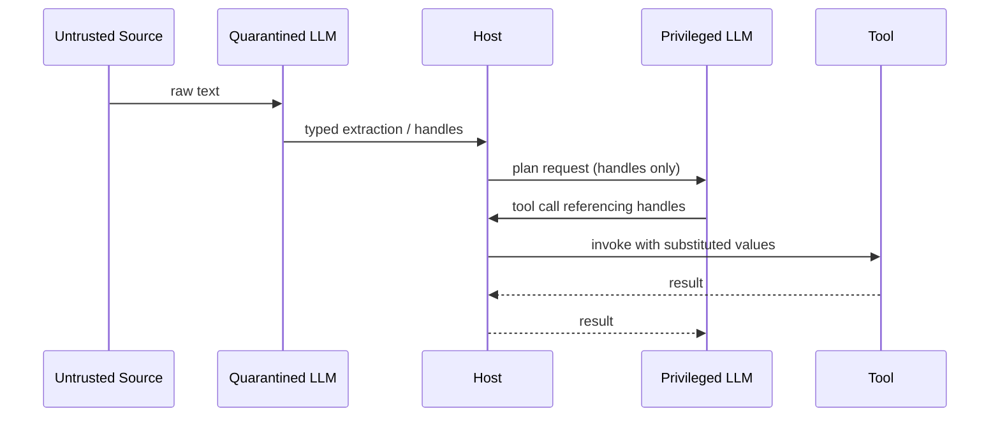

# Dual LLM Pattern

**Also known as:** Privileged/Quarantined LLM Split, Dual-Model Privilege Separation, Symbolic-Variable Handoff

**Category:** Safety & Control  
**Status in practice:** emerging

## Intent

Split agent work between a privileged model that holds tool access and a quarantined model that reads untrusted content, exchanging only opaque references between them.

## Context

A team builds a tool-using agent that has to read content the operator does not control — inbound emails, fetched web pages, document attachments, third-party API responses — while also calling tools that take real actions on the user's behalf, such as sending messages, making payments, or modifying records. The same agent sits in the middle of both the read path and the write path. Attackers know the agent will read whatever lands in its inbox or whatever page it browses, and they plant instructions inside that content.

## Problem

When one model both reads the untrusted text and decides which tools to call, a single successful prompt injection buried in an inbound email or a fetched web page can hijack the action loop and drive the tools the operator gave the agent. The model has no reliable way to tell instructions in the system prompt apart from instructions smuggled in as data, because both arrive as tokens in the same context window. Filtering or labelling untrusted text before it reaches the model is unreliable — every filter has bypasses — and prompting the model to ignore embedded instructions does not survive a clever payload.

## Forces

- Reading untrusted text is a normal, frequent operation; refusing to read it is not viable.
- Tool access is what makes the agent useful; removing it is not viable either.
- Filtering untrusted text before it reaches the model is unreliable — every filter has bypasses.
- Adding a second model raises cost, latency, and debugging complexity.

## Therefore

Therefore: split the work between a tool-holding model that never sees raw untrusted text and a quarantined model that reads the text but holds no tools, exchanging only typed handles between them, so that an injection in the untrusted content cannot drive a tool call.

## Solution

Run two models with disjoint privileges. A Privileged LLM plans, holds tool access, and never sees raw untrusted content. A Quarantined LLM ingests the untrusted content but has no tools and cannot emit free-form actions. The two communicate through symbolic references: the Quarantined LLM extracts typed values (an email address, a date, a summary) and returns them as opaque handles; the Privileged LLM composes tool calls using those handles, with the host substituting the underlying values only at execution time.

## Structure

```
Untrusted source --raw text--> Quarantined LLM (no tools) --typed values as opaque handles--> Host --handles only--> Privileged LLM (plans, holds tools) --tool call with handles--> Host --substitutes values--> Tool --result--> Host --> Privileged LLM
```

## Diagram



## Example scenario

An email assistant must read inbound messages and draft replies that may include calendar invites. A Privileged model holds the calendar tool and the send-email tool but never sees the raw inbox; a Quarantined model reads each inbound message and returns a structured extraction — sender handle, requested date, body summary — as typed values. The Privileged model composes "reply to $SENDER suggesting $DATE" without ever ingesting the original attacker-controlled text. A prompt injection in the inbound message cannot drive a tool call because it never reaches the model that holds the tools.

## Consequences

**Benefits**

- Prompt injections in untrusted content cannot directly drive tool calls — the model that reads them has no tools.
- The trust boundary is enforced by the host, not by prompt instructions, so it survives clever wording.
- Symbolic handles make capability surface auditable: every tool call shows which handles it consumed and where they came from.

**Liabilities**

- Doubles model cost and adds at least one extra round trip per untrusted payload.
- Debugging spans two model transcripts that must be correlated.
- Handle plumbing is intrusive — every tool argument needs a typed slot or it has to fall back to raw text.
- Defends only against injection via the untrusted path; injection via tool outputs or system prompts is out of scope.

## Failure modes

- Raw-text fallback — a tool argument has no typed slot, so the host passes the untrusted text through as a plain string and the privileged model reads it after all.
- Uncorrelated transcripts — a bad action needs both model logs to explain it, and the two are not linked, so the root cause is never found.
- Other injection path — the attack arrives through a tool result returned to the privileged model, a path the split does not cover.

## What this pattern constrains

The privileged model may not receive untrusted content as raw text; the quarantined model may not call tools.

## Applicability

**Use when**

- Agent processes content from sources the operator does not control (email, web, third-party APIs).
- Tool calls in the agent can take consequential actions (send, write, pay, publish).
- Information from untrusted content can be reduced to typed values (addresses, dates, IDs, short strings) rather than free-form text the privileged model must reason over verbatim.

**Do not use when**

- The agent has no consequential tools — there is nothing to hijack.
- The untrusted content must be reasoned over verbatim and cannot be compressed to typed extractions.
- Cost and latency budgets cannot absorb a second model round trip per untrusted payload.

## Components

- Privileged LLM — planner with tool access that never sees raw untrusted text
- Quarantined LLM — reader of untrusted content with no tools and no free-form action surface
- Host orchestrator — trust boundary that substitutes handles to raw values only at tool-call time
- Symbolic handle store — typed references (or opaque IDs) mapping to real extracted values
- Tool runtime — invocation layer that receives substituted values from the host

## Tools

- Typed schema validator — enforces the structured extraction shape the quarantined model returns
- Two distinct model endpoints — disjoint inference paths for privileged and quarantined roles

## Evaluation metrics

- Injection-success rate — share of crafted payloads that drove a privileged tool call
- Handle-leakage incidents — cases where a raw untrusted string slipped into the privileged context
- Extraction-schema conformance — fraction of quarantined outputs that parsed cleanly
- Added latency per untrusted payload — round-trip cost of the extra model hop
- Cost overhead vs single-model baseline — token spend for the quarantined call

## Known uses

- **[Simon Willison, original proposal](https://simonwillison.net/2023/Apr/25/dual-llm-pattern/)** _available_ — Coined as a defence pattern for AI assistants that read email and call tools.
- **[Beurer-Kellner et al., Design Patterns for Securing LLM Agents](https://arxiv.org/abs/2506.08837)** _available_ — Formalised as design pattern §3.1(4) — Dual LLM with symbolic variables.

## Related patterns

- _specialises_ **Prompt Injection Defense**
- _complements_ **Lethal Trifecta Threat Model** — Trifecta names the risk; dual-LLM removes one of the three legs (private data exposure to the action loop).
- _complements_ **Input/Output Guardrails**
- _complements_ **Sandbox Isolation**
- _alternative-to_ **Goal Hijacking**
- _complements_ **Control-Flow Integrity**
- _complements_ **AI-Targeted Comment Injection**
- _complements_ **Context Minimization**
- _complements_ **LLM Map-Reduce Isolation**
- _complements_ **Action Selector Pattern**
- _complements_ **Cryptographic Instruction Authentication**
- _complements_ **MCP Server-Side Sampling** — Both move language work across a model boundary; the dual-LLM split isolates a quarantined model from tools, while sampling lets a tool server borrow the host's model.
- _complements_ **Monotonic Privilege Confinement** — Keeps untrusted content away from the component that holds tools; this pattern assumes untrusted content reaches the deciding component anyway and constrains what its arrival is allowed to do to the permitted set.

## References

- [The Dual LLM pattern for building AI assistants that can resist prompt injection](https://simonwillison.net/2023/Apr/25/dual-llm-pattern/) — Simon Willison, 2023
- [Design Patterns for Securing LLM Agents against Prompt Injections](https://arxiv.org/abs/2506.08837) — Beurer-Kellner et al., 2025
