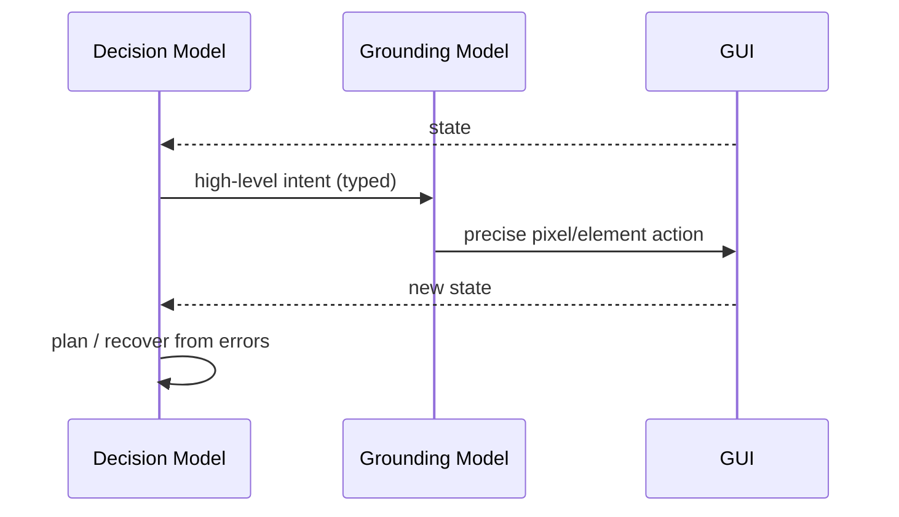

# Dual-System GUI Agent

**Also known as:** Decision-Plus-Grounding, Planner-and-Vision Split, Two-Model GUI Agent

**Category:** Tool Use & Environment  
**Status in practice:** emerging

## Intent

Split a GUI agent into a decision model that plans and recovers from errors and a grounding model that observes pixels and emits the precise action; route each subproblem to the better-suited model.

## Context

A team is operating a long, multi-step GUI workflow with an agent: a web flow that involves filling forms across half a dozen pages, or a phone app sequence that books a ride, applies a coupon, and confirms payment. The task needs flexible high-level planning (when to back out, when to retry, what to do if the form looks different than expected) and at the same time precise pixel-accurate grounding of each click.

## Problem

When one model does both planning and pixel grounding, it is dominated by whichever skill is hardest at the current step. A model strong at planning clicks the wrong menu item by a few pixels; a model strong at vision keeps trying to recover from a bad click locally instead of stepping back and replanning. Failures cannot be attributed cleanly either, since the same model is responsible for both deciding what to do and for executing it.

## Forces

- Planning skill and grounding skill are distinct in current models.
- Two models cost more per turn but can be smaller per task.
- Hand-off between models needs a clean intermediate representation.
- Error recovery has to know which model to blame.

## Therefore

Therefore: separate planning from pixel grounding behind a typed intent vocabulary, so that each subproblem runs on the model best suited to it and failures route back to the planner for recovery instead of being retried blind.

## Solution

Define a clean intermediate representation: the decision model emits a high-level intent ("open the cart", "swipe left to next item") in a small, typed vocabulary; the grounding model receives that intent plus the current screenshot and emits the concrete action (tap(x,y), swipe coordinates, key press). The decision model holds the plan and replans on failure; the grounding model is stateless per action but specialised on screen interpretation. Errors at the grounding step are reported back to the decision model for replanning, not retried locally.

## Structure

```
Screenshot -> Decision_Model -> intent (typed) -> Grounding_Model + Screenshot -> low-level action -> device -> next Screenshot.
```

## Diagram



## Example scenario

A desktop-automation agent occasionally clicks the wrong menu item by a few pixels, and on other tasks plans well but loops endlessly trying to recover from a bad click. A single model is dominated by whichever skill is harder at the moment. The team splits it into a Dual-System GUI Agent: a strong planning model decides what to do and how to recover from errors, and a separate vision-grounding model translates 'click Save As' into the precise pixel coordinates. Each subproblem goes to the better-suited model.

## Consequences

**Benefits**

- Each model is sized to its skill; total parameters are smaller than a unified model.
- Error recovery has a clean attribution: planning vs. grounding.
- Decision-model planning generalises across desktop, web, phone; grounding model is per-surface.

**Liabilities**

- Two model calls per turn — latency and cost.
- Intent vocabulary design is a real engineering problem.
- Hand-off mistakes (decision says X, grounding hears Y) are hard to debug.

## Failure modes

- Lost in hand-off — the decision model says "open the cart" and the grounding model taps a different cart icon, and neither side notices the mismatch.
- Local retry loop — the grounding step keeps retrying a failed click instead of reporting back, so the decision model never gets the chance to replan.
- Vocabulary too coarse — the typed intent set lacks a needed action, and the decision model squeezes it into an intent that grounds to the wrong gesture.
- Doubled latency — two model calls per step make long tasks slow enough that the screen changes between planning and action.

## What this pattern constrains

The decision model may not emit pixel-level actions; the grounding model may not change the plan or invent intents outside the typed vocabulary.

## Applicability

**Use when**

- A single GUI model is dominated by either planning or grounding and underperforms on the other skill.
- A clean intermediate vocabulary (open the cart, swipe left to next item) can express decisions for grounding.
- Two specialised models (decision and grounding) are available and routing between them is feasible.

**Do not use when**

- A single competent multimodal model handles both planning and grounding well enough.
- No clean intermediate vocabulary fits the task and the split would lose information.
- Routing overhead between two models exceeds the quality lift.

## Components

- Decision Model — holds the plan and emits a high-level intent in a small typed vocabulary
- Grounding Model — maps intent plus current screenshot to a concrete pixel-level or element-level action
- Intent Schema — typed intermediate representation that decouples planning from grounding
- GUI Environment — receives the action and returns the next state
- Replan Loop — returns control to the decision model when grounding fails or the state regresses

## Tools

- Specialist UI grounding VLM (SeeClick, CogAgent, or similar) — converts intent text plus screenshot to pixel coordinates
- GUI automation driver — executes the grounded action against the desktop or mobile environment

## Evaluation metrics

- Intent-to-action grounding accuracy — fraction of intents the grounding model executes correctly
- Plan-recovery rate — share of failures where the decision model successfully replans
- Cost split decision-vs-grounding — how much of total compute each role consumes
- End-to-end task success versus single-model baseline — headline value of the split
- Latency per step — added overhead of routing through two models per action

## Known uses

- **[AutoGLM (Zhipu)](https://xiao9905.github.io/AutoGLM/)** _available_ — Decision model (GLM-4.7) plus grounding/vision model; web and Android variants.
- **Mobile-Agent-v2** _available_ — Three-agent variant: planning + decision + reflection.

## Related patterns

- _specialises_ **Computer Use**
- _specialises_ **Browser Agent**
- _complements_ **Mobile UI Agent**
- _uses_ **Multi-Model Routing**
- _uses_ **Structured Output**
- _generalises_ **Policy-Localizer-Validator**
- _alternative-to_ **Talker-Reasoner**
- _alternative-to_ **Two-Rate Cloud-Brain / Edge-Controller Split** — The GUI split routes by subproblem (planning vs pixel grounding) with no timing invariant; here the split is by clock rate and the fast loop must hold its control deadline.
- _complements_ **Foveated Perception Escalation** — That splits planning from grounding across two models; this iterates observation scale inside whichever component perceives, and fits on either side of that split.

## References

- [AutoGLM: Autonomous Foundation Agents for GUIs](https://arxiv.org/abs/2411.00820) — 2024
- [Mobile-Agent-v2: Mobile Device Operation Assistant with Effective Navigation via Multi-Agent Collaboration](https://arxiv.org/abs/2406.01014) — Wang et al., 2024
