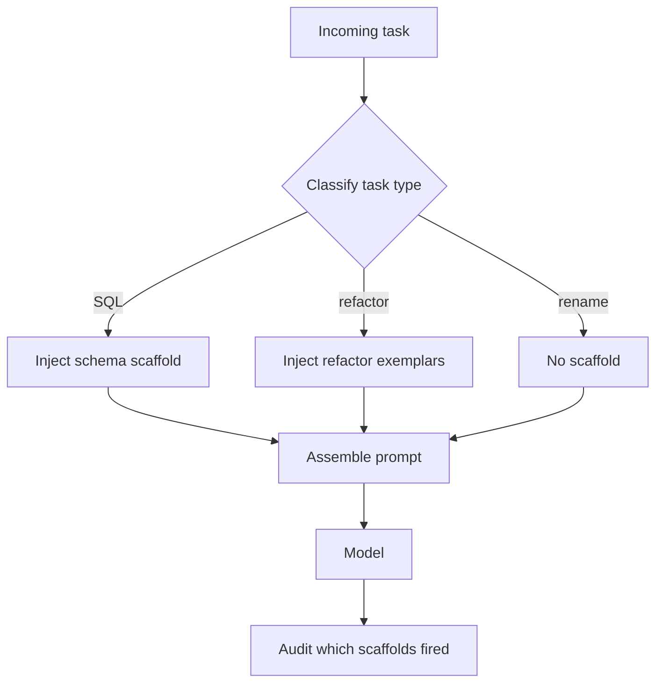

# Dynamic Scaffolding

**Also known as:** Adaptive Prompting, Just-in-Time Context

**Category:** Routing & Composition  
**Status in practice:** emerging

## Intent

Inject task-specific scaffolding (examples, hints, schemas) into the prompt only when the task type warrants it.

## Context

A general-purpose agent handles a wide range of task types in one product — answering free-text questions, writing or refactoring code, querying databases, transforming structured documents. Some of those tasks benefit a lot from extra material in the prompt such as worked examples, output schemas, or domain hints, while others are trivial and need none of it. The same prompt is shared across every request unless the team does something about it.

## Problem

If the prompt always carries the full scaffolding library, easy requests waste tokens on examples they never needed and sometimes the irrelevant examples push the model toward a wrong shape of answer. If the prompt always carries nothing, the model under-performs on the hard cases that genuinely benefit from few-shot examples or explicit schemas. A single static prompt forces the team to choose between overshooting cost on easy tasks and undershooting quality on hard ones.

## Forces

- Detection of when scaffolding helps is itself a problem.
- Scaffolding library curation effort.
- Compositional scaffolding (multiple scaffolds in one prompt) interacts unpredictably.

## Therefore

Therefore: classify the task at runtime and load only the scaffolds keyed to its type, so that each prompt carries the help it needs and nothing more.

## Solution

Maintain a library of scaffolds (few-shot examples, schemas, hints) keyed by task type or feature. At runtime, classify the task and inject the matching scaffolds. Audit which scaffolds fired per request.

## Structure

```
Incoming task --> Task classifier --task type--> Scaffold library lookup --matched scaffolds (or none: bare prompt)--> Prompt assembler --> Model --> Answer; Audit log records which scaffolds fired
```

## Diagram



## Example scenario

A general-purpose coding assistant carries 4k tokens of examples, schemas, and hints in its prompt for every request, including 'rename this variable'. The scaffolding burns tokens on trivial tasks and is sometimes misleading. The team uses Dynamic Scaffolding: a lightweight classifier identifies the task type and only injects the relevant scaffolding — schemas for SQL tasks, refactor exemplars for refactor tasks, nothing extra for renames. Token cost drops on easy tasks and hard tasks get richer help than before.

## Consequences

**Benefits**

- Token efficiency.
- Targeted quality lift on hard cases.

**Liabilities**

- Scaffold library maintenance.
- Misclassification injects wrong scaffolds.

## Failure modes

- Wrong scaffold — the task classifier mislabels a request, and the injected examples push the model toward the wrong shape of answer.
- Scaffold pile-up — several scaffolds match one request, they conflict in the same prompt, and output quality drops in ways that are hard to trace.
- Rotting library — scaffolds are never pruned against the audit log, so stale examples keep firing after the task they served has changed.
- Silent default — low-confidence classification falls to the bare prompt on a hard task that needed the schema, and nothing flags the gap.

## What this pattern constrains

Scaffolds load only on matching task classification; default tasks see the bare prompt.

## Applicability

**Use when**

- Some tasks need few-shot examples, schemas, or hints and others do not — static prompts overshoot or undershoot.
- A library of scaffolds keyed by task type or feature can be maintained.
- Task classification at runtime is reliable enough to route the right scaffold.

**Do not use when**

- All tasks are similar enough that one static prompt suffices.
- Task classification is unreliable and wrong scaffolds would confuse the model.
- Scaffold library maintenance cost exceeds the prompt-quality gain.

## Components

- Task classifier — labels the incoming request with a task type used as scaffold key
- Scaffold library — versioned store of few-shot examples, schemas, and hints keyed by task type
- Prompt assembler — composes the base prompt with the matched scaffolds for this request
- Audit log — records which scaffolds fired per request so the library can be evaluated and pruned
- Default path — bare prompt taken when no scaffold matches or classification is low-confidence

## Tools

- Lightweight classifier model or rule engine — labels the task cheaply before the main call
- Prompt-template engine — Jinja, DSPy signatures, or equivalent, with scaffold injection points
- LLM API — primary inference with the assembled prompt

## Evaluation metrics

- Per-task-type quality lift over bare-prompt baseline — does the scaffold actually help its class
- Token overhead per request — extra tokens the scaffold added vs the bare prompt
- Misclassification rate — fraction of requests routed to a scaffold that did not apply
- Scaffold-firing distribution — which scaffolds dominate, which are dead and removable
- Quality regression on default path — confirms unclassified traffic is not made worse

## Known uses

- **Avramovic Dynamic Scaffolding pattern** _available_
- **DSPy compiled prompts (signature-driven scaffolding)** _available_

## Related patterns

- _uses_ **Routing**
- _complements_ **Context Window Packing**
- _complements_ **Agent Skills**
- _complements_ **Prompt/Response Optimiser**
- _alternative-to_ **Scaffold Ablation on Model Upgrade** — Dynamic scaffolding injects support per task at runtime; scaffold ablation removes support across model generations.
- _complements_ **Hint Ladder** — Dynamic scaffolding injects scaffolds by task type; the hint ladder varies help specificity by the learner's per-attempt progress within one task.
- _complements_ **Productive Struggle Erosion** — Just-in-time scaffolding is part of the corrective; struggle erosion is what happens when help is maximal instead of scaffolded to the learner's need.

## References

- [zeljkoavramovic/agentic-design-patterns](https://github.com/zeljkoavramovic/agentic-design-patterns)
