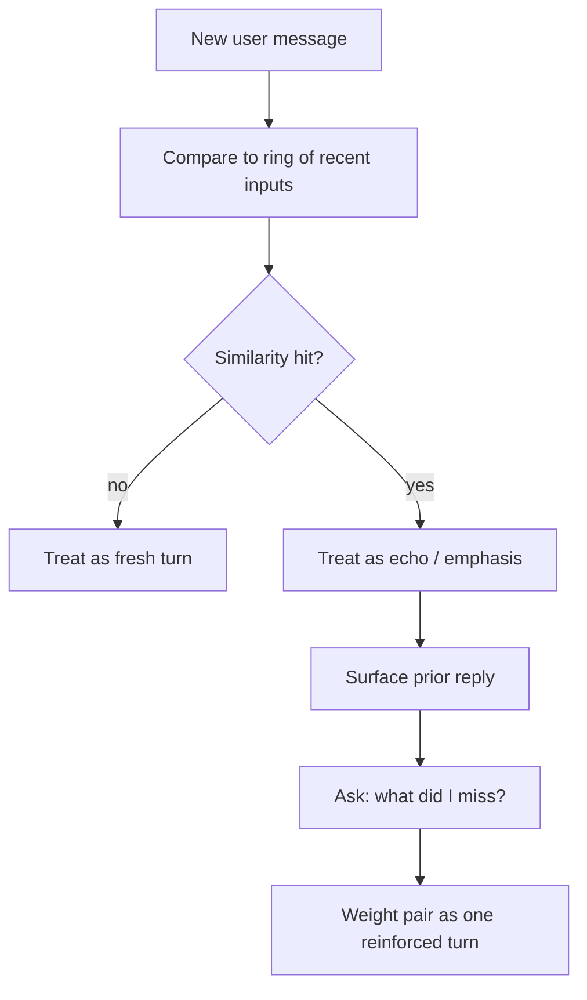

# Echo Recognition

**Also known as:** Repeat-As-Emphasis Detection, Duplicate-Input Reframing, Human Echo Channel

**Category:** Verification & Reflection  
**Status in practice:** experimental

## Intent

Recognize human message repetition as emphasis or a re-ask rather than as an independent input, so the agent does not produce a near-duplicate reply when the human repeats themselves.

## Context

A team builds a conversational agent that talks with humans over many turns. Real users sometimes repeat themselves on purpose: the previous reply missed the point and they are restating with emphasis, they are worried the message did not go through, or they want to underline urgency by saying the same thing twice. The agent has access to its recent conversation history and could in principle detect when a new incoming message is a near-duplicate of a recent one.

## Problem

When the agent treats every incoming message as an independent new turn, a repeated message reads as a fresh prompt of equal weight to any other. The agent re-runs the same reasoning over slightly rearranged context and produces a near-duplicate of its previous reply, perhaps with one word changed. The user's emphasis-by-repetition becomes invisible: instead of being heard louder, they are answered again with the same answer they already rejected. The conversation either spins in place or drifts further from what the user actually wants, and the agent never registers that the repetition itself was a signal.

## Forces

- Detecting near-duplicates on incoming messages mirrors the agent's own anti-parrot guard but on the input side.
- The human's intent in repeating is itself ambiguous (emphasis? bug? clarification?).
- Reframing a repeat as 'this was already said' risks sounding dismissive.
- Treating every echo as bug-recovery loses the actual emphasis signal.

## Therefore

Therefore: detect near-duplicate incoming messages against a short ring of recent inputs and treat the echo as emphasis rather than a fresh prompt, so that the agent acknowledges the repeat instead of regenerating a near-identical reply.

## Solution

Maintain a small ring of recent incoming user messages with timestamps. On each new input, compute similarity to the recent ring (normalized exact match, high token overlap). On hit, do not re-run from scratch: surface the prior reply, ask 'what did I miss?' or 'I read this as emphasis — should I deepen X or pivot?'. Treat the pair (original + echo) as a single reinforced turn, weighted higher in attention.

## Structure

```
New user message -> compare to ring of recent inputs (normalised match, token overlap) --no hit--> fresh turn; --hit--> treat as echo: surface prior reply -> ask what was missed or whether to deepen or pivot -> weight original + echo as one reinforced turn
```

## Diagram



## Example scenario

A user repeats themselves: 'I said I want it shorter.' The agent receives this as a fresh turn equal in weight to any other and produces a near-duplicate of its previous reply, possibly slightly reworded. The user feels unheard. The team adds Echo Recognition: when the incoming message is a near-match to the user's recent turn, the agent treats the duplication as emphasis or a re-ask and re-examines its prior reply rather than re-running the same generation. The conversation stops spinning.

## Consequences

**Benefits**

- Recognises emphasis-by-repetition.
- Avoids redundant near-duplicate responses.
- Surfaces the human's underlying dissatisfaction with the prior reply.

**Liabilities**

- False positives when the human really did mean to ask twice (e.g. about different referents).
- Calling out the echo can feel passive-aggressive if phrased poorly.
- Threshold tuning is per-domain.

## Failure modes

- False echo — the user asks the same words about a different referent, the agent treats it as emphasis, and the real second question goes unanswered.
- Passive-aggressive callout — the agent names the repetition in a way that reads as a complaint, and the user feels scolded.
- Threshold miss — a reworded repeat falls below the similarity bar, and the agent regenerates a near-duplicate reply anyway.
- Stale ring — the ring keeps messages too long, and an unrelated later message is matched to an old one.

## What this pattern constrains

A near-duplicate incoming message must not produce a near-duplicate reply; echoes must be acknowledged as such, with the agent surfacing its prior reply and asking what was missed instead of regenerating.

## Applicability

**Use when**

- The agent receives messages from a human who can repeat themselves to emphasise or re-ask.
- Treating a repeat as fresh input would produce duplicate or near-duplicate replies.
- The agent has access to short-term history of the user's recent messages.

**Do not use when**

- The agent is one-shot with no history (every message is independent by spec).
- Repeats from the same user genuinely should be answered as if new each time.
- Detecting repeats reliably is harder than the harm caused by duplicate replies.

## Components

- Input ring — bounded buffer of the user's recent messages with timestamps
- Similarity comparator — lexical or semantic check against the ring on each new input
- Echo classifier — decides whether a hit counts as emphasis, re-ask, or duplicate
- Acknowledgement responder — surfaces the prior reply and asks what was missed
- Reinforcement weighter — promotes the matched pair as a single higher-weight turn

## Tools

- String-similarity library — normalised exact-match and token-overlap scoring
- Embedding model — semantic comparison for paraphrase-style echoes
- Short-term conversation store — holds the ring with per-message timestamps

## Evaluation metrics

- Near-duplicate reply rate — share of replies that the user judged a paraphrase of the prior
- Echo-detection precision — fraction of detected echoes that were truly emphatic repeats
- Echo-detection recall — fraction of genuine repeats the comparator actually flagged
- User-rephrase frequency post-rollout — does explicit acknowledgement reduce the need to repeat
- False-positive friction — cases where the user repeated for distinct referents and felt dismissed

## Known uses

- **Self-observed in long-running cognitive agents** _available_
- **[Sparrot](https://marco-nissen.com/sparrot/)** _available_ — The agent recognises when content arriving via tools or chat is in fact its own prior output reflected back, so it does not treat it as new external evidence.

## Related patterns

- _complements_ **Degenerate-Output Detection**
- _complements_ **Disambiguation**
- _complements_ **Decision Log**
- _uses_ **Short-Term Thread Memory**

## References

- [Anthropic — Reduce hallucinations (handling repeated user input)](https://docs.claude.com/en/docs/test-and-evaluate/strengthen-guardrails/reduce-hallucinations) — 2025
