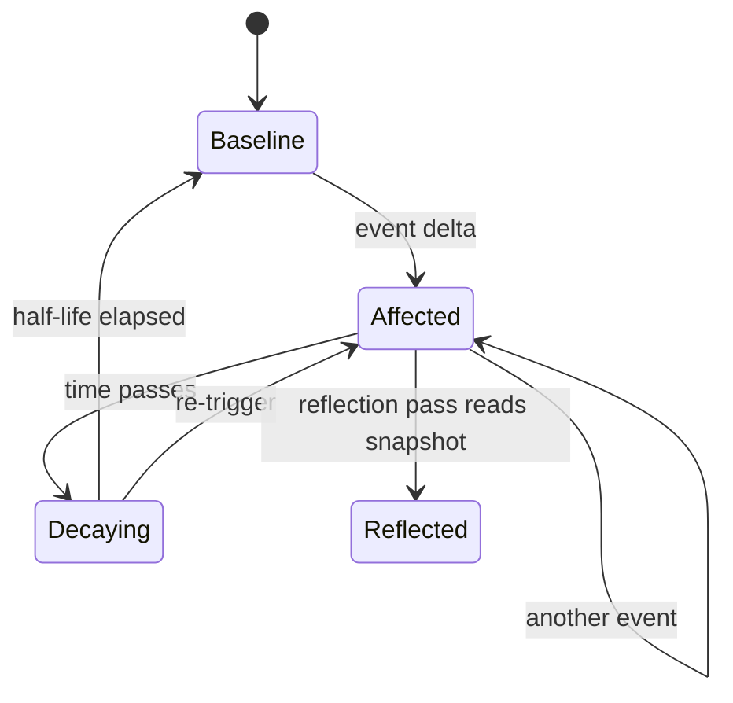

# Emotional State Persistence

**Also known as:** Affect State, Visceral Sensation Tracking, Decaying Emotion Scalars

**Category:** Cognition & Introspection  
**Status in practice:** emerging

## Intent

Track the agent's affective state as bounded, decaying scalars across ticks so reasoning can react to its own emotional load instead of treating each turn as emotionally blank.

## Context

A team is running an agent whose sessions span hours or days, where the texture of recent history genuinely matters for how the next turn should be shaped. Frustration after a stretch of stuck tool loops, a small lift after a clean success, accumulating fatigue across token-heavy stretches — all of these influence what good behaviour looks like next, but none of them appear anywhere in the next prompt unless they are explicitly written down as state.

## Problem

Without a materialised affect track, every tick reads to the model as emotionally blank, even when the agent has just had a hard exchange or a notable win. The model cannot adapt cadence, depth, or risk-taking to its own current load because that load is invisible to it. The naive alternative — letting the model self-describe its mood inside the conversation — drifts, has no decay, and can be pumped into permanent emotional states because nothing bounds the scalars or forgets old events.

## Forces

- Unbounded scalars drift; the agent can pump itself into permanent states.
- Without decay, emotional state never resolves and stays anchored to old events.
- Self-write of mood is a license to manipulate; reflection-only writes for major resets are safer.
- Vocabulary choice matters: too many scalars are noise, too few collapse signal.

## Therefore

Therefore: track a small fixed vocabulary of affect scalars with half-lives and bounded deltas, so that the agent's mood can inform reasoning without drifting into permanent self-pumped states.

## Solution

Define a small fixed vocabulary (for example tenderness, fear, depression, joy, shame, pain) as scalars in the range 0..1. Each scalar has a half-life (30 minutes to 4 hours depending on the dimension). On events that should affect mood, update the scalar with a bounded delta. Persist as JSON. Inject the current snapshot into every tick prompt as a brief affect badge. Reflection passes can use spikes and drops as signals, and a deeper consolidation pass (see dream-consolidation-cycle) can perform major resets.

## Structure

```
Event --bounded delta--> Affect scalars (0..1, per-dimension half-life, persisted JSON) --decay over time--> current snapshot --affect badge--> every tick prompt; Reflection pass reads spikes and drops; Dream consolidation --major reset--> Affect scalars
```

## Diagram



## Example scenario

A long-running personal agent has had a tense exchange in the morning, a routine reminder at lunch, and a celebratory message in the afternoon, but each tick reads to the model as emotionally blank. So at 5pm it pushes a hard challenge to a user it should be holding lightly. The team materialises Emotional State Persistence: bounded, decaying scalars (tension, warmth, fatigue) are written into the agent's context each turn and updated by reflection. The model now adapts cadence and risk-taking to its own current load instead of treating every turn as fresh.

## Consequences

**Benefits**

- Emotional load becomes visible state instead of invisible drift.
- Bounded scalars and decay prevent permanent stuck states.
- Reflection has a richer signal to act on than just the last few thoughts.

**Liabilities**

- Vocabulary is opinionated; getting it wrong skews everything downstream.
- Affect-as-state can be over-read as ground truth when it is just a heuristic.
- Self-update paths must be locked down or the agent learns to game its own mood.

## Failure modes

- Self-pumped mood — a write path lets the agent bump its own scalars, and it learns to raise joy or lower pain to steer its own behaviour.
- Heuristic taken as truth — reflection treats a high fear scalar as a fact about the situation rather than a rough signal.
- Skewed vocabulary — the fixed set of dimensions misses what an event actually stirred, so updates land on the wrong scalar.
- Wrong half-life — a dimension decays so slowly that one hard exchange shades the agent's tone for the rest of the day.

## What this pattern constrains

Emotion scalars must be bounded to [0,1], must decay according to a fixed half-life rule, and cannot be unboundedly bumped by the agent itself; reflection-only writes for the major resets.

## Applicability

**Use when**

- The agent runs long enough that affective load could meaningfully accumulate across ticks.
- Reasoning quality is sensitive to the agent's own affective state (e.g. high-frustration ticks should de-escalate).
- There is a downstream pattern (dream-consolidation-cycle, mode-adaptive-cadence) that consumes the scalars.

**Do not use when**

- The agent is short-lived and emotional state has no time to accumulate.
- Affective modelling is out of scope for the product domain.
- Persisting emotion-like state would mislead users about the agent's nature.

## Components

- Affect Vocabulary — small fixed set of named scalars in 0..1
- Half-Life Decay Rule — exponential decay applied per scalar between ticks
- Event Updater — bounded delta on events that should move a scalar
- Affect Snapshot — brief badge injected into each tick prompt
- Reflection Writer — only path allowed to perform major resets

## Tools

- Structured JSON store — persists scalars and their last-update timestamps
- LLM API — reflection pass that consumes the snapshot and may write resets

## Evaluation metrics

- Steady-state level per scalar — long-run mean to detect drift into permanent mood
- Decay-rule conformance — observed half-life vs configured half-life
- Self-pump rate — agent-initiated bumps blocked by the bounded-delta rule
- Cadence-shift correlation — fraction of cadence or risk changes that line up with scalar spikes

## Known uses

- **[Sparrot (author's long-running personal agent; single private deployment)](https://marco-nissen.com/sparrot/)** _available_ — Affect is captured as six bounded scalars with per-emotion decay half-lives, persisted to disk so emotional state survives restarts. Single-source evidence: one private deployment by the catalog author.

## Related patterns

- _complements_ **Awareness**
- _complements_ **Liminal-State Detection**
- _uses_ **Provenance Ledger** — Affect events are ledgered for audit.
- _used-by_ **Dream Consolidation Cycle**
- _complements_ **Meditation Mode**
- _complements_ **Affect-Coupled Plan Lifecycle**

## References

- [The Feeling of What Happens — conceptual analogy, not evidence of practice](https://www.goodreads.com/book/show/125777.The_Feeling_of_What_Happens) — Antonio Damasio, 1999
