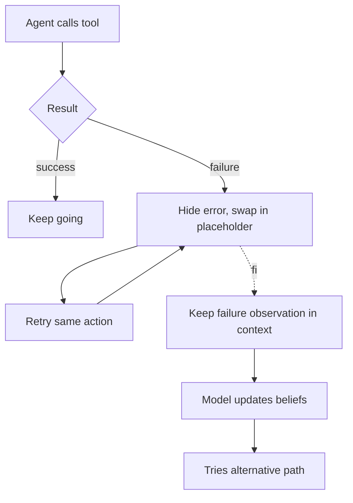

# Errors Swept Under the Rug

**Also known as:** Error Hiding, Failure Erasure, Clean Trace Anti-Pattern

**Category:** Anti-Patterns  
**Status in practice:** deprecated

## Intent

Anti-pattern: scrub failed actions, stack traces, and error observations from the agent's own context so the trace looks clean, leaving the model with no evidence of what did not work.

## Context

An agent takes many tool actions per task and naturally accumulates failures — a tool returns an HTTP 500, a command exits non-zero, an API call is rejected. The team wants short, tidy prompts and clean-looking transcripts, so the wrapper either retries silently, replaces the failed tool output with a generic placeholder like 'retrying...', or strips stack traces before they ever reach the model's context. The intent is usually a mix of cosmetics, token economy, and a feeling that errors are noise.

## Problem

The error message, stack trace, or rejection reason is exactly the signal the model needs to revise its plan and stop repeating the same call. When it is scrubbed before re-prompting, the agent re-attempts the failed action turn after turn, sometimes in tight loops, because nothing in its visible context contradicts the choice. After-the-fact debugging is also harder, because the transcript no longer shows whether a run succeeded cleanly or was salvaged across several hidden failures.

## Forces

- Failed turns inflate context length and look untidy in transcripts.
- Retries are easier to log as a single clean event than as fail-then-retry.
- Models are sensitive to recency and adapt when they see the wrong turn explicitly.
- Compliance reviewers may misread visible errors as system bugs rather than agent learning.

## Therefore

Therefore: keep failed actions, stack traces, and rejection messages in the agent's own context as first-class observations, so that the model has the evidence it needs to update its beliefs and avoid repeating the failed path.

## Solution

Don't. Treat failure observations as load-bearing context, not noise. Preserve stack traces, tool-error returns, and rejection messages in the agent's running transcript. Compress only after the run is done, not mid-loop. See decision-log and provenance-ledger for keeping the audit trail separate from the working context.

## Structure

```
Anti-pattern: tool call fails -> error scrubbed from context -> agent sees no failure -> repeats same call. Corrected: tool call fails -> error kept in transcript -> agent revises plan -> compress only after run ends; audit trail kept separately.
```

## Diagram



## Example scenario

An ops agent calls a deployment tool that fails with a 500. The wrapper catches the error, replaces the failed observation with a generic 'retrying...' string, and lets the agent try again. The agent retries the same call eight times because the context shows eight clean attempts in progress and no evidence that anything is wrong. The team flips the policy: the failed response body, status code, and stack trace are inserted verbatim into the agent's transcript. On the next run the agent reads the 500, switches to the documented fallback endpoint, and succeeds in two steps.

## Consequences

**Benefits**

- Short-term: a transcript without errors looks tidy, uses fewer tokens, and reads well in demos.
- Naming it lets a team treat failure observations as context the agent needs.

**Liabilities**

- Agent repeats the same failed action because no evidence of failure persists.
- Loop-detection heuristics misfire because the surface trace looks like progress.
- Post-incident analysis cannot distinguish a clean run from a salvaged run.

## Failure modes

- Repeat loop — the error from a failed tool call is removed from context, so the agent tries the same call again turn after turn.
- Fake progress — the cleaned transcript looks like steady progress, so loop detection does not fire.
- Hidden salvage — post-incident review cannot tell a clean run from one rescued after several hidden failures.

## What this pattern constrains

Avoiding it imposes a context-hygiene rule: failure observations (stack traces, tool errors, rejections) must not be scrubbed from the running transcript mid-loop; compression may happen only at run boundaries.

## Applicability

**Use when**

- Cite this entry when a trace-cleanup step removes failed actions so runs look tidy.
- You are already here if the model repeats an action that just failed because the failure left no evidence in context.
- Keep failure observations in the running transcript and compress only at run boundaries (see decision-log, provenance-ledger).

**Do not use when**

- Always do not use. There is no scenario in which scrubbing failure evidence from the agent's own context helps the agent.
- Cosmetic transcript cleanliness is not a reason to delete failure observations — separate the audit trail from working context instead.

## Components

- Tool-wrapper layer — silently retries or substitutes a placeholder when a tool call fails
- Agent transcript — shows only clean-looking turns because failure observations were stripped
- Retry loop — re-issues the same failed call because nothing in context contradicts it
- Post-hoc compression step — folded into the running loop instead of running at run boundaries

## Tools

- Failed tool response — the load-bearing observation that gets discarded before re-prompting
- Stack trace and rejection body — the verbatim signal the model needs but never sees

## Evaluation metrics

- Repeated-call rate — fraction of runs that re-issue an identical failed tool call within a single task
- Failed-observation retention rate — share of tool errors that survive in the working context until run end
- Retry-to-recovery ratio — how many retries happen before the agent switches strategy; high values fire the anti-pattern
- Salvaged-run share — fraction of runs whose transcript hides one or more failed turns from post-incident review

## Known uses

- **[Manus (named as a deliberate design rejection)](https://manus.im/blog/Context-Engineering-for-AI-Agents-Lessons-from-Building-Manus)** _available_ — Manus's context engineering essay explicitly argues against hiding failed actions; the team leaves wrong turns in context so the model updates its internal beliefs.

## Related patterns

- _alternative-to_ **Decision Log**
- _alternative-to_ **Provenance Ledger**
- _alternative-to_ **Replan on Failure**
- _complements_ **Unbounded Loop**
- _complements_ **Demo-to-Production Cliff**
- _alternative-to_ **Rigor Relocation**
- _complements_ **Hidden State Coupling**
- _complements_ **Observability Fail-Open** — That anti-pattern swallows an error that did occur; this returns a false-healthy reading when the monitoring itself could not run, so there is not even an error to swallow.
- _complements_ **Fail-Plausible Narration** — Scrubbing error observations from the context is the upstream enabler: a model that never sees the failure has nothing to narrate except the happy path.

## References

- [Context Engineering for AI Agents — Lessons from Building Manus](https://manus.im/blog/Context-Engineering-for-AI-Agents-Lessons-from-Building-Manus) — Yichao 'Peak' Ji, 2025
