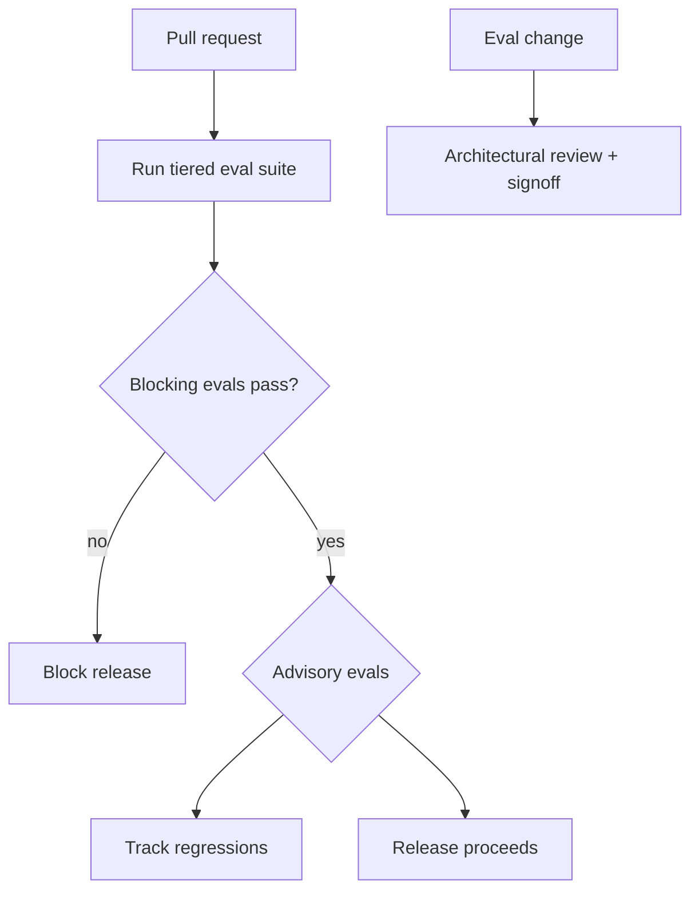

# Eval as Contract

**Also known as:** Test-Driven Agent, Eval-Gated Release

**Category:** Governance & Observability  
**Status in practice:** mature

## Intent

Treat the eval suite as the contract the agent must satisfy; releases ship only if evals pass.

## Context

A team ships an agent to real users and is expected to keep a stable quality bar release after release. They have an evaluation suite — a held-out set of inputs paired with expected outputs or rubric checks — that already gives them a numeric read on quality. Stakeholders such as product, customers, and compliance depend on that bar holding from one release to the next.

## Problem

If the eval suite is something the team runs by hand and looks at when they remember to, regressions slip through silently: a prompt tweak goes out on Tuesday, the eval suite is not run, and by Thursday quality has dropped without anyone noticing. The suite turns into aspirational documentation rather than an actual constraint on releases. The team is forced to choose between trusting vibes between deploys or treating the eval suite the way they would treat a failing unit test.

## Forces

- Contract authoring is up-front work.
- Eval-suite drift if not maintained.
- Calibration: which evals are blocking, which are advisory.

## Therefore

Therefore: split the eval suite into blocking and advisory tiers and wire the blocking tier into CI as a release gate, so that quality regressions stop a release the same way a failing test does.

## Solution

Define a tiered eval suite: blocking evals (must pass for release), advisory evals (tracked but not blocking). Wire blocking evals into CI. Block PRs and releases when blocking evals fail. Treat eval changes as architectural changes (review, signoff).

## Structure

```
Pull request --> CI runs tiered eval suite --> Blocking evals pass? --no--> Block release (or recorded operator override) / --yes--> Advisory evals --> Track regressions + Release proceeds; Eval change --> Architectural review + signoff --> Eval suite
```

## Diagram



## Example scenario

A team improves their support agent's planning prompt and ships the change on a Tuesday. By Thursday, the agent's tool-selection accuracy on three known regressions has dropped, but no one notices because there's no gate. They adopt Eval-as-Contract: the held-out eval suite is treated as the release contract — every PR runs it, and any regression below threshold blocks the deploy. The eval suite stops being optional documentation and starts being the thing the agent has to satisfy.

## Consequences

**Benefits**

- Quality bar is enforced, not aspirational.
- Eval suite earns its seat by being load-bearing.

**Liabilities**

- Bad evals block legitimate releases.
- Calibration is empirical.

## Failure modes

- Wrong blocking eval — a badly written blocking eval fails on correct behaviour, and a legitimate fix sits blocked until someone overrides it.
- Override habit — the bypass path becomes routine, and releases ship past failing blocking evals with only a recorded click.
- Advisory graveyard — important checks get filed as advisory to avoid blocking, and their regressions pile up in a tracker nobody reads.
- Quiet suite edit — a blocking eval is loosened in the same pull request that would have failed it, without the review that suite changes require.

## What this pattern constrains

Releases are forbidden when blocking evals fail; bypassing requires explicit operator override.

## Applicability

**Use when**

- An eval suite exists that can be tiered into blocking and advisory.
- CI can be wired so blocking eval failures actually prevent release.
- The team is willing to treat eval changes as architectural changes (review and signoff).

**Do not use when**

- There is no eval suite robust enough to gate releases on.
- Blocking-eval failures would be routinely overridden, hollowing out the contract.
- Release cadence cannot tolerate blocking gates and a softer signal is preferred.

## Components

- Tiered Eval Suite — blocking evals that must pass and advisory evals that are tracked
- CI Release Gate — refuses to merge or deploy when blocking evals regress
- Eval-Change Reviewer — treats changes to the suite itself as architectural changes requiring signoff
- Override Path — explicit operator-recorded bypass when a blocking eval is wrong
- Advisory Tracker — surfaces non-blocking regressions for follow-up without halting release

## Tools

- CI runner (GitHub Actions, Buildkite) — executes the blocking tier on every PR and release
- Eval framework (Ragas, DeepEval, Langfuse Evals, Inspect AI) — scores the suite
- Prompt and code registry — pins the version under test to the eval result

## Evaluation metrics

- Blocking-eval pass rate at release — share of releases that cleared the gate without override
- Override-bypass count — explicit operator overrides per quarter (signals miscalibration)
- Regressions caught pre-release — issues blocked by the contract that would have shipped otherwise
- Advisory-to-blocking promotion rate — how often an advisory eval is promoted after proving itself
- Mean time to fix a failing blocking eval — release-gate latency cost

## Known uses

- **AI-Standards Eval as Contract pattern** _available_

## Related patterns

- _specialises_ **Eval Harness**
- _complements_ **Shadow Canary**
- _conflicts-with_ **Perma-Beta**
- _used-by_ **Prompt Versioning**
- _complements_ **Automatic Workflow Search**
- _alternative-to_ **Demo-to-Production Cliff**
- _alternative-to_ **Agentic Skill Atrophy**
- _alternative-to_ **Agentic Debt**
- _used-by_ **Rigor Relocation**
- _complements_ **Own Your Prompts (12-Factor Agents)**
- _complements_ **Stochastic-Deterministic Boundary (SDB)**
- _complements_ **Demo-Production Cliff (Multi-Agent)**
- _complements_ **Red-Team Sandbox Reproduction**
- _complements_ **Intermediate Artifact Evaluation**
- _used-by_ **Scaffold Ablation on Model Upgrade** — Used as the gate that decides whether a harness component's assumption has expired before it is ablated.
- _generalises_ **Re-Contact-Subtracted Resolution Gate** — Eval as Contract gates releases on a passing eval suite in general; this specialises that gate to the support domain by making a re-contact-subtracted resolution rate the contract a deployment must satisfy.
- _alternative-to_ **Compliance-Certified Launch Gate** — Eval-as-contract gates release on the operator's own internal eval suite; this gate substitutes an external regulator's published standard and a filing the operator does not author.
- _complements_ **Silent Hypotheses in Generated Code** — Treating the eval suite as the release contract counters the false assurance of a happy-path-only suite that shares the code's hidden premise.
- _complements_ **Behavior-Pinning Test Before Agent Edit** — Eval-as-contract treats the suite as the release gate going forward; this pattern seeds that contract with a behaviour-preserving baseline frozen before the agent touches the code.
- _complements_ **Agent Liability Insurance** — Eval-as-contract gates releases on an eval suite agreed with the customer; here a third party with capital at stake audits the controls and enforces the contract through premiums and coverage.
- _complements_ **Chance-Corrected Judge Validation** — If the eval suite is the release contract, the judge behind it needs a published agreement number before it can hold that contract.

## References

- [ai-standards/ai-design-patterns (Eval as Contract)](https://github.com/ai-standards/ai-design-patterns)
