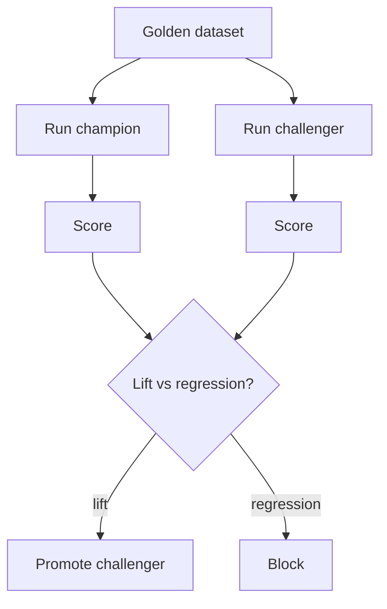

# Eval Harness

**Also known as:** Golden Dataset Suite, Champion-Challenger, Regression Suite

**Category:** Governance & Observability  
**Status in practice:** mature

## Intent

Run a held-out dataset against agent versions to detect regressions and measure improvement.

## Context

A team is iterating on an agent whose outputs depend on a prompt, a model version, retrieval choices, and tool wiring — none of which is deterministic in the way a normal function is. Small changes anywhere in that stack can shift behaviour in ways that are not obvious from a few hand-tested examples. The team needs a way to compare a proposed version against the current one on a fixed, representative set of inputs.

## Problem

When the team relies on intuition or a handful of spot checks, a change that 'feels better' on three examples can quietly regress on the dozens of cases nobody re-ran. Open-ended outputs cannot be checked with simple exact-match assertions, so without a deliberate scoring approach there is no shared yardstick. The team is forced to choose between shipping by feel and reading user complaints, or running ad-hoc one-off comparisons that never accumulate into a baseline.

## Forces

- Dataset construction is expensive and ages.
- Judging open-ended outputs needs a metric or judge.
- Champion-challenger is fairer but doubles cost.

## Therefore

Therefore: run a held-out golden dataset against both the current champion and any proposed challenger before promotion, so that regressions are caught on a fixed yardstick rather than detected in production.

## Solution

Build a golden dataset of (input, expected output) pairs. Run candidate versions against the dataset; score each. Compare champion (current) against challenger (proposed). Promote on quality lift, blocked on regression. Re-run on every meaningful change.

## Structure

```
Golden dataset (input, expected output) --> Champion runner + Challenger runner --> Scorer (exact match / similarity / LLM-as-judge) --> Promotion gate (lift vs regression within tolerance) --lift--> Promote challenger / --regression--> Block
```

## Diagram



## Example scenario

A team intuits that switching from one model to another 'feels better' for their RAG agent and pushes the change. Two days later, users complain that summaries are now missing key facts. They build an Eval Harness: a held-out dataset of representative queries, a scoring function for each, and a runner that scores any candidate version. Now changes that 'feel better' get a number; the regression on factual recall would have been visible before deploy.

## Consequences

**Benefits**

- Quality becomes measurable, comparable, and trendable.
- Releases gain a quantitative gate.

**Liabilities**

- Dataset bias means high scores can hide real-world failures.
- LLM-as-judge has its own calibration cost.

## Failure modes

- Unrepresentative golden set — the dataset covers easy or old cases, so the challenger scores higher while real users hit failures the set never tests.
- Judge drift in the scorer — the LLM-as-judge scorer shifts between runs, and a score gap between champion and challenger reflects the scorer, not the agent.
- Tolerance too loose — the regression tolerance is wide enough that a real drop on a subset of items passes as noise.
- Skipped re-run — a change is judged too small to need the harness, and the regression it carries ships unmeasured.

## What this pattern constrains

Releases are blocked if the harness flags a regression beyond tolerance.

## Applicability

**Use when**

- A change that 'feels better' is regressing quality silently in your system.
- A golden dataset of (input, expected output) pairs can be constructed.
- Champion-vs-challenger comparison drives promotion decisions.

**Do not use when**

- No expected outputs exist (open-ended creative tasks) and scoring would be subjective.
- Dataset cost or maintenance exceeds the regression risk it would catch.
- There is no release process to gate on quality lift in the first place.

## Components

- Golden Dataset — curated (input, expected output) pairs representative of the task
- Champion Runner — runs the current production version against the dataset
- Challenger Runner — runs the proposed version against the same dataset
- Scorer — applies exact-match, similarity, or LLM-as-judge scoring per item
- Promotion Gate — compares champion and challenger scores against tolerance and decides

## Tools

- Ragas — RAG-focused eval harness with reference and reference-free metrics
- DeepEval — Python eval harness with golden datasets and assertions
- Langfuse Evals — managed harness tied to trace data
- Inspect AI — eval framework for agent tasks

## Evaluation metrics

- Score lift of challenger over champion — primary promotion signal on the golden dataset
- Per-slice regression rate — items where the challenger scored worse than the champion
- Dataset coverage of production distribution — share of real-traffic categories represented in the golden set
- Dataset staleness age — time since the golden set was last refreshed
- Inter-judge agreement on scoring — calibration when LLM-as-judge is used inside the harness

## Known uses

- **Bobbin (Stash2Go)** _planned_ — Eval harness flagged as the explicit next step; in beta because of this gap.
- **Ragas, DeepEval, Langfuse Evals** _available_

## Related patterns

- _uses_ **LLM-as-Judge**
- _generalises_ **Eval as Contract**
- _complements_ **Shadow Canary**
- _alternative-to_ **Perma-Beta**
- _used-by_ **DSPy Signatures**
- _used-by_ **Agent-as-a-Judge**
- _used-by_ **Automatic Workflow Search**
- _complements_ **Scorer Live Monitoring**
- _complements_ **Dual Evaluation (Offline + Online)**
- _complements_ **Red-Team Sandbox Reproduction**
- _complements_ **Intermediate Artifact Evaluation**
- _complements_ **Agent Evaluator**
- _used-by_ **Bayesian Bandit Experimentation**
- _used-by_ **evaluation-driven-development**
- _complements_ **Sampled Prompt Trace Eval**
- _used-by_ **Dimensional Synthetic Eval Set**
- _used-by_ **Prompt Variant Evaluation**
- _alternative-to_ **Behavior-Pinning Test Before Agent Edit** — An eval harness scores held-out quality against expected outputs to track improvement; this pattern instead freezes the code's own current outputs as the must-match baseline before an edit, with no notion of better, only unchanged.
- _complements_ **Served-Policy Anchoring** — The harness decides which dataset scores a version; this pattern constrains which runtime is allowed to produce that score.
- _complements_ **As-Of Information-Set Pinning** — A held-out backtest is only valid if the graded inputs are pinned to what existed at each decision date, otherwise the harness measures hindsight.
- _used-by_ **Chance-Corrected Judge Validation** — The meta-evaluation set is a held-out dataset replayed against judge versions, so the same harness machinery scores the judge instead of the agent under test.
- _complements_ **Harness-Native Rollout Capture** — An eval harness scores a checkpoint for regression; harness-native capture supplies the training signal, and the two read the same episodes for different purposes.
- _uses_ **Mirrored Tool Environment** — A regression harness needs a responder that does not change between runs; the mirror supplies one for tools whose live endpoint would.
- _complements_ **Simulated-User Rollout Evaluation** — The harness replays a fixed set of inputs against agent versions; here the input is a live second policy that reacts to what the agent says, so the two cover different halves of a release gate.

## References

- [explodinggradients/ragas](https://github.com/explodinggradients/ragas)
- [Anthropic: Building Effective Agents (eval section)](https://www.anthropic.com/engineering/building-effective-agents) — 2024
