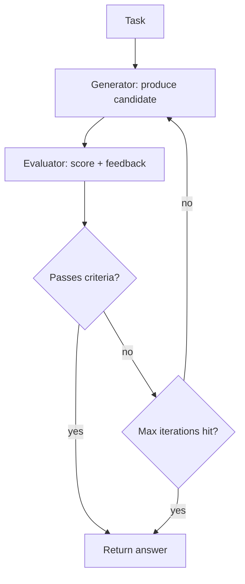

# Evaluator-Optimizer

**Also known as:** Generator-Critic Loop, LLM-as-Judge Refinement

**Category:** Verification & Reflection  
**Status in practice:** mature

## Intent

One LLM generates; another evaluates and feeds back; loop until criteria are met.

## Context

A team runs a generation task where the quality of a candidate can be scored against explicit criteria: unit tests pass or fail, a rubric is satisfied or not, a translation matches a glossary or it doesn't. Single-shot generation gets most cases right but plateaus below the quality bar the team needs. The team can afford to spend several model calls per output and is willing to trade latency for quality.

## Problem

When generation and evaluation happen in one prompt the model has no incentive to disagree with itself: it produces a draft and then signs off on it. Single-shot generation tops out below what a loop with an explicit evaluator achieves, but a naive loop where the same prompt does both jobs collapses into self-approval and adds cost without quality. The team needs separate roles for proposing and judging, and a bounded loop between them, otherwise the system either fails to improve past one pass or runs forever chasing diminishing critique.

## Forces

- The evaluator must be calibrated; a bad judge teaches bad lessons.
- Loop budget caps cost.
- Generator and evaluator can collude (especially if same model, same prompt family).

## Therefore

Therefore: split generation from evaluation into two prompts with different roles and a bounded loop between them, so that the optimizer pushes against an explicit, calibrated target rather than its own approval.

## Solution

Generator produces a candidate. Evaluator scores it against criteria with feedback. Generator revises with the feedback. Loop until evaluator passes or max iterations.

## Structure

```
Task -> Generator produces candidate -> Evaluator scores against criteria + feedback -> pass -> return; fail -> Generator revises with feedback -> repeat until pass or max iterations
```

## Diagram



## Example scenario

A code-generation agent produces a function that compiles but fails three of the team's unit tests. Single-shot generation has topped out. The team wraps the generator in an Evaluator-Optimizer loop: a second LLM (or a deterministic test runner) reads the candidate, returns specific failure feedback, and the generator revises against it. The loop runs up to five times or until tests pass. Average pass-rate on the same tasks rises substantially without changing the underlying model.

## Consequences

**Benefits**

- Quality climbs predictably with iterations.
- Evaluator can be reused as an offline regression suite.

**Liabilities**

- Cost = (generator + evaluator) x iterations.
- Convergence is not guaranteed.

## Failure modes

- Non-convergence — feedback keeps shifting between rounds, the generator chases it, and the loop exits at the cap with no better answer.
- Lenient evaluator — the evaluator passes the first draft every time, and the loop adds cost without changing output.
- Cap as success — the loop hits max iterations and returns the last candidate as if it had passed the criteria.
- Cost multiplication — both calls run on every iteration, and a high cap makes each request several times more expensive.

## What this pattern constrains

Generator outputs are accepted only after the evaluator passes; an unbounded loop is forbidden by the iteration cap.

## Applicability

**Use when**

- Single-shot generation tops out below the quality the task requires.
- An evaluator can score candidates against criteria with actionable feedback.
- Iteration budget (max iterations or pass threshold) is acceptable in the latency model.

**Do not use when**

- Single-shot generation already meets quality targets.
- No evaluator exists that can produce useful feedback on the output type.
- Latency budget allows only one generation pass.

## Components

- Generator — LLM that produces a candidate output each turn
- Evaluator — separate prompt or model that scores against criteria and emits actionable feedback
- Feedback channel — structured critique passed back into the next generation turn
- Iteration controller — caps the loop on pass-threshold or max-iterations
- Criteria specification — explicit pass conditions both roles read from

## Tools

- LLM API — at least two calls per iteration, often two different prompts or model tiers
- Test runner or rubric checker — deterministic evaluators for code-like or rule-bound tasks
- Iteration logger — records candidate, feedback, and verdict per loop for offline regression use

## Evaluation metrics

- Pass rate at iteration N — quality curve as a function of the loop budget
- Generator-evaluator collusion rate — share of passes the evaluator approved that an independent judge rejects
- Average iterations to pass — efficiency of convergence on the criteria
- Cost-per-resolved-task — (generator + evaluator) tokens divided by passing outputs
- Non-convergence rate — share of tasks that hit the iteration cap without passing

## Known uses

- **Anthropic Building Effective Agents (Workflow #5)** _available_
- **Cursor auto-fix loops** _available_
- **Cline auto-iterate** _available_
- **Aider lint-then-fix loop** _available_

## Related patterns

- _generalises_ **Reflection**
- _alternative-to_ **Best-of-N Sampling**
- _composes-with_ **Planner-Executor-Observer**
- _uses_ **LLM-as-Judge**
- _conflicts-with_ **Same-Model Self-Critique**
- _alternative-to_ **Self-Refine**
- _used-by_ **CRAG**
- _used-by_ **Dynamic Expert Recruitment**
- _complements_ **Voting-Based Cooperation**
- _generalises_ **Planner-Generator-Evaluator Harness**
- _alternative-to_ **Policy-Localizer-Validator**
- _complements_ **Blind Grader with Isolated Context**
- _complements_ **Darwin-Gödel Self-Rewrite**
- _alternative-to_ **Scorer Live Monitoring**
- _complements_ **Human Reflection**
- _alternative-to_ **Planner-Executor-Verifier (PEV)**
- _complements_ **Compound Error Degradation**
- _complements_ **Bayesian Bandit Experimentation**
- _complements_ **Prior-Estimate Anchoring** — The refinement loop is the usual carrier: it passes its own iteration state to the evaluator, and the evaluator's score is pulled toward the score it produced last time.
- _complements_ **Advisor Consult** — An evaluator critiques on a fixed loop regardless of need; the advisor speaks only when the executor asks, and can be asked for a completion check before the executor declares the task done.

## References

- [Anthropic: Building Effective Agents](https://www.anthropic.com/research/building-effective-agents) — 2024
- [Agent design pattern catalogue: A collection of architectural patterns for foundation model based agents](https://doi.org/10.1016/j.jss.2024.112278) — Yue Liu, Sin Kit Lo, Qinghua Lu, Liming Zhu, Dehai Zhao, Xiwei Xu, Stefan Harrer, Jon Whittle, 2025
