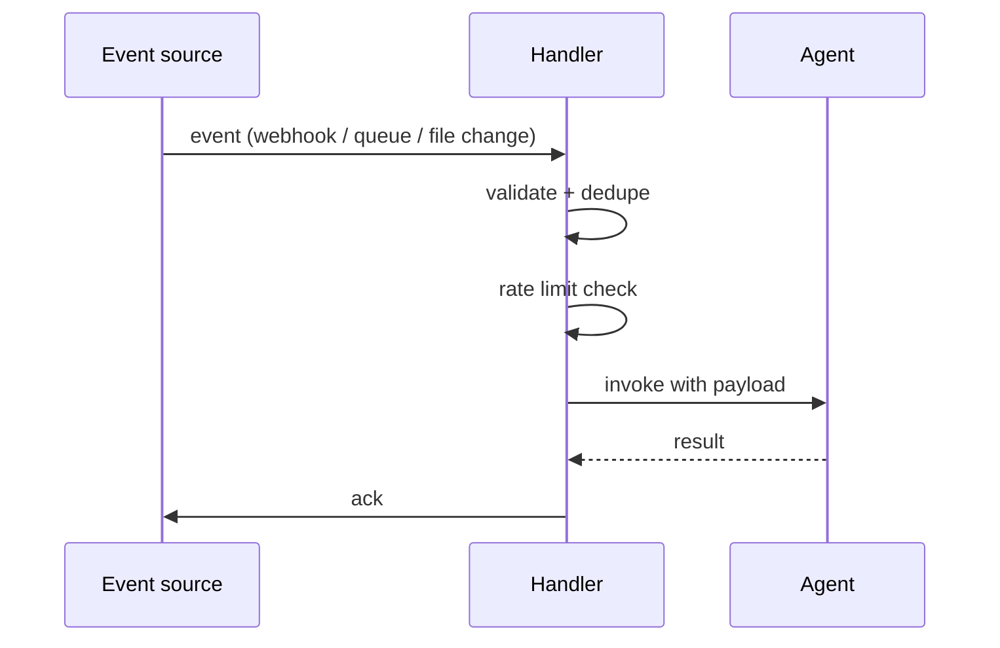

# Event-Driven Agent

**Also known as:** Event Subscriber, Reactive Agent, Webhook Agent

**Category:** Planning & Control Flow  
**Status in practice:** mature

## Intent

Trigger the agent on external events (webhooks, message queues, file changes) instead of user requests or schedules.

## Context

A team operates an agent whose job is to react to things happening in the wider system — a pull request opened on a repository, a customer message arriving in a queue, a monitoring alert firing, a file appearing in a watched folder. The work should happen when the event occurs, not when a human remembers to ask and not on a fixed schedule. An event source (webhook, message queue, file watcher) is already available or can be added.

## Problem

If the agent has to discover these events by polling a status endpoint on a schedule, most polls find nothing and burn tokens and quota; the few that find something arrive up to one polling-interval late. Inviting the agent only on user demand misses everything that happens overnight. Wiring the agent naively to an event firehose without validation, deduplication, or rate limits exposes it to event storms, replayed deliveries, and spurious triggers that can drain budgets or cause duplicate side effects.

## Forces

- Event source reliability.
- Burst handling: event storms can overwhelm.
- Dedup of events that fire multiple times.

## Therefore

Therefore: subscribe to a validated event stream and invoke the agent only on deduplicated, rate-limited events, so that the agent reacts at event time without paying for idle polling.

## Solution

Subscribe to event source (webhook, queue, watcher). On event, validate, deduplicate, and invoke the agent with event payload as input. Apply rate limiting and idempotency. Acknowledge after successful processing.

## Structure

```
Event source (webhook / queue / file watcher) --event--> Validator --> Deduplicator (event id) --> Rate limiter --> Agent invoker (payload) --result--> Ack to event source
```

## Diagram



## Example scenario

A monitoring agent polls a status endpoint every thirty seconds to see whether a build has finished. Most polls find nothing, burning tokens. The team flips to Event-Driven Agent: the build system fires a webhook on completion, and the agent wakes up only when an event arrives. Latency to react drops from up to thirty seconds to roughly the webhook round-trip, and idle cost drops to near zero.

## Consequences

**Benefits**

- Timely action without polling cost.
- Composes with downstream automations naturally.

**Liabilities**

- Event-source failures stop the agent silently.
- Idempotency is its own engineering.

## Failure modes

- Silent source outage — the webhook or queue stops delivering, and the agent simply stops running with no error raised.
- Duplicate side effects — a replayed delivery passes a weak deduplicator, and the agent sends the same email or payment twice.
- Event storm — a burst of events gets past the rate limiter, and invocations drain the budget in minutes.
- Early ack — the handler acknowledges before the agent finishes, so a crashed run is never redelivered.

## What this pattern constrains

The agent runs only on validated events; spurious or duplicate events are filtered.

## Applicability

**Use when**

- An external event source (webhook, queue, file watcher) exists and pulling on a schedule wastes effort.
- Events can be validated, deduplicated, and processed idempotently.
- Acknowledgement after successful processing is supported by the event source.

**Do not use when**

- No event source exists and polling is the only available trigger.
- Event volume is so low that a daily cron is simpler than a subscription.
- Idempotency cannot be guaranteed and duplicate events would cause harm.

## Components

- Event source — webhook, message queue, or file watcher that fires triggers
- Validator — rejects malformed or unauthenticated events
- Deduplicator — drops replayed or duplicate deliveries by event id
- Rate limiter — bounds invocation frequency under event storms
- Agent invoker — runs the agent with the event payload and acknowledges on success

## Tools

- Event bus or queue — pub/sub, webhook receiver, or file watcher
- Idempotency store — records processed event ids for dedup
- LLM API — invoked per validated event for the agent's reasoning
- Acknowledgement channel — return path back to the event source

## Evaluation metrics

- Event-to-action latency — wall-clock from event arrival to agent completion
- Duplicate-suppression rate — fraction of replayed events caught by the dedup store
- Idle cost reduction vs polling baseline — tokens saved by not polling an empty endpoint
- Event-source liveness — silent-failure detection when no events arrive for a stale window
- Burst-handling survival — fraction of events processed during a declared storm test

## Known uses

- **[GitHub Actions agent triggers](https://docs.github.com/en/actions)** _available_
- **Pub/Sub-driven agent platforms** _available_

## Related patterns

- _alternative-to_ **Scheduled Agent**
- _complements_ **Rate Limiting**
- _complements_ **Agent Resumption**
- _complements_ **Salience-Triggered Output**
- _complements_ **Actor-Model Agents**
- _complements_ **Topic-Based Routing**
- _complements_ **Visual Workflow Graph**
- _used-by_ **LLM as Periphery**
- _alternative-to_ **Blocking Sync Calls in Agent Loop**
- _alternative-to_ **Orchestrator as Bottleneck**
- _complements_ **Stateless Reducer Agent**
- _complements_ **Stigmergic Coordination**
- _complements_ **CDC-Driven Vector Sync**
- _complements_ **Streaming Feature Pipeline**
- _complements_ **Channel-Decoupled Agent Core** — Unattended and background surfaces are event-driven; an event or webhook source is simply another inbound adapter feeding the channel-agnostic core.

## References

- [AutoGen](https://microsoft.github.io/autogen/stable/) — Microsoft, 2025
