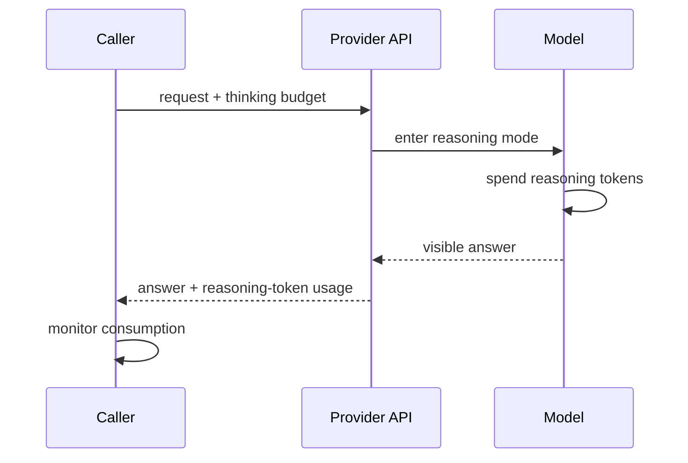

# Extended Thinking

**Also known as:** Reasoning Tokens, Reasoning Budget

**Category:** Reasoning  
**Status in practice:** mature

## Intent

Spend a configurable budget of internal reasoning tokens before producing a user-visible answer.

## Context

A team is calling a modern reasoning-capable model — for example Anthropic Claude with extended thinking, OpenAI o-series reasoning models, Gemini 2.5, or DeepSeek-R1 — on tasks where they have already observed that giving the model more time to think before answering reliably improves quality. Some requests in their workload are easy classifications or routing decisions that need no deep thought; others are hard analytical problems where the team is willing to trade latency and cost for a much better answer.

## Problem

If the team relies on prompt-based chain-of-thought, the reasoning ends up mixed into the user-visible response, and the same prompt has to drive both easy and hard tasks. They have no clean control to say 'spend more compute on this one' without rewriting the prompt for that request, and the visible reasoning pollutes downstream turns by leaving long traces in the conversation. They need a way to dial up internal reasoning effort per request while keeping the response itself focused, and they need to be able to monitor how many reasoning tokens each request actually consumed.

## Forces

- Reasoning tokens cost more than standard tokens on most providers.
- User-visible latency rises with thinking budget.
- Opaque reasoning blocks: harder to inspect and debug.

## Therefore

Therefore: spend a configurable budget of provider-native reasoning tokens before emitting the user-visible answer, so that hard problems get more compute and easy ones stay cheap.

## Solution

Use the provider's reasoning-mode API (OpenAI o-series reasoning effort, Anthropic Claude extended thinking budget_tokens, Gemini thinking budget). Set budget per request based on task difficulty (cheap for routing, expensive for hard reasoning). Monitor reasoning-token consumption.

## Structure

```
Caller --request + thinking budget (per task difficulty)--> Provider API --> Model reasoning mode (internal reasoning tokens within budget) --> visible answer --> Caller + reasoning-token usage --> monitoring
```

## Diagram



## Example scenario

An agent answering 'is this contract fair to my client?' produces a one-paragraph answer that misses two clauses. The team enables Extended Thinking with a generous internal-token budget: before the user-visible reply, the model spends thousands of opaque reasoning tokens working through clauses, comparing precedents, and listing edge cases. The user sees a tighter, better-reasoned answer; the chain itself stays internal so the prompt isn't polluted by reasoning artefacts on subsequent turns.

## Consequences

**Benefits**

- Quality lift on hard reasoning without prompt rewrites.
- Budget meter is a clean control.

**Liabilities**

- Cost spikes with budget.
- Opaque reasoning blocks are harder to debug than visible CoT.

## Failure modes

- Flat budget — every request gets the same large thinking budget, and cost rises on easy routing calls.
- Truncated reasoning — the budget is too small for a hard task, reasoning is cut off, and the model answers before finishing.
- Opaque failure — a wrong answer comes out of hidden reasoning blocks, and the team has little trace to debug it.
- Unwatched spend — reasoning-token usage is not monitored, so cost spikes go unnoticed until the bill arrives.

## What this pattern constrains

Reasoning happens within the declared token budget; exceeding it terminates reasoning and forces an answer.

## Applicability

**Use when**

- The provider exposes a reasoning-budget API and you want to tune effort per request.
- Some tasks (routing, classification) need cheap reasoning and others (hard problems) need expensive reasoning.
- Internal opaque reasoning that the user does not see is acceptable for the deployment.

**Do not use when**

- Static prompt-based chain-of-thought already meets quality and cost targets.
- The provider does not expose a separate reasoning budget.
- The user must see the reasoning verbatim (use chain-of-thought instead, since extended thinking is opaque).

## Components

- Reasoning-capable model — provider model that supports a hidden thinking phase (o-series, Claude extended thinking, Gemini 2.5, DeepSeek-R1)
- Budget controller — caller-side policy that picks token budget or effort level per request
- Difficulty classifier — upstream signal that maps task class to budget tier
- Usage telemetry — collector for reasoning-token counts returned by the API

## Tools

- Provider reasoning API — Anthropic budget_tokens, OpenAI reasoning.effort, or Gemini thinking budget parameter
- Cost and latency dashboard — per-request reasoning-token accounting

## Evaluation metrics

- Quality lift per extra reasoning token — accuracy gain as a function of budget on the target task class
- Budget-hit rate — fraction of requests that exhaust the declared budget before answering
- User-visible latency at p95 — wall-clock impact of the hidden thinking phase
- Cost per resolved task — combined visible and reasoning tokens against task completion
- Easy-task overspend rate — share of low-difficulty requests that received a high budget

## Known uses

- **Anthropic Claude extended thinking (budget_tokens)** _available_
- **Gemini 2.5 thinking budget** _available_
- **DeepSeek-R1** _available_
- **OpenAI reasoning effort (o1, o3, o4-mini)** _available_ — Qualitative low/medium/high control.

## Related patterns

- _complements_ **Chain of Thought**
- _complements_ **Scratchpad**
- _complements_ **Cost Gating**
- _specialises_ **Test-Time Compute Scaling**
- _complements_ **Reasoning Trace Carry-Forward**
- _complements_ **Rumination Agent**
- _composes-with_ **Talker-Reasoner**
- _complements_ **Large Reasoning Model (LRM) Paradigm**

## References

- [Anthropic: Extended thinking](https://platform.claude.com/docs/en/build-with-claude/extended-thinking)
- [OpenAI: Reasoning models](https://platform.openai.com/docs/guides/reasoning)
