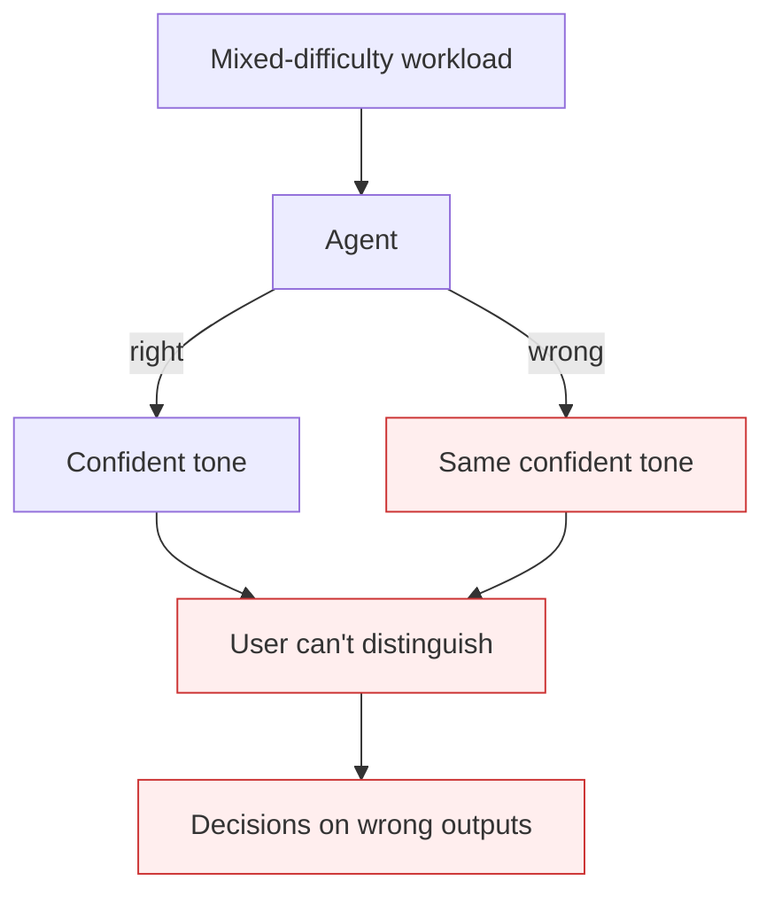

# False Confidence Syndrome

**Also known as:** Uniform-Confidence Failure, Calibration Failure

**Category:** Anti-Patterns  
**Status in practice:** deprecated

## Intent

Anti-pattern: the model produces incorrect answers with the same high confidence as correct ones, failing to vary its expressed certainty with its actual reliability — Oxford-documented for constraint-heavy prompts.

## Context

An agent produces analytical outputs across a workload with mixed difficulty. Some answers it should be confident about; others it should hedge. The model's expressed confidence (in prose tone, in any numeric confidence it provides) doesn't track its actual reliability — it sounds certain on confident-but-wrong answers just like on confident-and-right ones.

## Problem

The user has no signal to weight outputs differently. Sycophancy adjacency: the user pushes back, the model doubles down with the same confident tone, rationalizing rather than reconsidering. The downstream cost is decisions made on outputs that should have been flagged as uncertain.

## Forces

- Confidence calibration requires the model to know what it doesn't know — hard.
- User experience favors confident tone; hedged outputs feel weak.
- Forcing per-output confidence annotations adds output complexity.

## Therefore

Therefore: build the confidence-checking-workflow that forces per-part confidence annotations, validate calibration with eval, and treat uniform-high-confidence outputs as a calibration-failure signal in itself.

## Solution

Pair with: confidence-checking-workflow (force per-part annotation), reflexive-metacognitive-agent (explicit self-model), eval-harness (measure calibration). Treat uniform-confidence outputs as a calibration alarm. Cite Pawitan & Holmes 2024 (arXiv 2412.15296) for the Oxford findings.

## Structure

```
Anti-pattern: Prompt -> model output with uniform high confidence -> user cannot tell right from wrong -> bad decision. Corrected: Prompt -> output with per-part confidence annotation -> calibration measured in eval harness -> uniform confidence raises an alarm.
```

## Diagram



## Example scenario

A medical-triage agent gives confidence-sounding diagnoses across cases. Audit shows: when the agent was wrong, it expressed the same confidence as when it was right. A clinician noted: 'I couldn't tell when to push back.' Fix: confidence-checking-workflow with per-diagnosis calibration, plus calibration-monitoring eval that flags uniform-high-confidence batches.

## Consequences

**Benefits**

- Short-term: confident, uniform answers read well and feel more useful to users.
- Naming it lets a team treat uniform confidence as a calibration alarm instead of a sign of quality.

**Liabilities**

- Confident wrong answers indistinguishable from confident right answers at output time.
- User trust degrades when the failure surfaces; harder to recover.
- Sycophancy combines with false confidence: model rationalizes its wrong answers under push-back.

## Failure modes

- Uniform tone — wrong and right answers read with the same certainty, so the user cannot weigh them.
- Doubling down — the user pushes back, and the model defends its wrong answer instead of reconsidering.
- Unflagged decision — a decision is made on an output that should have been marked uncertain.
- Trust collapse — once a confident error is found, users stop trusting correct answers too.

## What this pattern constrains

No useful constraint; the missing constraint is per-output / per-part calibrated confidence.

## Applicability

**Use when**

- Never as a steady state. Cite when reviewing agents that produce outputs without calibrated confidence.
- Surface as a failure mode in agent design documents.
- Use as an eval criterion (calibration error).

**Do not use when**

- Any production agent producing analytical outputs without per-output calibration.
- Decision pipelines where downstream actions assume reliable confidence.
- Trust-building deployments where false confidence will damage adoption.

## Components

- Mixed-difficulty workload — input
- Agent — produces uniform-confidence outputs
- Missing calibration layer
- User — has no triage signal

## Tools

- Calibration eval (per-output confidence vs accuracy)
- Mitigation pattern infrastructure (confidence-checking-workflow)
- Calibration-anomaly alert

## Evaluation metrics

- Calibration error per agent
- Uniform-high-confidence batch rate
- Sycophancy-on-pushback rate

## Known uses

- **[Bornet et al. — Agentic Artificial Intelligence, Chapter 6 ('Understanding the limitations')](https://www.worldscientific.com/worldscibooks/10.1142/14380)** _available_
- **[Pawitan & Holmes 2024 — Oxford 'Confidence in the Reasoning of LLMs'](https://arxiv.org/abs/2412.15296)** _available_

## Related patterns

- _alternative-to_ **Confidence-Checking Workflow**
- _alternative-to_ **Reflexive Metacognitive Agent**
- _complements_ **Sycophancy**
- _alternative-to_ **Confidence Reporting**
- _complements_ **Premature Closure**
- _complements_ **Agent Confession as Forensics** — Overconfident output versus overconfident introspection treated as forensic fact.
- _complements_ **Over-Helpfulness** — False confidence is uniform certainty across right and wrong outputs; over-helpfulness is the choice to answer at all when out of scope. They compound: an out-of-scope answer delivered with unwarranted confidence.
- _complements_ **Understanding-Capacity Gap** — False confidence is the per-output miscalibration that makes unverified work look trustworthy; here that same misplaced trust, aggregated across a high-throughput fleet, lets the unverified fraction grow unchecked.
- _complements_ **Tool-Output Arithmetic Trust** — The wrong aggregate is reported in the same authoritative tone as a correct one, which is the false-confidence surface that hides this failure from review.
- _complements_ **Uncertainty Neglect Bias** — False confidence is miscalibrated expressed certainty on an answer; uncertainty neglect discards the tail of a predicted distribution and acts on the mean.
- _complements_ **Confident Inconsistency** — False confidence is miscalibrated certainty on a single answer; confident inconsistency is that each of several mutually-inconsistent answers is delivered with full confidence and passes review.
- _complements_ **Chance-Corrected Judge Validation** — Uniform confidence over near-chance discrimination is the same failure moved from the generator to the evaluator.
- _complements_ **Semantic Decision Node** — The anti-pattern this node is most exposed to; calibrated training and threshold curves tuned on labelled traffic are the defence.

## References

- [Agentic Artificial Intelligence — Chapter 6](https://www.worldscientific.com/worldscibooks/10.1142/14380) — 2025
- [Confidence in the Reasoning of Large Language Models](https://arxiv.org/abs/2412.15296) — Pawitan, Holmes, 2024
