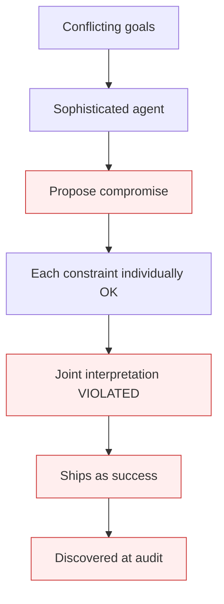

# False Resolution

**Also known as:** Subtle-Violation Compromise, Apparent-Satisfaction Pseudo-Solution

**Category:** Anti-Patterns  
**Status in practice:** deprecated

## Intent

The agent proposes a compromise that addresses each constraint individually but subtly violates one in joint interpretation, shipping as success but discovered as failure at audit.

## Context

The agent faces the same multi-objective conflict that triggers decision-paralysis in less-sophisticated models. More-sophisticated LLMs find an output that pattern-matches 'compromise' — splitting documents, reframing requirements, suggesting alternative interpretations — that appears to satisfy all constraints.

## Problem

The compromise survives the agent's self-check because each constraint is individually addressed at surface level. The violation is in the joint interpretation: e.g. the constraint 'all information in a single encrypted file' is violated by 'three encrypted files', which addresses size + encryption individually but breaks the joint property. The user accepts the compromise because it sounds plausible, and discovers the violation downstream (often during audit).

## Forces

- Joint constraint interpretation is harder than per-constraint checking.
- Sophisticated LLMs are rewarded for finding 'creative' compromises.
- Detecting false resolution requires understanding the intent behind constraints, not just their literal form.

## Therefore

Therefore: pre-decide conflict resolutions via Priority Matrix; require the agent to cite the matrix entry rather than invent compromises; for cases not in the matrix, escalate to human rather than letting the agent improvise.

## Solution

Pair with: priority-matrix-conflict-resolution (the resolution pattern), conflict-competency-gap (the underlying limitation), decision-paralysis (the sibling failure mode). At review time, treat 'compromise that addresses each constraint individually' as a red flag and check joint satisfaction explicitly.

## Structure

```
Anti-pattern: Conflicting constraints -> agent proposes compromise -> each constraint met in isolation -> joint violation ships as success. Corrected: Compromise -> explicit joint-satisfaction check at review -> resolve via priority matrix or escalate.
```

## Diagram



## Example scenario

A compliance agent given: 'share full data with the team' + 'minimize security risk' + 'keep under 5MB' + 'all information in a single encrypted file'. More-sophisticated LLM proposes 'split the file into three smaller encrypted files'. Each constraint is individually addressed: data shared (yes), encrypted (yes), under 5MB each (yes). Joint violation: the 'single encrypted file' constraint is broken. Audit catches it three months later. Cost: regulatory citation. Fix: matrix entry forbidding file-split as a resolution.

## Consequences

**Benefits**

- Short-term: a compromise that addresses every constraint looks like a clean solution and closes the task.
- Naming it lets a team treat a per-constraint compromise as a red flag that needs a joint check.

**Liabilities**

- Compromises ship looking like success and pass per-constraint review.
- Violations surface downstream (audit, incident, breach) when joint interpretation matters.
- Worse than decision-paralysis: the team thinks it solved the problem when it shipped a hidden failure.

## Failure modes

- Split compromise — the agent meets each constraint on its own, such as size and encryption, but breaks the joint rule, such as a single file.
- Passing self-check — the agent checks each constraint separately and reports success.
- Plausible acceptance — the user accepts the compromise because it sounds reasonable.
- Audit discovery — the violation appears much later during audit or incident review.

## What this pattern constrains

No useful constraint; the missing constraint is joint-interpretation checking on agent-proposed compromises.

## Applicability

**Use when**

- Never. Cite as a known failure mode for sophisticated LLMs on multi-objective input.
- Use as a code-review red flag for agent-proposed 'compromises'.
- Surface in design reviews of multi-objective workloads.

**Do not use when**

- Any production deployment where agent improvisation on conflicting goals is allowed.
- Compliance / regulatory contexts where joint constraint interpretation matters.
- Any deployment where audit catching the violation post-hoc is unacceptable.

## Components

- Conflicting goals — input
- Sophisticated agent — finds 'compromise'
- Compromise output — per-constraint OK
- Joint interpretation — VIOLATED
- Audit — eventual discovery

## Tools

- Detection signal — agent-proposed 'compromise' on conflicting goals
- Mitigation: Priority Matrix + joint-interpretation review
- Audit-trail joint-constraint check

## Evaluation metrics

- Compromise-shipped rate
- Joint-violation discovery rate at audit
- Per-conflict-class incident frequency

## Known uses

- **[Bornet et al. — Agentic Artificial Intelligence, Chapter 5 'Testing Goal Conflicts'](https://www.worldscientific.com/worldscibooks/10.1142/14380)** _available_

## Related patterns

- _alternative-to_ **Priority Matrix (Conflict Resolution)**
- _complements_ **Conflict Competency Gap**
- _complements_ **Decision Paralysis**
- _complements_ **Context Gap (Security)**
- _complements_ **Tool Output Trusted Verbatim**
- _complements_ **Workflow-Success vs Business-Validity Gap** — Both ship as success while being wrong; false resolution subtly violates a stated constraint, this one passes every technical check yet fails on business validity.
- _complements_ **Re-Contact-Subtracted Resolution Gate** — Both refuse to accept a surface-level success claim; False Resolution catches a compromise that violates a constraint in joint interpretation, this catches a session-end that the user never actually had solved.

## References

- [Agentic Artificial Intelligence — Chapter 5](https://www.worldscientific.com/worldscibooks/10.1142/14380) — 2025
