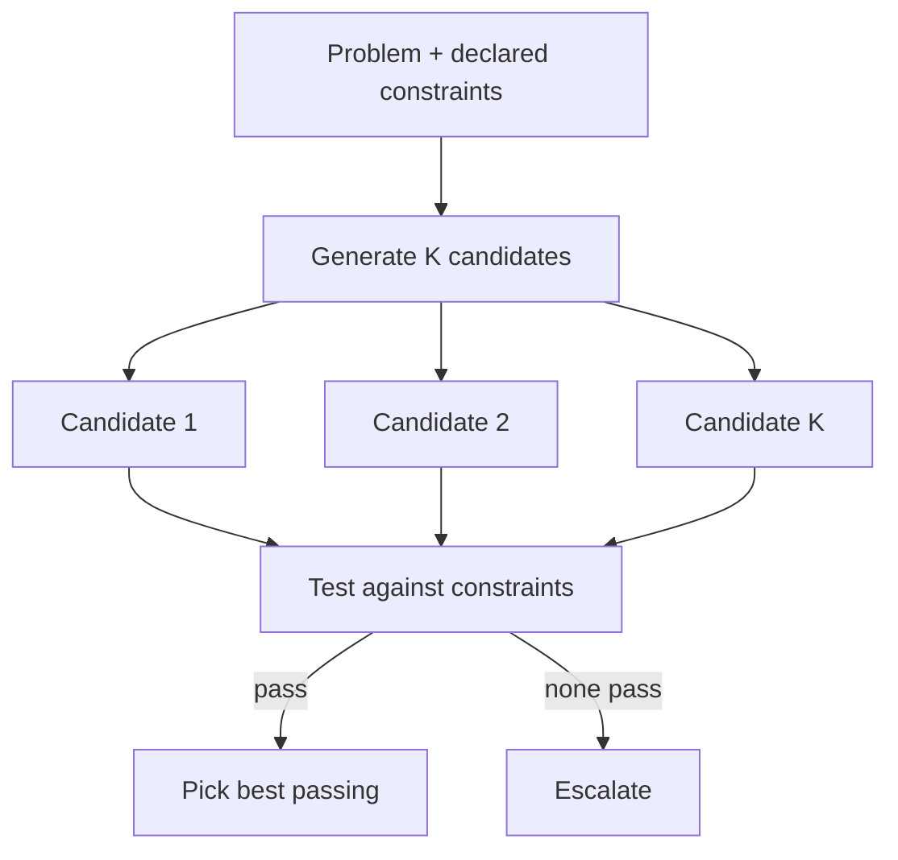

# Generate-and-Test Strategy

**Also known as:** Multi-Hypothesis with Constraint Verification, Hypothesize-then-Test

**Category:** Reasoning  
**Status in practice:** emerging

## Intent

Generate multiple candidate solutions in parallel, then systematically test each against declared constraints rather than committing to the first plausible one — adapted from Langley & Simon's cognitive-science research on human expert problem-solving.

## Context

The agent faces a problem with multiple plausible solutions and known constraints. Default LLM behavior is to commit to the first fluent answer (premature-closure). Expert humans, by contrast, generate alternatives and check each against constraints before committing.

## Problem

Single-path generation commits prematurely to suboptimal solutions. Multi-path generation alone (e.g. tree-of-thoughts) explores but doesn't always systematically verify against declared constraints. The team needs the discipline of generation-then-verification as a unit.

## Forces

- Generating multiple hypotheses costs N× per attempt.
- Constraint verification requires explicit constraint statement up front.
- Some domains have hard constraints (math) and others soft (style); the test step must handle both.

## Therefore

Therefore: separate Generate (produce K candidate solutions) and Test (verify each against the constraints), and require Test to pass before committing.

## Solution

Two-stage workflow. Generate: produce K candidates using multi-path or sampling. Test: for each candidate, verify against declared constraints (deterministic where possible, LLM-judge where soft). Pick the highest-passing candidate or escalate if none passes. Distinct from multi-path-plan-generator (which generates candidates without mandating verification). Pair with strategic-preparation-phase (which provides the constraint list), planner-executor-verifier, multi-path-plan-generator.

## Structure

```
Problem + declared constraints --> generate K candidates (multi-path or sampling) --> test each against constraints (deterministic where possible, LLM judge for soft) --> {pick best passing | none pass -> escalate}
```

## Diagram



## Example scenario

A trading-strategy agent given 'maximize Q4 returns under risk constraint X'. Naive: pick the first plausible strategy. Generate-and-Test: generate 5 candidate strategies, test each against historical data + risk constraint + drawdown limit. Three fail constraint X (one violates drawdown, one fails risk, one fails returns floor). Two pass; pick the higher-return one. Without the Test step, the agent would have shipped a constraint-violating strategy.

## Consequences

**Benefits**

- Premature-closure avoided by structural workflow.
- Constraint violations caught before commit, not after.
- Failure mode is 'no candidate passed' rather than 'wrong answer shipped'.

**Liabilities**

- N× cost for generation, plus verification cost.
- Constraint statement must be explicit and machine-checkable.
- Soft constraints require LLM-judge with its own reliability issues.

## Failure modes

- Constraints invented late — the constraint list is written after seeing candidates and quietly fits whichever one looked best.
- Unreliable soft check — an LLM judge passes a candidate that violates a soft constraint, and it is committed.
- Homogeneous candidates — the K candidates are near-copies, so testing them adds cost without real choice.
- Unhandled no-pass — no candidate passes, and the system returns the closest one instead of escalating.

## What this pattern constrains

No candidate is committed without passing the Test step; the constraint list is declared up front, not invented during generation.

## Applicability

**Use when**

- Problems with explicit declarable constraints.
- Generation cost is acceptable.
- Constraint verification is feasible (deterministic or LLM-judge).

**Do not use when**

- Single-candidate domains (no benefit).
- No checkable constraints exist.
- Cost budget can't absorb N× generation.

## Components

- Generate stage — produces K candidates
- Declared constraint list
- Test stage — verifies each candidate
- Selection rule — pick best passing
- Escalation path — when no candidate passes

## Tools

- Generator stage
- Declared constraint list
- Test stage with verifier
- Selection rule

## Evaluation metrics

- Per-task generation count K
- Test-pass rate
- Escalation rate when no candidate passes

## Known uses

- **[Bornet et al. — Agentic Artificial Intelligence, Chapter 6 (LRM crossword puzzle exhibits this naturally)](https://www.worldscientific.com/worldscibooks/10.1142/14380)** _available_
- **[Langley, Simon et al. 1987 — 'Scientific Discovery: Computational Explorations of the Creative Process'](https://mitpress.mit.edu/9780262620529/)** _available_

## Related patterns

- _complements_ **Multi-Path Plan Generator**
- _complements_ **Strategic Preparation Phase**
- _complements_ **Planner-Executor-Verifier (PEV)**
- _complements_ **Best-of-N Sampling**
- _alternative-to_ **Premature Closure**
- _alternative-to_ **Context Fragmentation**
- _complements_ **Large Reasoning Model (LRM) Paradigm**
- _alternative-to_ **Silent Hypotheses in Generated Code** — Generate-and-test makes premises explicit by deriving constraints and testing candidates against them, which is the discipline whose absence produces silent hypotheses.

## References

- [Agentic Artificial Intelligence — Chapter 6](https://www.worldscientific.com/worldscibooks/10.1142/14380) — 2025
- [Scientific Discovery: Computational Explorations of the Creative Process](https://mitpress.mit.edu/9780262620529/) — Langley, Simon, Bradshaw, Zytkow, 1987
