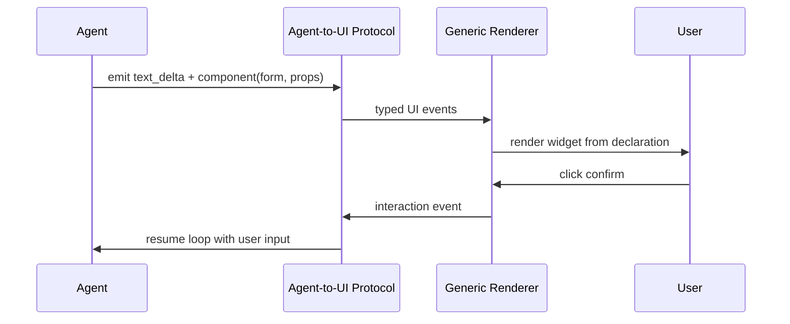

# Generative UI

**Also known as:** Agent-Generated Interface, 生成UI, Dynamic Agent UI

**Category:** Streaming & UX  
**Status in practice:** emerging

## Intent

Let the agent decide which interface components to render at runtime and stream them to the frontend over a typed protocol, so the surface follows the agent's output instead of being hardcoded.

## Context

A team is building a user-facing agent whose output is open-ended: it may answer in prose, show a chart, ask a clarifying question with buttons, render a form, or surface a confirmation step before acting. The frontend is a web or mobile client built ahead of time, with a fixed set of components wired to a fixed response shape. The team has to decide how an interface designed in advance can present whatever the agent decides to produce at runtime.

## Problem

A hardcoded interface can only render the response shapes its developers anticipated, so every new agent capability — a new card type, a new interactive step — needs a coordinated frontend release before users can see it. Pushing the raw model output to a generic chat bubble avoids that coupling but throws away structure: the client receives text and cannot tell a chart from a form from a confirmation prompt, and cannot route an interactive step like a button click back into the agent. Embedding model-generated executable code in the page removes the limit but opens an injection surface the team cannot audit.

## Forces

- An interface built in advance cannot enumerate every output shape an open-ended agent will produce.
- Coupling the frontend to a fixed response schema forces a coordinated release for every new agent capability.
- Sending declarative interface data is auditable; sending executable code is flexible but an injection risk.
- The frontend and the agent backend evolve on different schedules and are often owned by different teams.
- Interactive steps (button clicks, form submits) must round-trip back into the agent's loop, not just render once.

## Therefore

Therefore: define a typed event protocol over which the agent streams interface intent — declarative component descriptions, state updates, and tool or human-in-the-loop prompts — and let a thin generic renderer turn each event into a widget, so neither side hardcodes the other.

## Solution

Specify an event vocabulary that carries declarative interface structure (component, props, layout), shared state, and interaction requests rather than raw markup or code. The agent emits these events on the same stream as its text; a generic client renderer maps each declared component to a real widget and routes user interactions (clicks, form submits) back to the agent as new events. Because the contract is the protocol, the same frontend works against any agent backend that speaks it, and the agent can introduce new interface shapes without a frontend release. Declarative payloads (for example JSON Lines describing the component tree) keep the surface auditable; executable payloads are avoided unless sandboxed.

## Structure

```
Agent runtime --emits--> typed event stream (text + declarative components + state) --> generic renderer --maps--> widgets; user interactions --> interaction events --> back into the agent loop. The protocol is the only contract between the two ends.
```

## Diagram



*The agent streams declarative interface components; a generic renderer draws them and routes user interactions back into the agent loop.*

## Example scenario

A support agent normally answers in text, but for a refund it needs to show the order, a reason dropdown, and a confirm button. The frontend was not built with a refund widget. With Generative UI the agent emits a declarative form-and-confirm component over the event stream; the generic renderer draws it, the user picks a reason and clicks confirm, and the click returns to the agent as an event — all without a frontend release for the new flow.

## Consequences

**Benefits**

- A new agent capability can surface in the interface without a coordinated frontend release.
- The same frontend renders against any backend that speaks the protocol; backends can be swapped.
- Declarative payloads keep the rendered surface inspectable and reviewable.
- Interactive steps and human-in-the-loop prompts round-trip through one channel.

**Liabilities**

- A generic renderer can only draw components it already knows; truly novel widgets still need client work.
- A shared protocol is another contract to version; drift between agent and renderer breaks rendering.
- Declarative-only payloads limit interactivity; richer behaviour pushes teams toward riskier executable payloads.
- Latency and reconnection semantics of the event stream become part of the user-perceived experience.

## Failure modes

- Unknown component — the agent emits a component the renderer does not know, and the user sees nothing or an error in its place.
- Protocol version drift — the agent and the renderer move to different versions of the vocabulary, and props or layouts render wrong.
- Executable escape hatch — a team needs richer behaviour, slips executable payloads in without a sandbox, and reopens the injection surface the protocol was meant to close.
- Lost interaction — a click or form submit is not routed back as an event, so the agent loop waits forever for input that was already given.

## What this pattern constrains

The agent cannot ship raw markup or executable code to the client; it may emit only declarative components drawn from the protocol's typed vocabulary, and the renderer must reject events outside that vocabulary.

## Applicability

**Use when**

- The agent's output is open-ended and a fixed set of response shapes cannot capture it.
- Frontend and agent backend are owned by different teams or released on different schedules.
- Interactive steps (forms, confirmations, button choices) must flow back into the agent loop.
- The interface should be swappable across multiple agent backends behind one protocol.

**Do not use when**

- The interface has a small, stable set of response shapes a fixed frontend already covers.
- The product cannot accept the latency or reconnection complexity of a live event stream.
- A single team owns both ends and a hardcoded contract is cheaper than a shared protocol.
- Rendering needs truly novel widgets a generic renderer cannot draw without per-case client work.

## Components

- Agent runtime — decides which interface components to emit and produces interface events alongside text
- Agent-to-UI protocol — typed event vocabulary carrying declarative components, shared state, and interaction requests
- Generic renderer — thin frontend client that maps each declared component to a real widget
- Interaction channel — routes user actions (clicks, form submits) back to the agent as events
- Component registry — the renderer's allow-list of component types it can draw and will accept

## Tools

- Server-Sent Events or WebSocket transport — carries the ordered typed interface event stream
- Declarative interface schema — component, props, and layout vocabulary the agent emits and the renderer consumes
- Frontend component library — concrete widgets the renderer instantiates from declarations

## Evaluation metrics

- Time-to-first-component — latency from request to the first rendered interface element
- Unknown-component rate — share of emitted components the renderer cannot draw
- Backend-swap success — whether the same frontend renders correctly against a different agent backend
- Interaction round-trip rate — fraction of user actions that successfully re-enter the agent loop
- Rejected-event rate — events dropped for falling outside the declared vocabulary, tracking injection-guard health

## Known uses

- **[AG-UI (CopilotKit)](https://github.com/ag-ui-protocol/ag-ui)** _available_ — Agent-User Interaction Protocol: bidirectional event transport between agent backends and frontends, with shared state and frontend tool calls. Adopted by LangChain, Mastra, and PydanticAI among others.
- **[A2UI (Google)](https://developers.googleblog.com/introducing-a2ui-an-open-project-for-agent-driven-interfaces/)** _available_ — Declarative JSON Lines stream describing interface structure and data model; framework-independent because it ships data, not executable code.
- **[MCP Apps (Anthropic + OpenAI)](https://blog.modelcontextprotocol.io/posts/2025-11-21-mcp-apps/)** _available_ — Model Context Protocol extension treating an interface as an interactive resource returned by a tool.

## Related patterns

- _complements_ **Streaming Typed Events** — Generative UI rides a typed event stream; streaming-typed-events is the transport vocabulary it specialises for interface declarations.
- _complements_ **Human-in-the-Loop** — Confirmation and approval steps are rendered as generative-UI components and routed back to the agent.

## References

- [AG-UI: the Agent-User Interaction Protocol](https://docs.ag-ui.com/introduction) — 2025
- [ag-ui-protocol/ag-ui](https://github.com/ag-ui-protocol/ag-ui) — 2025
- [Generative UI — Google Cloud](https://cloud.google.com/discover/generative-ui) — 2025
- [Generative UI を支える3つのプロトコル — A2UI・AG-UI・MCP Apps の設計思想と使い分け](https://zenn.dev/tsuboi/articles/a52773ee9c3dfb) — 2026
