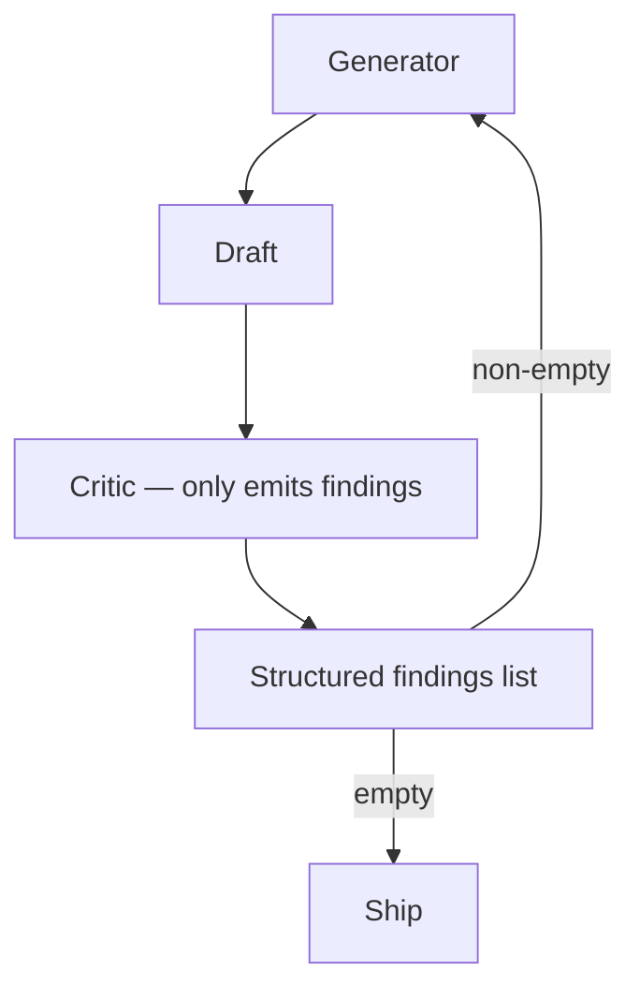

# Generator-Critic Separation

**Also known as:** Strict Generator-Critic Roles, Separated-Roles Critique

**Category:** Verification & Reflection  
**Status in practice:** emerging

## Intent

Strict role separation between a Generator agent that produces drafts and a Critic agent that judges them against pre-defined criteria; the Critic never generates.

## Context

A team adopts a critique workflow. The same model is often given both roles in turn ('now generate', 'now critique'), or the critic is allowed to suggest revisions (mixing critique and generation). The result is inconsistent role discipline.

## Problem

When the critic can generate, it tends to rewrite rather than name issues, depriving the team of clean error signals. When the same model swaps roles, biases bleed across the swap. The team cannot tell whether the critic caught a real issue or invented an opinion. Differs from inner-critic (same model), llm-as-judge (judge-only with no revision loop), and reflection (which subsumes both roles).

## Forces

- Single-model role-swap is cheaper than two separate models.
- Letting the critic rewrite is faster than separating critique from revision.
- Role separation requires architectural enforcement, not just prompt instructions.

## Therefore

Therefore: instantiate Generator and Critic as separate components with disjoint capabilities — Generator can produce text and revise; Critic can only flag issues against a fixed rubric and emit structured findings, never produce or rewrite content.

## Solution

Generator and Critic are separate components (different model calls; ideally different model instances). Critic's interface returns structured findings: list of {section, issue_class, severity, citation}. Critic cannot produce free-form text or rewrites. On non-empty findings, findings are passed back to Generator which produces a revision. Pair with cross-reflection, frozen-rubric-reflection, llm-as-judge.

## Structure

```
Generator -> draft -> Critic (separate call; output only structured findings {section, issue_class, severity, citation}) --empty--> ship; --non-empty--> findings back to Generator -> revision -> Critic
```

## Diagram



## Example scenario

A press-release agent has Generator (drafts) and Critic (judges against a rubric: tone-on-brand, no banned phrases, all facts cited). Critic returns {findings: [{section: para3, issue: missing-citation, severity: high, citation: rule-7}]}. Generator revises only those flagged sections. The Critic never wrote prose; its only output was structured findings. Audit can count finding rate per rule.

## Consequences

**Benefits**

- Clean error signal — Critic findings are structured, attributable, countable.
- Generator and Critic biases stay separate; one cannot launder the other.
- Findings over time inform rubric improvements.

**Liabilities**

- Strict separation requires two model calls per cycle.
- Rigid critic schema may miss issues that don't fit a slot.
- Architectural enforcement (not just prompt-based) requires more engineering.

## Failure modes

- Critic rewrites — prompt-only separation leaks, the critic returns revised text, and the clean error signal is lost.
- Slot misfit — a real issue does not match any issue_class, so the critic drops it or files it wrongly.
- Shared biases — both roles run on the same model instance, and the critic agrees with the generator's mistakes.
- Empty findings by default — the critic returns an empty list when unsure, and the draft ships unreviewed in effect.

## What this pattern constrains

Generator may not critique; Critic may not generate or rewrite; the only output the Critic produces is structured findings.

## Applicability

**Use when**

- Critique benefits from structured outputs over free-form review.
- Two model calls per cycle is acceptable.
- Rubric can be expressed as finding-type schema.

**Do not use when**

- Single-model role-swap is acceptable for simpler use cases.
- Rubric is too open-ended for a finding schema.
- Cost or latency budget cannot absorb separated critic.

## Components

- Generator component — produces and revises drafts
- Critic component — emits structured findings only, never prose
- Rubric — schema of finding types the critic recognises
- Revision router — passes findings to Generator for next iteration

## Tools

- Generator component — produces and revises
- Critic component — emits structured findings only
- Rubric — finding-type schema

## Evaluation metrics

- Finding-rate per rubric rule
- Generator-revision count per cycle
- Critic-rule-coverage — how many rules fire on real outputs

## Known uses

- **[Google ADK: 8 multi-agent design patterns (Korean roundup)](https://nextplatform.net/best-ai-architecture-google-multi-agent-eight-design-patterns/)** _available_

## Related patterns

- _alternative-to_ **Self-Modification Diff Gate**
- _complements_ **LLM-as-Judge**
- _specialises_ **Reflection**
- _complements_ **Cross-Reflection**
- _complements_ **Frozen Rubric Reflection**
- _generalises_ **Pipeline Triad Pattern**

## References

- [베스트 AI 아키텍처 | 구글이 제안하는 멀티 에이전트 8대 디자인 패턴](https://nextplatform.net/best-ai-architecture-google-multi-agent-eight-design-patterns/) — 2026
