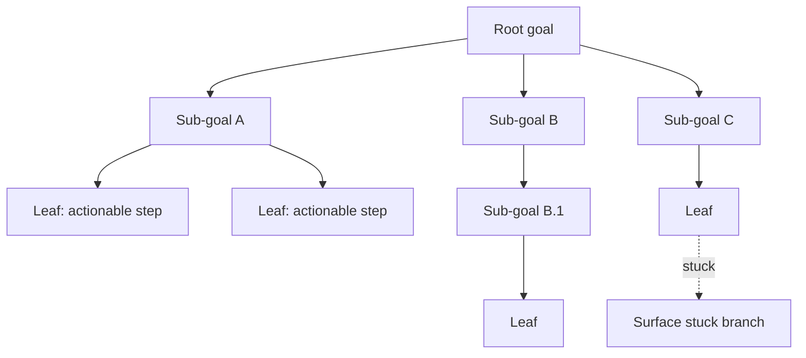

# Goal Decomposition

**Also known as:** Hierarchical Task Network, Goal Setting & Monitoring, Task Tree

**Category:** Planning & Control Flow  
**Status in practice:** mature

## Intent

Decompose a goal into sub-goals recursively until each leaf is directly actionable.

## Context

A team gives an agent a goal that is too large to act on in a single step — renew all cloud contracts before the next quarter, prepare a release across half a dozen repositories, plan a multi-week research investigation. The work decomposes naturally into sub-goals, and those sub-goals decompose further, until eventually each leaf is something the agent can actually do (send an email, run a query, edit one file).

## Problem

Without explicit decomposition the agent attacks the whole goal at once and produces shallow work — a three-paragraph summary instead of a finished negotiation, a partial plan instead of a release. Stuck branches deep in the work disappear into the final summary because there is no place to track them. The team is forced to choose between writing the breakdown by hand every time, which negates the agent's autonomy, or trusting a single-shot answer they cannot verify.

## Forces

- Decomposition depth: too shallow loses scaffolding; too deep loses the forest.
- Sub-goal independence affects parallelisation.
- Goal-monitoring at each level adds overhead.

## Therefore

Therefore: recursively split the goal into sub-goals until every leaf is directly actionable and monitor progress at each level, so that long-horizon work becomes tractable and stuck branches surface instead of vanishing into a summary.

## Solution

Build a tree of goals. The root is the user's goal. Each non-leaf goal decomposes into sub-goals. Leaves are directly actionable steps. Monitor progress at each level; surface stuck branches. Distinct from least-to-most (which is sequential) by allowing parallel sibling goals.

## Structure

```
Root goal --Decomposer--> sub-goals --Decomposer--> ... --> actionable leaves --Leaf executor--> results --Progress monitor (per level)--> stuck branches surfaced --> root goal status
```

## Diagram



## Example scenario

A team building a procurement assistant gives it a single brief: 'renew our cloud contracts before Q4'. Asked in one shot, the agent produces a three-paragraph summary and stalls. They wrap the agent in a goal-decomposition tree: the root splits into inventory-current-contracts, gather-renewal-quotes, and negotiate-and-sign, each of which decomposes again until each leaf is a concrete email or spreadsheet update. Progress now shows up at every level, and the negotiate branch surfaces as 'stuck' for two weeks instead of vanishing into the summary.

## Consequences

**Benefits**

- Long-horizon tasks become tractable.
- Progress is visible at multiple granularities.

**Liabilities**

- Tree construction is itself work.
- Stuck branches at deep levels are easy to lose.

## Failure modes

- Lost stuck branch — a leaf deep in the tree stalls, the progress monitor does not surface it, and the final report omits the gap.
- Over-splitting — the decomposer keeps adding levels for simple goals, and building the tree costs more than doing the work.
- Premature action — the agent acts on a non-leaf goal that is still too vague, and produces shallow work for that branch.
- Sibling overlap — parallel sub-goals cover the same ground, and the leaves duplicate or contradict each other.

## What this pattern constrains

Action is taken only at leaf goals; non-leaf goals must decompose further before action.

## Applicability

**Use when**

- Goals are large enough that a single-shot attempt produces shallow work.
- Sub-goals can be expressed in a tree where each leaf is directly actionable.
- Parallel sibling goals exist and you want to track stuck branches explicitly.

**Do not use when**

- Goals are atomic and decomposition would invent fake sub-structure.
- Strict sequential structure fits better (use least-to-most prompting instead).
- Tracking the tree adds more overhead than it saves in execution quality.

## Components

- Goal tree — root holds the user goal, leaves are directly actionable
- Decomposer — splits a non-leaf goal into sibling sub-goals
- Leaf executor — runs the action for any leaf goal
- Progress monitor — reports status at each level and surfaces stuck branches

## Tools

- LLM API — performs the decomposition step and the leaf action
- Tree state store — persists the goal tree across decomposition rounds
- Status dashboard or log — surfaces per-level progress and stuck branches

## Evaluation metrics

- Tree depth at completion — how many levels the decomposition needed versus expected
- Stuck-branch surfacing rate — fraction of stalled deep leaves caught versus lost in summary
- Leaf-action success rate — fraction of leaves that completed on first attempt
- End-to-end goal completion — long-horizon task success vs single-shot baseline
- Decomposition overhead — tokens spent on non-leaf splitting versus leaf execution

## Known uses

- **Classical AI Hierarchical Task Networks** _available_
- **Gulli ch.20 Goal Setting & Monitoring** _available_

## Related patterns

- _complements_ **Least-to-Most Prompting**
- _complements_ **Hierarchical Agents**
- _specialises_ **Plan-and-Execute**
- _complements_ **Pre-Flight Spec Authoring**
- _complements_ **Hybrid HTN + Generative Agent**
- _complements_ **BDI Agent**
- _complements_ **Behavior Tree Back Chaining**
- _complements_ **Query-Decomposition Agent**

## References

- [Agentic Design Patterns (Gulli, ch. 20 Prioritization)](https://www.goodreads.com/book/show/237795815) — 2025
